# octreg

octreg registers a serial-sectioning OCT volume of a tissue block to an ex-vivo MRI cropped around the block, with an affine
transform and a small smooth deformation on top. It uses no labels and needs no initial alignment, since it searches every
orientation of the block inside the MRI crop.

## How it works

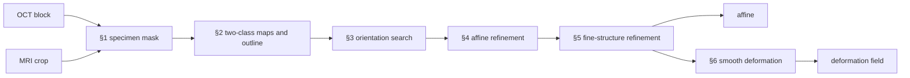

**§1 Specimen mask.** Doped agarose scatters about as strongly as tissue, but its structure is directional. Section stripes and
tile seams vary along one array axis, while tissue texture varies along all three. The OCT specimen mask is the region of
isotropic texture, and the MRI foreground is a histogram threshold.

**§2 Two-class maps and outline.** Both scans become two-class maps, a soft split of the tissue into a brighter and a darker
class, scored together with the outline when both scans show what lies outside the tissue. OCT tissue must lie on MRI tissue,
while the MRI may hold tissue beyond the block. Swapping the OCT classes negates the two-class score exactly, so its sign gives
the contrast polarity.

**§3 Orientation search.** An FFT search scores 8,000 rotations with all translations inside the MRI crop and keeps 24 poses.

**§4 Affine refinement.** Each pose is refined to a 12-parameter affine under a prior on scale and shear, since the score alone
rewards distorting the block.

**§5 Fine-structure refinement.** The best pose is refined on the orientation of the gradients inside both scans, scored by the
correlation of their orientation tensors. The gradients follow fibre bundles and vessels, and their orientation needs neither an
intensity mapping nor the polarity.

**§6 Smooth deformation.** A small displacement field on a 5 mm control lattice is fitted to interior matches and surface-edge
offsets, as flexible as a strain limit of 0.15 allows. The field is applied only when it predicts held-out evidence at least 10
% better than no deformation. The affine stays the primary result.

The method uses two kinds of evidence, the shape of the specimen and the structure of the tissue, and each at two scales.

| evidence | global, for the affine (§2 to §5) | local, for the deformation (§6) |
|---|---|---|
| specimen shape | the outline: OCT specimen mask against MRI foreground | surface-edge offsets along the MRI boundary normals |
| tissue structure | two-class maps (§2 to §4) and gradient orientation (§5) | interior matches of the same gradient orientation at a finer scale |

None of them needs labels or an intensity mapping between the modalities. [docs/METHOD.md](docs/METHOD.md) gives every step in
full.

## Installation

```
git clone https://github.com/yyttim/oct-mri-registration
cd oct-mri-registration
pip install -e .
```

octreg requires Python 3.9 or newer and PyTorch. A CUDA GPU is recommended for full-size volumes. `pip install -e ".[test]"`
adds the test dependencies, and `pytest` runs the tests on synthetic data on the CPU.

## Usage

```
octreg register OCT MRI -o OUT [--oct-spacing-um Z,Y,X] [--oct-mask F] [--mri-mask F] [--params F] [--device cuda|cpu]
octreg qc --run OUT --oct OCT --mri MRI [--T F] [-o PREFIX] [--oct-spacing-um Z,Y,X] [--oct-mask F] [--mri-mask F]
octreg apply --run OUT --moving X --reference Y -o Z [--inverse] [--affine-only] [--oct-spacing-um Z,Y,X]
```

`register` runs §1 to §6 and writes the outputs below into `OUT`. The OCT can be NIfTI, TIFF, OME-TIFF or NPY, and the MRI is
NIfTI. `--oct-spacing-um` gives the OCT voxel spacing in µm along the numpy axes z, y, x, for the OCT and its mask file. A TIFF
or NPY without spacing needs it, and it overrides the spacing a file has. `--oct-mask` and `--mri-mask` replace the automatic
masks with files in the world frame of their scan, whose positive voxels are the mask. `--params` reads parameter overrides from
JSON (the fields of `octreg.params.Params`, listed in [docs/METHOD.md](docs/METHOD.md#parameters)), and `--device cpu` runs
without a GPU.

`qc` renders the QC images of the affine again, for the run's transform or for another one given with `--T`. `-o` sets the
output prefix (default `OUT/qc`, or `OUT/qc_<T stem>` for another transform), and `--oct-spacing-um`, `--oct-mask` and
`--mri-mask` default to those of the run.

`apply` resamples an OCT-frame volume onto the grid of an MRI-frame `--reference`, through the affine and, when the run wrote
one, the deformation field. `--affine-only` leaves the field out. With `--inverse` it resamples an MRI-frame volume onto an
OCT-frame reference through the affine alone, since the field is not inverted. `--oct-spacing-um` gives the spacing of an
OCT-frame TIFF or NPY. It defaults to that of the run for the run's own OCT file at its original path.

The same functions are available in Python: `from octreg.register import register, apply, qc`.

### Outputs

| file | content |
|---|---|
| `T_oct2mri.txt`, `T_mri2oct.txt` | 4×4 affine in mm between the world frames of the two input files |
| `oct2mri.lta`, `oct2mri_itk.txt` | the same affine for FreeSurfer and ITK |
| `oct2mri_warp.nii.gz` | the deformation of §6, only when it is applied: displacement u in mm along the MRI world axes on the MRI base grid (0.15 mm), as a NIfTI vector image (ITK and ANTs expect the first two components negated). The registered OCT at the MRI point x is OCT(T⁻¹(x + u(x))) |
| `oct_in_mri.nii.gz` | OCT on the MRI grid through the affine and the deformation |
| `oct_in_mri_affine.nii.gz` | OCT on the MRI grid through the affine alone (the same image when no deformation is applied) |
| `mri_in_oct.nii.gz` | MRI on the OCT base grid (0.15 mm), through the affine |
| `qc.png`, `qc_montage.png` | QC of the affine in four columns: OCT, MRI through the transform, a checkerboard of the two, and the OCT with the outlines of the MRI foreground (red) and the specimen mask (cyan). `qc.png` shows one plane per OCT array axis, `qc_montage.png` four |
| `qc_deform.png` | only with a deformation: MRI, OCT through the affine, OCT through the affine and the deformation, and the field magnitude, on three planes with the MRI outline |
| `result.json` | inputs, parameters and their hash, the transform, scores, contrast polarity, scales, the read-outs of §6, flags, time per step and peak memory |

A registration is judged by looking at it. In every plane of the QC images the MRI boundary should follow the edge of the OCT
specimen, and the OCT should lie on the same MRI anatomy.

## Inputs and assumptions

The OCT shows a tissue block embedded in scatterer-doped agarose. The specimen mask of §1 separates tissue from agarose by
texture, so it needs an embedding. A block that is not embedded should be given its mask with `--oct-mask`, and the OCT file
itself serves when it is exactly zero outside the tissue, since a mask file is read as its positive voxels. Exact zeros in the
OCT are read as missing data. The OCT contrast may be inverted relative to the MRI.

The MRI is an ex-vivo scan roughly cropped to a region containing the block. The crop should hold the whole block and may hold
tissue that is not in it, for example beyond a face where the block was cut out of a larger specimen. The crop is the only
position prior. Inside the tissue the MRI must show a brighter and a darker class, as grey and white matter do in a FLASH image
at a suitable flip angle. The medium around the MRI tissue must be darker than half the brightest tissue and the intensities
free of an offset, otherwise the MRI foreground is given with `--mri-mask`.

Both voxel sizes must be correct, so the true scales are close to 1. A NIfTI header (sform or qform) may give any position and
orientation, since §3 searches them, but its handedness must be that of the specimen. A TIFF or NPY stack (x, y, z = numpy axes
2, 1, 0), or a NIfTI file without sform and qform, is taken in its array frame, which must then have the handedness of the
specimen. §3 searches proper rotations only, and the score of §2 cannot tell mirror images apart on a nearly symmetric block, so
the registration does not correct a frame of the wrong handedness.

§6 takes the surface edge of each scan as the steepest fall of intensity going outwards. This assumes that in both scans the
tissue at the surface is brighter than what surrounds it.

## Results on the I58 brainstem block

octreg was developed on this block, and its constants set by hand were chosen on it, except three set with runs on public data
([docs/METHOD.md](docs/METHOD.md#parameters)). The block has no reference registration, so its result is shown and not scored.
On the I58 pair (OCT 1457×2013×1595 at 20 µm, MRI crop 343×489×495 at 0.08 mm) the run takes 10 min 46 s, of which §6 is 21 s,
with 5.2 GiB of RAM and 1.6 GiB of GPU memory allocated by torch (RTX 5090, Windows).

| sagittal | coronal | axial |
|---|---|---|
|  |  |  |
|  |  |  |
|  |  |  |

Three planes through the centroid of the MRI tissue in freeview. From top to bottom the rows show the MRI crop, the OCT
registered onto it (`oct_in_mri.nii.gz`, affine and §6), and the same OCT with the boundary of the MRI tissue in red: the
foreground rule of §1 applied to the MRI crop alone on its 0.08 mm grid. The outline term of §2 to §4 fits the OCT specimen mask
to this foreground and §6 reads surface edges at its boundary, so the OCT follows this line partly by construction, while the
standard tools below never saw it. Internal structures are the check that does not depend on it. Each panel is the whole crop at
one pixel per MRI voxel of 0.08 mm (39.6 × 39.1 mm sagittal, 27.4 × 39.1 mm coronal, 27.4 × 39.6 mm axial). The grey levels are
linear, at freeview's default window, from the 5th percentile of the voxels that are not 0 to the 99th plus a fifth of their
difference: 0.212 to 1.662 for the MRI crop and 0.00122 to 0.00553 for the OCT every method received, the same in every panel
([docs/figures/figures.json](docs/figures/figures.json)). Where the boundary runs beyond the OCT, at both ends of the block, the
MRI holds tissue outside its cut faces. The grey around the specimen is the agarose, and the horizontal stripes in the sagittal
and coronal planes are the sections. Sagittal planes have anterior on the right, and coronal and axial planes show the subject's
right on the left.

### Comparison with standard tools

Eight standard registration tools ran on the same pair in the affine stage, and five deformable tools after them. Each is shown
at the setting its documentation gives (FLIRT with both headers scaled x10, as its schedule works in mm), a rule fixed after the
runs had been made and applied to every tool ([bench/baselines](bench/baselines/README.md)). The moving image is the OCT
box-averaged to the 0.08 mm voxels of the MRI. Every deformable tool starts from octreg's affine with the OCT resampled through
it, as Klein et al. (NeuroImage 46:786, 2009) started every nonlinear method from one common linear registration, so the
deformable panels compare the deformation alone. The block has no reference, so the comparison is the panels. The tables give
only properties that need no reference: the scale per OCT axis and the determinant of each affine, and the Jacobian of each
field. [BASELINES.md](bench/baselines/BASELINES.md) shows every tool on all three planes, with every other setting and start
that was run.

| method | setting | start | scale per OCT axis | determinant |
|---|---|---|---|---|
| image centres aligned (the start) | not a registration | header orientation | 1.00 / 1.00 / 1.00 | 1.00 |
| octreg 2.1.0 | §1 to §5, default parameters | its orientation search | 0.99 / 0.96 / 0.98 | 0.94 |
| NiftyReg reg_aladin 2.1.2 | defaults, rigid then affine | image centres | 0.97 / 0.96 / 0.98 | 0.91 |
| greedy 1.4.0 | NMI, dof 6 then 12 | image centres | 1.19 / 0.93 / 0.90 | 0.91 |
| elastix 5.3.1 | model-zoo rigid then affine, Mattes MI | geometric centres | 0.92 / 0.84 / 0.97 | 0.74 |
| FreeSurfer mri_robust_register 8.2.0 | NMI, rigid then affine | centres of mass | 0.99 / 1.00 / 1.07 | 1.06 |
| ANTs 2.6.5 | antsRegistrationSyN.sh -t a | centres of mass | 0.86 / 0.62 / 0.92 | 0.49 |
| FreeSurfer mri_coreg 8.2.0 | NMI, dof 6 then 12 | its brute-force search | 0.92 / 0.81 / 1.00 | 0.74 |
| FSL FLIRT 6.0.7.23 | normmi, dof 6 then 12, headers scaled x10 | its rotation search (±90°) | 0.76 / 0.76 / 0.67 | 0.39 |
| SynthMorph (FreeSurfer 8.2.0) | -m affine | none | 0.82 / 0.62 / 1.20 | 0.49 |

| MRI | image centres aligned (the start) | octreg | NiftyReg reg_aladin |
|---|---|---|---|
|  |  |  |  |
| **greedy** | **elastix** | **mri_robust_register** | **ANTs** |
|  |  |  |  |
| **mri_coreg** | **FLIRT** | **SynthMorph** | |
|  |  |  | |

The axial plane of the figure above through each affine, with the MRI tissue boundary in red.

| method | setting | Jacobian min | folded (J ≤ 0) | SD of log J | time |
|---|---|---|---|---|---|
| no deformation (octreg's affine) | | 1 | 0 % | 0 | |
| octreg 2.1.0, §6 | strain-limited field on a 5 mm lattice | 0.94 | 0 % | 0.07 | 21 s |
| ANTs 2.6.5 SyN | antsRegistrationSyN.sh -t so, CC, no mask | 0.01 | 0 % | 0.46 | 42 min |
| elastix 5.3.1 | model-zoo B-spline, Mattes MI | 1.02 | 0 % | 0.02 | 21 s |
| NiftyReg reg_f3d 2.1.2 | defaults | −88.3 | 47.8 % | 6.33 | 3 min |
| ConvexAdam 0.2.0 | MIND-SSC, shipped defaults | −0.86 | 0.46 % | 1.10 | 8 s |
| greedy 1.4.0 | quick-start deformable command, WNCC | 0.10 | 0 % | 0.17 | 4 min |

The Jacobian of each field over the MRI foreground: its minimum, the share of voxels where it is not positive, and the standard
deviation of its logarithm, with J clipped at 10⁻⁶ where it is not positive (as in Learn2Reg, Hering et al., IEEE Trans. Med.
Imaging 42:697, 2023), on the field's own grid (0.15 mm for octreg, 0.08 mm for the tools). Times are indicative, on a machine
shared with other jobs.

| MRI | no deformation (octreg's affine) | octreg, §6 | ANTs SyN |
|---|---|---|---|
|  |  | 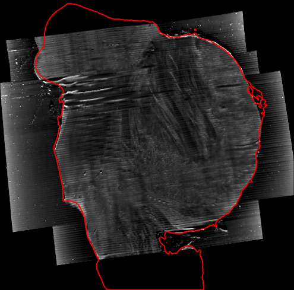 | 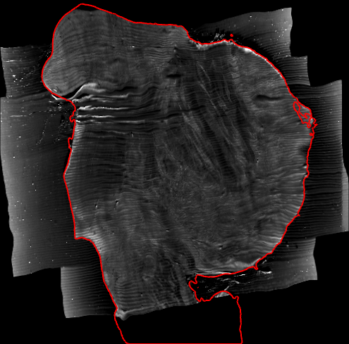 |
| **elastix** | **NiftyReg reg_f3d** | **ConvexAdam** | **greedy** |
| 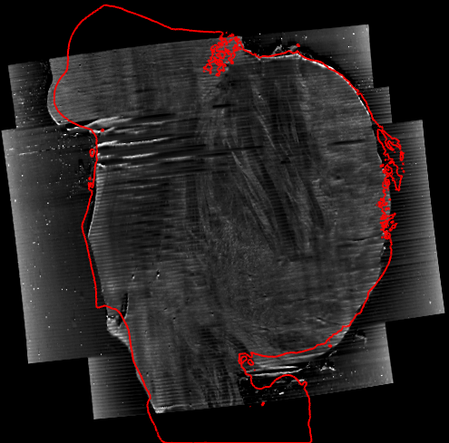 | 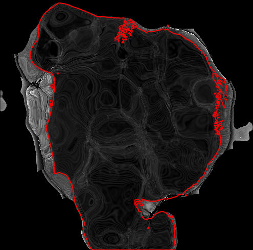 | 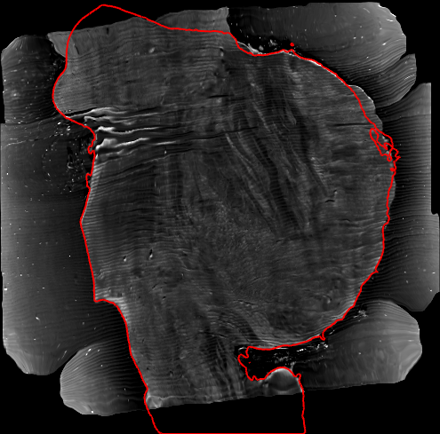 | 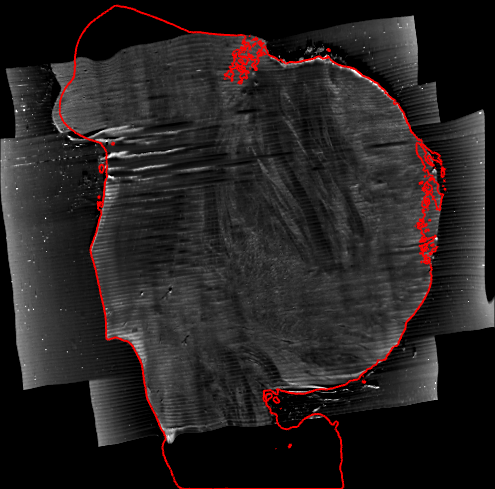 |

The sagittal plane of the figure above through octreg's affine and each field, with the MRI tissue boundary in red.

### Ablations

Each variant removes or replaces one element of the method and keeps the rest (`bench/ablate.py`). With an intensity threshold
in place of the texture mask or without the outline term the section stripes, nearly level in the result, slant, and without the
scale and shear penalty they stand upright in a smaller block. In all three the specimen leaves the boundary. The intensity
threshold leaves the measured OCT almost no outside, so the rule of §2 also turns the outline off. With the outline alone, §4
ends at another pose and §5 moves the block to one whose panel looks like the result. Without §5 the posterior surface lies
beyond the boundary. From the header orientation of this pair, §4 and §5 without the orientation search end at the result, but
from the OCT turned by 90° about the sectioning axis the block stays turned without the search. With the interior matches alone
§6 leaves the bright rim at the superior anterior surface outside the boundary, as without deformation, and with the
surface-edge offsets alone it lies on the boundary, as with §6.

| intensity-threshold mask | no outline term | no scale and shear penalty | no fine-structure refinement |
|---|---|---|---|
|  |  |  | 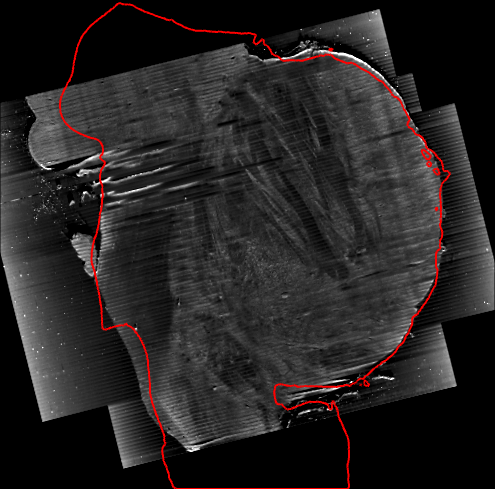 |
| **the outline alone** | **turned 90°, the start** | **turned 90°, no orientation search** | **turned 90°, octreg** |
|  |  |  |  |

The panels show the sagittal plane of the figure above through each variant's own affine.
[docs/METHOD.md](docs/METHOD.md#ablations) shows the main variants, the start test and the two §6 variants, and the full tables
are in [bench/BENCHMARK.md](bench/BENCHMARK.md) and
[bench/results/I58/deform_ablation.md](bench/results/I58/deform_ablation.md). The ablation on the data of Costantini et al.,
scored against their registration, is in the next section.

## Test on the data of Costantini et al. (2023)

Costantini et al. imaged a block of Broca's area from one fixed human hemisphere with serial-sectioning OCT, scanned the
hemisphere with 7 T MRI at 0.15 mm and registered the MRI to the OCT with an affine transform ([Science Advances 9:eadg3844,
2023](https://doi.org/10.1126/sciadv.adg3844)). The data are public in
[DANDI:000026](https://dandiarchive.org/dandiset/000026/draft) (sample I46, CC BY 4.0), and their affine, from their code
repository, serves as the reference R. It is an expert registration, not ground truth: a fit of the OCT vessels to the MRI
vessel labels alone, L, lies 0.16 mm from it on average (0.31 mm p95), so distances below about 0.3 mm are not interpreted.

The MRI was cropped around the block as R places it, holding at least 99.97 % of the OCT tissue as octreg expects
([crops.json](bench/results/I46/crops.json)), ten times per condition with a seeded random shift: with a 3 mm margin on the
FLASH images at 10°, 20° and 30°, and with 6 and 12 mm margins at 10°. octreg got the OCT masked to the tissue and that mask
(the block is not embedded), and eight standard tools got the same masked OCT at one setting each, fixed from their
documentation before any run. The distance is the mean displacement from R over the OCT tissue. The protocol, the reference and
every number are in [bench/i46](bench/i46/README.md) and [its tables](bench/results/I46/tables.md).

| condition | within 1 mm of R | distance from R (mm) |
|---|---|---|
| 10° FLASH, 3 mm margin | 10 of 10 | 0.37 to 0.42 |
| 20° FLASH, 3 mm margin | 10 of 10 | 0.44 to 0.60 |
| 30° FLASH, 3 mm margin | 10 of 10 | 0.31 to 0.35 |
| 10° FLASH, 6 mm margin | 10 of 10 | 0.37 to 0.41 |
| 10° FLASH, 12 mm margin | 10 of 10 | 0.36 to 0.41 |
| 10° FLASH, 3 mm margin, octreg's own specimen mask | 10 of 10 | 0.52 to 0.67 |

No run comes within 0.30 mm of R: every run is turned by 3.5° to 5.2° from it, about an axis that differs between the contrasts,
and by 3.2° to 5.0° from L, against 0.57° between the two references. Parts of the method, the outline rule of
§2, the valley rule of §1, the candidate suppression of §3 and the score of §5, were designed with runs on these data, so this
is not a held-out test. The OCT depth spacing is taken from the acquisition, 500 µm sections of 33 planes (15.15 µm), as octreg
takes both voxel sizes as correct. The dataset's own metadata give 12 µm, at which R stretches the depth by 1.21, against the
scale prior of §4 and beyond its clamp.

The standard tools come within 1 mm in none of their 96 runs. Every run starts from the header orientation, 7 mm and 122° from
R, and octreg without its orientation search comes within 1 mm from that start on none of the ten crops either, so these runs
test recovery from a large turn rather than accuracy near R. With their own global rotation search, FLIRT, ANTs (antsAI) and
greedy end 14 to 24 mm away on all ten crops of the 10° FLASH. With the OCT tissue as a mask of the moving image, greedy, ANTs
and FLIRT come within 1 mm in none of their 30 runs. elastix ends without a transform on every crop, and reg_aladin (NiftyReg
2.1.2 does not use the mask), mri_robust_register and mri_coreg end where their runs without the mask end. From a start near R
(1.14 to 1.20 mm and about 10° from it), octreg without its orientation search comes within 1 mm on all ten crops (0.37 to
0.42 mm), ANTs on six (median over the ten crops 0.84 mm), mri_robust_register on one and the other tools on none.

octreg needs no initial alignment here. On the crop with the median distance, from the OCT turned by 90° and 180° about each
array axis and by 20 rotations drawn at random over all orientations, it ends 0.38 to 0.42 mm from R every time, while without
its orientation search it comes within 1 mm from 4 of the 26 starts. Its fine-structure refinement (§5) brings the median
distance from R down in five of the six conditions (0.55 to 0.39 mm on the 10° FLASH with a 3 mm margin) and up on the 20° FLASH
(0.35 to 0.50 mm, in all ten runs). It also brings the median distance from L down on the 10° FLASH (0.65 to 0.39 mm), while the
vessel check moves the other way: after §5 it is higher than at §4 in all 40 runs with `--oct-mask` on the 10° and 20° FLASH
(median from 0.148 to 0.170 mm on the 10° FLASH with a 3 mm margin), and lower on the 30° FLASH and in 9 of the 10 runs without
`--oct-mask`. Replacing the two-class maps by standardised intensities changes no final distance by more than 0.07 mm on 40
crops, and on I58 it ends at the same affine. At §4 the standardised intensities end farther from R in all four conditions
(median 0.64 against 0.55 mm on the 10° FLASH with a 3 mm margin), and after §5 the median difference is at most 0.001 mm in
each condition. The outline is not tested here: the masked OCT has almost no outside (0.04 % of its measured voxels), and in the
runs without `--oct-mask` the MRI crop has none. The texture mask is tested only in those runs, on an OCT that is zero outside
the tissue. There it leaves out about half of the tissue (50 % of the measured OCT lies outside it), and the §4 affine lies
beyond 1 mm from R in 9 of the 10 runs (median 2.52 mm). §5 brings all ten within 1 mm. Nor is §6 tested: it found no confident
interior match and at most three boundary points on any crop, so it refused its field in every run.

| OCT plane | OCT | OCT with the line through R | OCT with the line through octreg | MRI through R | MRI through octreg |
|---|---|---|---|---|---|
| 102 | 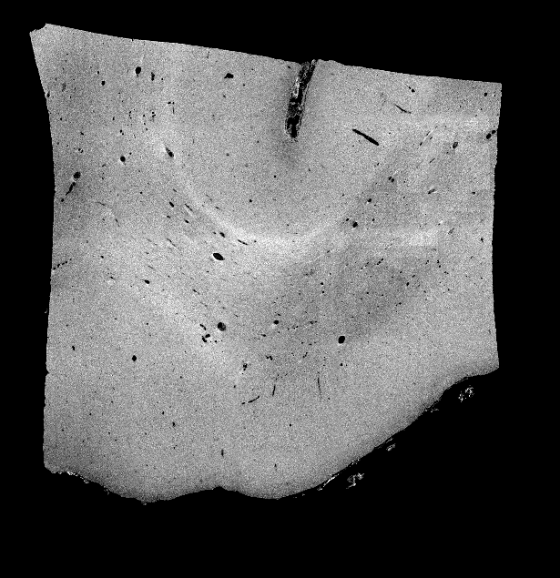 | 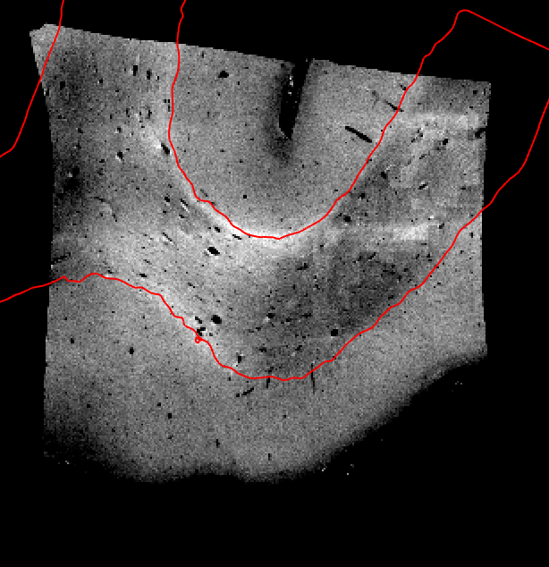 | 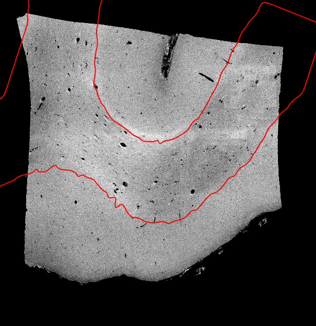 | 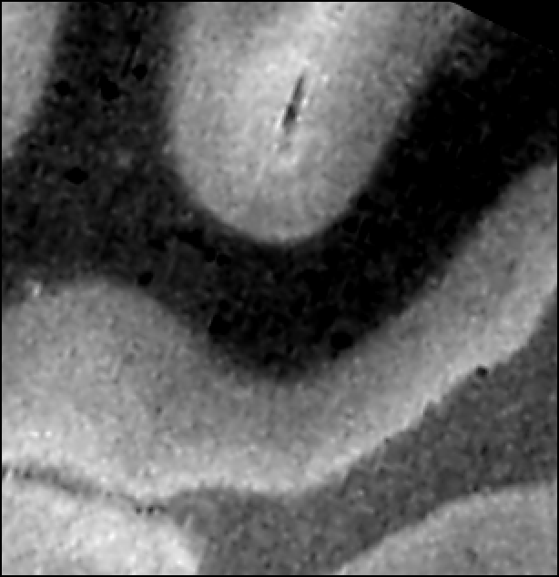 | 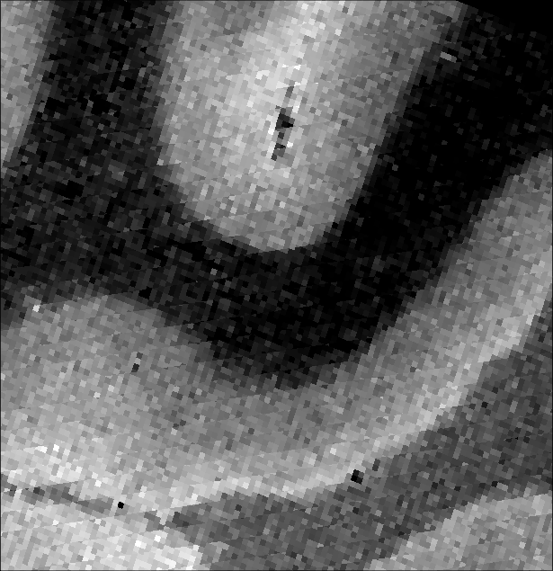 |
| 300 |  | 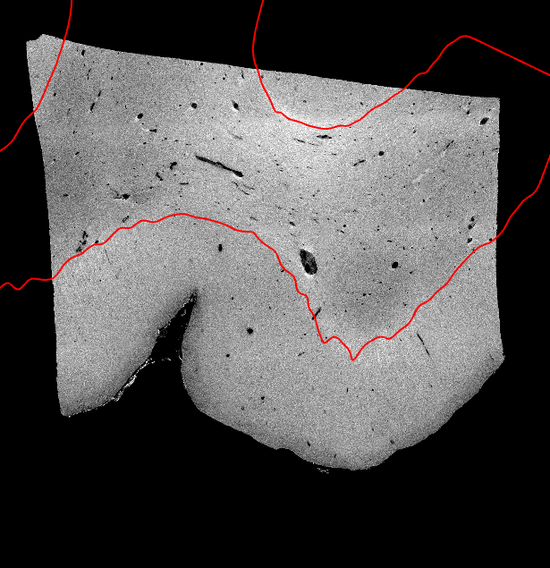 | 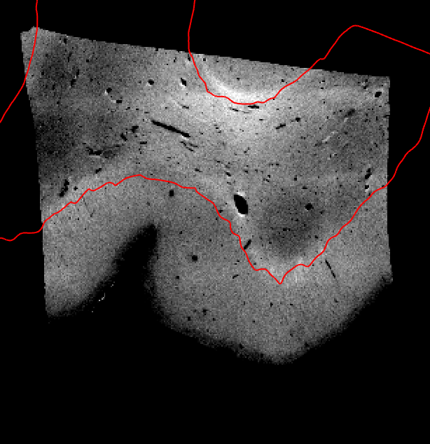 | 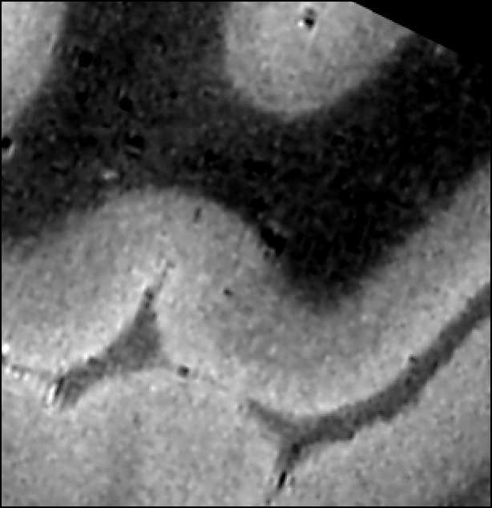 | 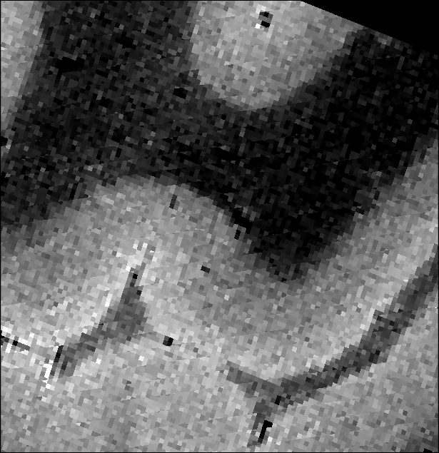 |
| 498 | 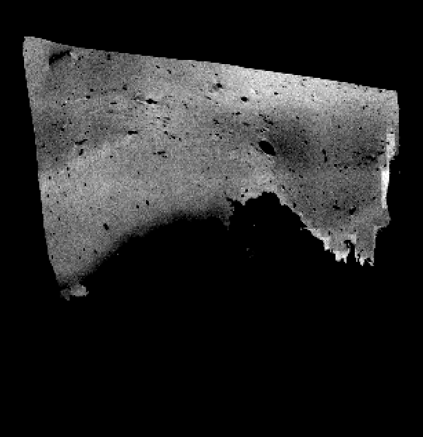 | 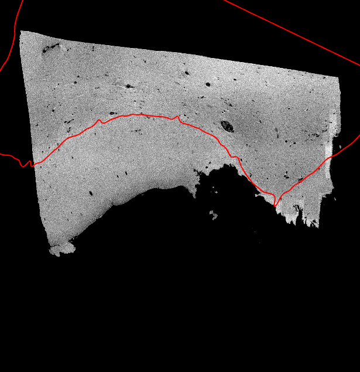 | 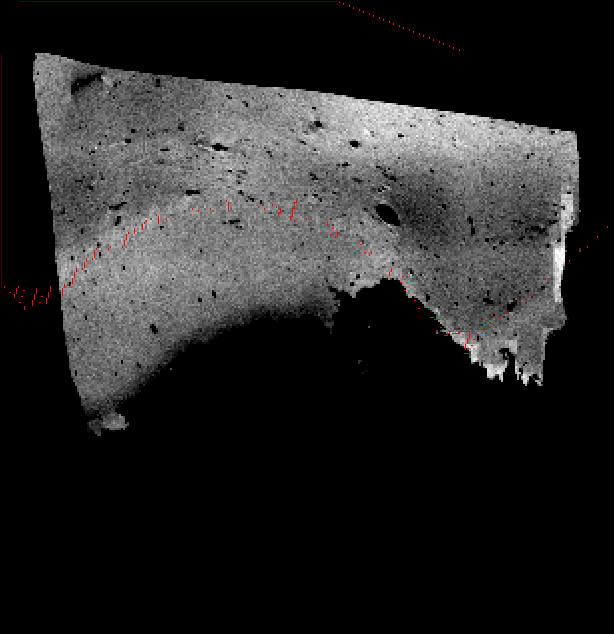 | 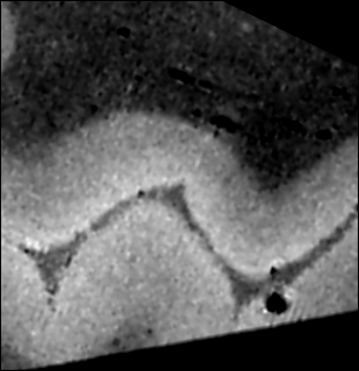 | 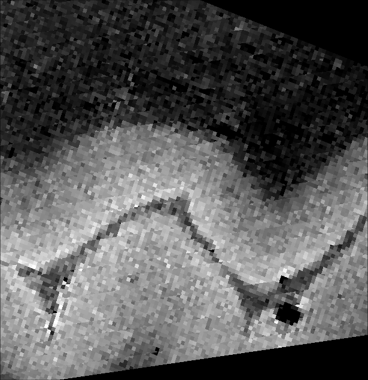 |

The crop with the median distance under octreg (10° FLASH, 3 mm margin, k = 0) in three planes of the OCT itself, the way
Costantini et al. show their OCT: OCT planes 102, 300 and 498, each three planes below the top of its section, 14.7 × 15.2 mm
at 48 µm (a 4 × 4 average of the 12 µm OCT). From left: the OCT, the OCT with the white-matter boundary of the authors' manual
MRI labels placed through R and through octreg (red), and the MRI crop resampled through R and through octreg. Outside the OCT
tissue the line continues through the MRI, and where the white matter reaches the edge of the crop it runs along that edge.
The grey levels are linear, at freeview's default window of each OCT plane and of the crop
([docs/figures/i46/figures.json](docs/figures/i46/figures.json)).

| R | octreg | NiftyReg reg_aladin | greedy | ANTs |
|---|---|---|---|---|
|  |  | 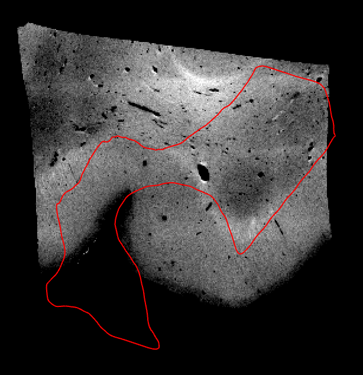 | 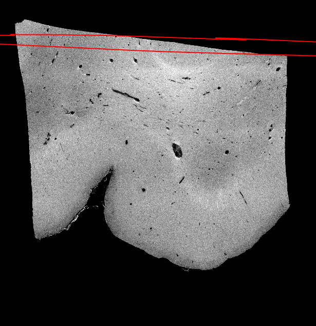 | 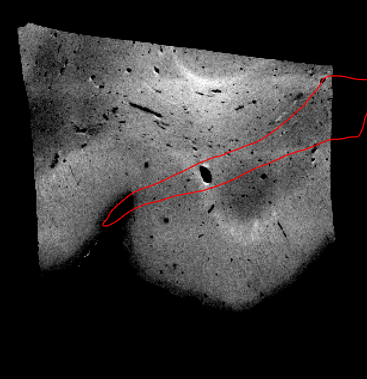 |
| **mri_robust_register** | **mri_coreg** | **FLIRT** | **SynthMorph** | **elastix** |
| 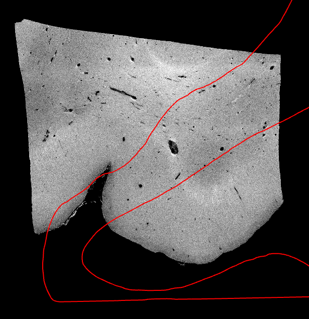 | 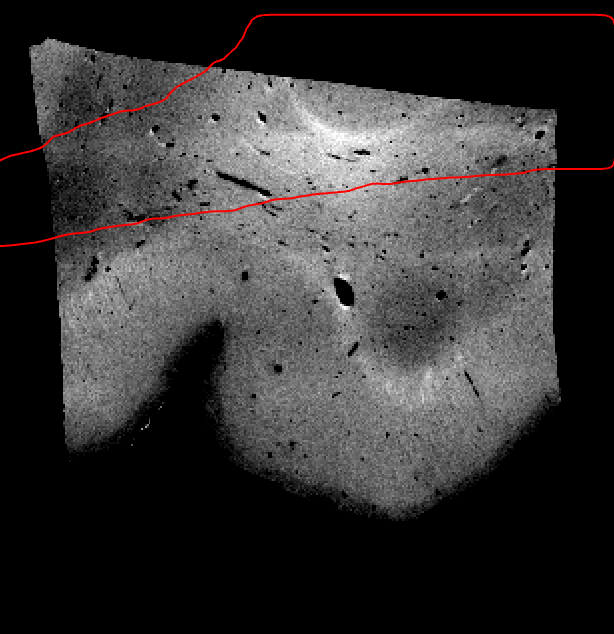 |  |  | no transform (tool error) |
| **FLIRT, its search over ±180°** | **ANTs, antsAI start** | **greedy, its search** |  |  |
|  | 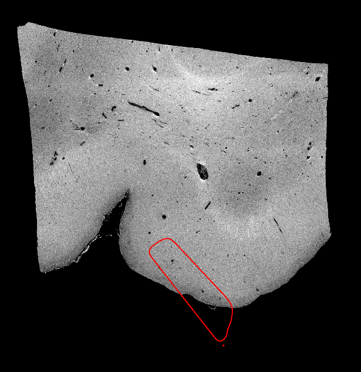 | 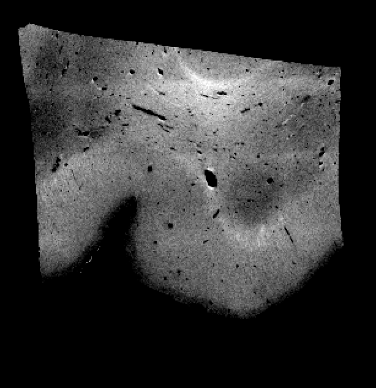 |  |  |

OCT plane 300 of the same crop with the white-matter boundary placed through R, through octreg and through each standard tool
at its declared setting and with its own search. FLIRT, SynthMorph and the searches of FLIRT and greedy place no white matter
within 0.6 mm of this plane, so their panels show no line. elastix ended without a transform on this crop.
[bench/i46](bench/i46/README.md) shows the crop on the MRI grid in three planes, the median crop of every condition, and all
ten crops of this condition.

## Reproducing the benchmark

The scripts in `bench/` run the I58 benchmark: the registration, the ablations, the label-free evaluation, the report
`bench/BENCHMARK.md` and the freeview figures (`bench/figures.py`). The I58 files are not distributed with the repository, and
the stored results of the benchmark are in `bench/results/I58/`. [bench/i46](bench/i46/README.md) runs the test on the data of
Costantini et al. (2023), from the download to the tables and figures, with its stored results in `bench/results/I46/`. `python
bench/evaluate.py --selftest` checks the evaluation on synthetic arrays without any of the data.
[bench/README.md](bench/README.md) describes the steps and how to point the scripts at the data, and
[bench/baselines/README.md](bench/baselines/README.md) the settings of the baseline comparison.
