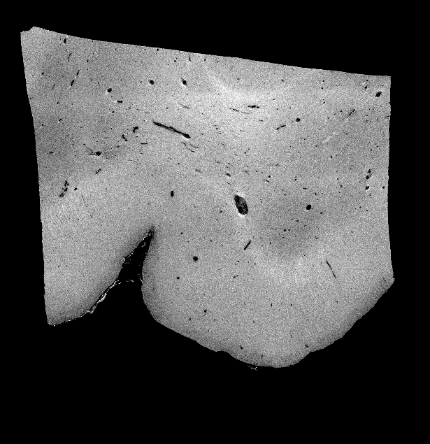
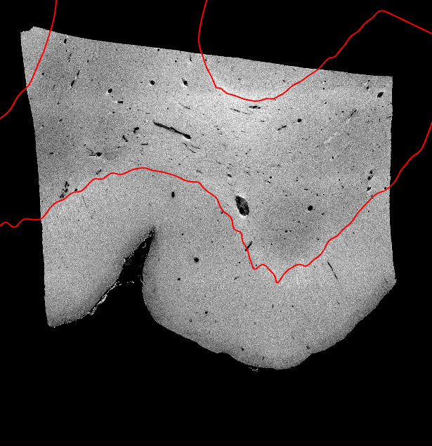
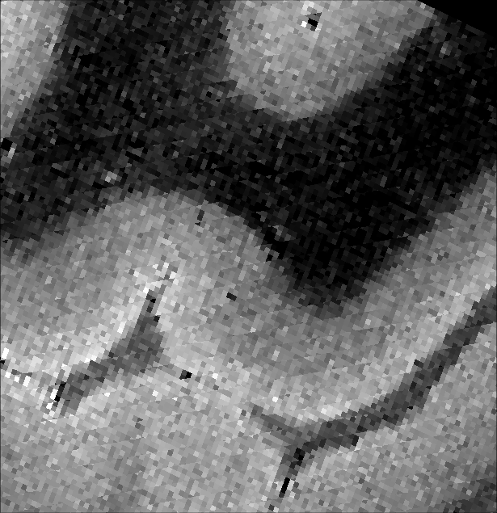
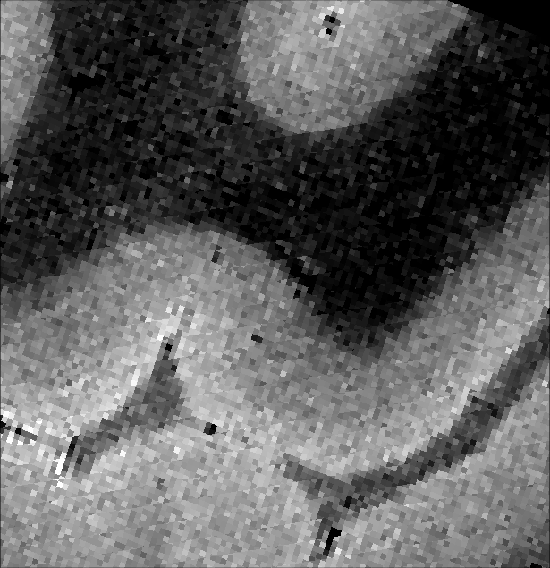
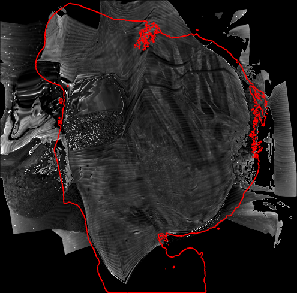

# octreg

octreg registers a serial-sectioning OCT volume of a tissue block to an ex-vivo MRI cropped around the block. It finds an affine
transform from any starting orientation and adds a small smooth deformation on top, with no labels and no manual start.

| sagittal | coronal | axial |
|---|---|---|
|  |  |  |
|  |  |  |
|  |  |  |

The OCT of the I58 brainstem block registered by octreg onto its MRI crop (top), the same with the boundary of the MRI tissue in
red (middle), and the MRI (bottom), on three planes in freeview. On the coronal plane a separate piece of tissue at the upper
right lies partly outside the line, and on the sagittal plane the rounded tissue edge at the upper left lies just outside it. On
the axial plane the specimen ends short of the line along the right side, where the OCT shows a dark band with a few bright
fragments.

## Method

The search, the refinement and the deformation maximise one score, the correlation of the gradient-orientation tensors of the
two volumes (§2 of [docs/METHOD.md](docs/METHOD.md)),

$$F = \operatorname{corr}\big(P(n_\text{OCT}),\, P(n_\text{MRI})\big), \qquad P(n) = n n^\top - \tfrac13 |n|^2 I,$$

where n is the normalised image gradient. P(n) = P(−n), so F needs neither an intensity mapping between OCT and MRI nor their
contrast polarity. As an inner product of six-channel fields, F can be computed at every translation by FFT.

- **§1 Masks.** The OCT specimen is the region of isotropic texture: doped agarose is as bright as tissue, but its section
  stripes and tile seams vary along one axis only. The MRI foreground is a histogram threshold.
- **§3 Orientation search.** For each of 8,000 rotations, F is scored at every translation inside the crop, together with the
  overlap of the specimen with the MRI foreground where both images show an outside, and 24 poses are kept.
- **§4 Affine refinement.** Every pose is refined on F to a 12-parameter affine under a prior on scale and shear, coarse to fine
  down to 0.3 mm, and the best final F under the prior wins: the search proposes, the finest scale decides.
- **§5 Deformation.** A displacement field on a 5 mm lattice is fitted to F, with the tissue surface in the score as well, under
  a strain bound of 8 %.

[docs/METHOD.md](docs/METHOD.md) gives the equations and the parameters.

## Installation

```
git clone https://github.com/yyttim/oct-mri-registration
cd oct-mri-registration
pip install -e .
```

octreg requires Python 3.9 or newer and PyTorch. A CUDA GPU is recommended for full-size volumes. `pip install -e ".[test]"`
adds the test dependencies, and `pytest` runs the tests on synthetic data on the CPU.

## Usage

```
octreg register OCT MRI -o OUT [--oct-spacing-um Z,Y,X] [--oct-mask F] [--mri-mask F] [--params F] [--no-deform]
                [--device cuda|cpu]
octreg apply --run OUT --moving X --reference Y -o Z [--inverse] [--affine-only] [--oct-spacing-um Z,Y,X]
octreg qc --run OUT --oct OCT --mri MRI [--T F] [-o PREFIX] [--oct-spacing-um Z,Y,X] [--oct-mask F] [--mri-mask F]
```

`register` writes the outputs below into `OUT`. The OCT can be NIfTI, TIFF, OME-TIFF or NPY, and the MRI is NIfTI.
`--oct-spacing-um` gives the OCT voxel spacing in µm along the numpy axes z, y, x, which a TIFF or NPY without spacing needs.
`--oct-mask` and `--mri-mask` replace the automatic masks with files whose positive voxels are the mask. A block that is not
embedded needs `--oct-mask`, and the OCT file itself serves when it is exactly zero outside the tissue. `--params` reads
overrides of `octreg.params.Params` from JSON, and `--no-deform` stops after the affine. `apply` resamples an OCT-frame volume
onto an MRI-frame reference through the affine and the deformation (`--affine-only` leaves it out), or an MRI-frame volume onto
an OCT-frame reference through the affine with `--inverse`. `qc` renders the QC images of the affine again, `qc.png` and
`qc_montage.png` for the run's affine, or `qc_<stem>.png` and `qc_<stem>_montage.png` for another one given with `--T` (`-o`
sets another prefix). The same functions are available in Python: `from octreg.register import register, apply, qc`.

| file | content |
|---|---|
| `T_oct2mri.txt`, `T_mri2oct.txt` | 4×4 affine in mm between the world frames of the two input files |
| `oct2mri.lta`, `oct2mri_itk.txt` | the same affine for FreeSurfer and ITK |
| `oct2mri_warp.nii.gz` | the deformation: displacement u in mm along the MRI world axes on a 0.15 mm grid, as a NIfTI vector image. The registered OCT at the MRI point x is OCT(T⁻¹(x + u(x))) |
| `oct_in_mri.nii.gz`, `oct_in_mri_affine.nii.gz` | the OCT on the MRI grid, through the affine and the deformation, and through the affine alone |
| `mri_in_oct.nii.gz` | the MRI on the OCT base grid (0.15 mm), through the affine |
| `qc.png`, `qc_montage.png`, `qc_deform.png` | visual QC of the affine and of the deformation |
| `result.json` | inputs, parameters, the transform, the scores of every step, flags, time per step and memory |

A registration is judged by looking at it: in every plane the MRI tissue boundary should follow the edge of the OCT specimen,
and the OCT should lie on the same MRI anatomy.

## Results

### I58 brainstem block

On this pair (OCT 1457 × 2013 × 1595 voxels at 20 µm, MRI crop 343 × 489 × 495 at 0.08 mm) a run takes 8 min 45 s, with 5.2 GiB
of RAM and 0.9 GiB of GPU memory allocated by torch. The block has no reference registration, so its result is shown and not
scored. Eight standard registration tools ran on the same pair, with the OCT box-averaged to the 0.08 mm voxels of the MRI as
the moving image, each at the setting its documentation gives, except that FLIRT got both headers scaled x10 because its
schedule works in mm ([bench/baselines](bench/baselines/README.md)).

| MRI | image centres aligned (the start) | octreg | NiftyReg reg_aladin |
|---|---|---|---|
|  |  |  |  |
| **greedy** | **elastix** | **mri_robust_register** | **ANTs** |
|  |  |  |  |
| **mri_coreg** | **FLIRT** | **SynthMorph** | |
|  |  |  | |

The axial plane of the figure above through each affine, with the MRI tissue boundary in red.
[BASELINES.md](bench/baselines/BASELINES.md) shows every tool on all three planes, with the scale and determinant of each
affine, and five deformable tools started from octreg's affine.

### Test on the data of Costantini et al. (2023)

Costantini et al. imaged a block of Broca's area from one fixed human hemisphere with serial-sectioning OCT, scanned the
hemisphere with 7 T MRI at 0.15 mm and registered the MRI to the OCT with an affine transform ([Science Advances 9:eadg3844,
2023](https://doi.org/10.1126/sciadv.adg3844)). The data are public in
[DANDI:000026](https://dandiarchive.org/dandiset/000026/draft) (sample I46, CC BY 4.0), and their affine serves as the reference
R. R is their own registration, not ground truth: a fit of the OCT vessels to the MRI vessel labels alone lies 0.16 mm from it
on average, so distances below about 0.3 mm are not read. octreg was developed on I58 and checked on these data during its
development, so this is not a held-out test.

The MRI was cropped around the block as R places it, ten times per condition with a seeded random shift: with a 3 mm margin on
the FLASH images at 10°, 20° and 30°, and with 6 and 12 mm margins at 10°. Every method got the same OCT, masked to the tissue
since the block is not embedded, and octreg also got that mask. The distance is the mean displacement from R over the OCT
tissue.

| condition | within 1 mm of R | distance from R (mm) |
|---|---|---|
| 10° FLASH, 3 mm margin | 10 of 10 | 0.39 to 0.40 |
| 20° FLASH, 3 mm margin | 10 of 10 | 0.50 to 0.52 |
| 30° FLASH, 3 mm margin | 10 of 10 | 0.32 |
| 10° FLASH, 6 mm margin | 10 of 10 | 0.39 to 0.40 |
| 10° FLASH, 12 mm margin | 10 of 10 | 0.39 to 0.41 |
| 10° FLASH, 3 mm margin, octreg's own specimen mask | 1 of 10 | 0.66 to 11.43 |

The last row replaces the given mask by the texture mask of §1, whose rule needs an embedding that this block does not have.
Through the deformation of §5 the MRI vessel labels lie closer to the OCT vessels than through the affine alone in 47 of the 50
runs with the mask (median distance 0.155 against 0.173 mm). From the OCT turned by 90° and 180° about each array axis and by 10
random rotations, octreg ends 0.39 to 0.41 mm from R every time. From the header orientation, 7.0 mm and 122° from R, the eight
standard tools come within 1 mm in none of their 96 runs, and none does with its own rotation search (FLIRT, ANTs and greedy) or
with the OCT tissue as a mask of the moving image.

| OCT | OCT with the line through R | OCT with the line through octreg | MRI through R | MRI through octreg |
|---|---|---|---|---|
|  |  |  |  |  |

Plane 300 of the 12 µm masked OCT of the crop with the lower median distance under octreg (10° FLASH, 3 mm margin, k = 1), the
way Costantini et al. show their OCT. The red line is the white-matter boundary of the authors' manual MRI labels, placed
through R and through octreg, and the last two panels show the MRI crop resampled through each, all in freeview at its default
window. [bench/i46/README.md](bench/i46/README.md) gives the protocol, the other planes and every standard tool, and
[bench/results/I46/tables.md](bench/results/I46/tables.md) every number.

### Ablations

Each variant changes one thing in the method (`bench/ablate.py`). On the ten crops of the 10° FLASH with a 3 mm margin:

| variant | within 1 mm of R | distance from R, median (mm) |
|---|---|---|
| octreg | 10 of 10 | 0.40 |
| no orientation search: the refinement from the header orientation | 0 of 10 | 6.74 |
| no refinement: the best search pose | 5 of 10 | 1.01 |
| only the best search pose refined | 7 of 10 | 0.40 |
| signed normalised gradients instead of their tensor, OCT polarity +1 | 0 of 10 | 11.50 |
| the same, OCT polarity −1 | 0 of 10 | 9.40 |
| no scale and shear prior | 10 of 10 | 0.39 |
| the full tensor n nᵀ instead of its trace-free part | 10 of 10 | 0.38 |

The outline is never used on these crops, where the OCT is given as tissue only and the MRI is all tissue. On I58:

| no outline term | signed gradients, polarity +1 | signed gradients, polarity −1 | no refinement |
|---|---|---|---|
|  |  |  |  |
| **no strain bound** | **turned 90°, the start** | **turned 90°, no orientation search** | **turned 90°, octreg** |
|  |  |  |  |

The sagittal plane of the I58 figure through each variant, with the MRI tissue boundary in red. The last three panels start from
the OCT turned by 90° about its sectioning axis. [bench/README.md](bench/README.md) shows every variant of `bench/ablate.py`.

## Reproducing the results

[bench/README.md](bench/README.md) runs the I58 benchmark, whose data are not distributed with the repository, and
[bench/i46/README.md](bench/i46/README.md) the test on the data of Costantini et al. (2023), from the download to the tables and
figures. The stored results are in `bench/results/`.
