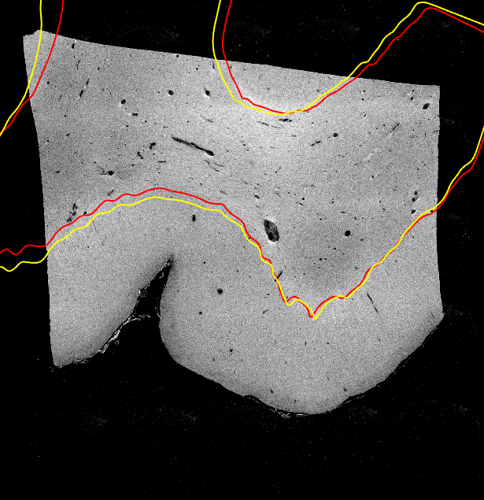
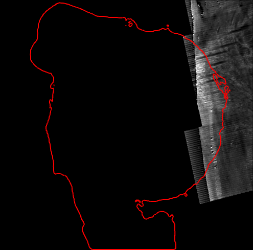

# octreg

octreg registers a serial-sectioning OCT volume of a tissue block to an ex-vivo MRI cropped around the block. It finds an affine
transform from any starting orientation, with no labels and no manual start.

| sagittal | coronal | axial |
|---|---|---|
|  |  |  |
|  |  |  |
|  |  |  |

The OCT of the I58 brainstem block registered by octreg onto its MRI crop (top), the same with the boundary of the MRI
foreground of §1 in red (middle), and the MRI (bottom), on three planes in freeview. Each panel is the whole MRI crop at one
pixel per 0.08 mm voxel: 39.6 × 39.1 mm on the sagittal plane, 27.4 × 39.1 mm on the coronal and 27.4 × 39.6 mm on the axial, in
freeview's default orientation, anterior on the right of the sagittal plane and the subject's right on the left of the coronal
and axial planes. The specimen surface runs along the line except at these places. On the sagittal plane the bright rim at the
top, the rounded tissue edge at the upper left and a bright band just below the step in the line at the lower left lie outside
the line, and on the right, below the rim, small loops of the line reach past the specimen edge. On the coronal plane the
striped upper right corner of the specimen and a separate piece of tissue below it lie partly outside the line, below that piece
the specimen ends short of the line, and at the top the line dips into the specimen. On the axial plane the specimen ends short
of the line along the right side, where the OCT shows a dark band with a few bright fragments. On the sagittal and coronal
planes the line also runs past the top and bottom of the OCT image.

## Method

The search and the refinement maximise one similarity, the correlation of the gradient-orientation tensors of the two volumes
(§2 of [docs/METHOD.md](docs/METHOD.md)),

$$F = \mathrm{corr}\big(P(n_\text{OCT}),\, P(n_\text{MRI})\big), \qquad P(n) = n n^\top,$$

where n is the normalised image gradient and ⟨P(n), P(n′)⟩ = (n·n′)², the squared product of normalised gradient fields (Haber
and Modersitzki, 2007). P(n) = P(−n), so F needs neither an intensity mapping between OCT and MRI nor their contrast polarity.
As an inner product of six-channel fields, F can be computed at every translation by FFT, as in Cross-Sim-NGF (Öfverstedt et
al., 2022). F is normalised over the OCT block, with the MRI tensors zero outside the MRI foreground.

- **§1 Masks.** The OCT specimen is the voxels with signal and isotropic texture, both decided by one threshold rule. Isotropic
  texture separates tissue from doped agarose, which can be as bright as tissue but whose section stripes and tile seams vary
  along one axis only. The MRI foreground lies above a histogram valley whose darker class lies mostly outside the convex hull
  of the brighter voxels, as the embedding medium does, and not inside it, as white matter under cortex does.
- **§3 Orientation search.** For each of 8,000 rotations, F is scored at every translation inside the crop. The outline term O,
  the correlation of the OCT specimen mask with the MRI foreground, places a block by its shape. Poses are proposed by F and,
  where both images show medium around the tissue, also by (F + O) / 2. 24 poses are kept.
- **§4 Affine refinement.** Every pose is refined on F to a 12-parameter affine under a prior on scale and shear, on a 0.15 mm
  grid with gradient scales from 0.6 down to 0.3 mm, and the pose with the lowest final loss, 1 − F plus the prior, wins.

[docs/METHOD.md](docs/METHOD.md) gives the equations and the parameters.

## Installation

```
git clone https://github.com/yyttim/oct-mri-registration
cd oct-mri-registration
pip install -e .
```

octreg requires Python 3.10 or newer and PyTorch. A CUDA GPU is recommended for full-size volumes. `pip install -e ".[test]"`
adds the test dependencies, and `pytest` runs the tests on synthetic data on the CPU.

## Usage

```
octreg register OCT MRI -o OUT [--oct-spacing-um Z,Y,X] [--oct-mask F] [--mri-mask F] [--params F] [--device cuda|cpu]
octreg apply --run OUT --moving X --reference Y -o Z [--inverse] [--oct-spacing-um Z,Y,X]
```

`register` writes the outputs below into `OUT`. The OCT can be NIfTI, TIFF, OME-TIFF or NPY, and the MRI is NIfTI.
`--oct-spacing-um` gives the OCT voxel spacing in µm along the numpy axes z, y, x (NIfTI axes k, j, i), which a TIFF or NPY
without spacing needs. It overrides the spacing in the file, also that of an `--oct-mask` of the OCT's array shape. `--oct-mask`
and `--mri-mask` replace the masks of §1 with files whose positive voxels are the mask, the specimen mask kept only where the
OCT is positive. The OCT file itself can be given as `--oct-mask` when it is exactly zero outside the tissue. `--params` reads
overrides of `octreg.params.Params` from JSON. `apply` resamples an OCT-frame volume onto an MRI-frame reference through the
affine, or an MRI-frame volume onto an OCT-frame reference through the inverse affine with `--inverse`. The same functions are
available in Python: `from octreg.register import register, apply`.

| file | content |
|---|---|
| `T_oct2mri.txt` | 4×4 affine in mm from the world frame of the OCT file to that of the MRI file |
| `oct2mri.lta`, `oct2mri_itk.txt` | the same affine for FreeSurfer and ITK, for NIfTI files whose sform and qform hold the world octreg read ([Scope](docs/METHOD.md#scope)) |
| `oct_in_mri.nii.gz` | the OCT on the MRI grid, through the affine |
| `mri_in_oct.nii.gz` | the MRI on the OCT base grid (0.15 mm), through the affine |
| `qc.png`, `qc_montage.png` | visual QC of the affine |
| `result.json` | inputs, parameters, the transform, the scores of every step and the time per step |

A registration is judged by looking at it: the OCT should lie on the same MRI anatomy, and where both images show medium around
the tissue, the MRI foreground boundary should follow the edge of the OCT specimen.

## Results

### I58 brainstem block

The pair is an OCT of 1457 × 2013 × 1595 voxels at 20 µm and an MRI crop of 343 × 489 × 495 voxels at 0.08 mm. The block has no
reference registration, so its result is shown and not scored. Eight standard registration tools ran on the same pair, with the
OCT box-averaged to the 0.08 mm voxels of the MRI as the moving image, each at the setting its documentation gives, except that
FLIRT ran with both headers scaled x10, because its schedule resamples the images to fixed voxel sizes in mm
([bench/baselines](bench/baselines/README.md)).

| MRI | image box centres aligned (the start) | octreg | NiftyReg reg_aladin |
|---|---|---|---|
|  |  |  |  |
| **greedy** | **elastix** | **mri_robust_register** | **ANTs** |
|  |  |  |  |
| **mri_coreg** | **FLIRT** | **SynthMorph** | |
|  |  |  | |

The axial plane of the I58 figure at the top, the MRI and the OCT through each affine, with the MRI foreground boundary in red.
Through the SynthMorph affine only a corner of the OCT image, at the lower right, reaches this plane.
[BASELINES.md](bench/baselines/BASELINES.md) shows every tool on all three planes, with the scale and determinant of each
affine.

### Test on the data of Costantini et al. (2023)

Costantini et al. imaged a block of Broca's area from one fixed human hemisphere with serial-sectioning OCT, scanned the
hemisphere with 7 T MRI at 0.15 mm and registered the MRI to the OCT with an affine transform
([Science Advances 9:eadg3844, 2023](https://doi.org/10.1126/sciadv.adg3844)). The data are public in
[DANDI:000026](https://dandiarchive.org/dandiset/000026/draft) (sample I46, CC BY 4.0), and their affine serves as the reference
R. R is their own registration, not ground truth: a fit of the OCT vessels to the MRI vessel labels alone lies 0.16 mm from it
on average and 0.31 mm at the 95th percentile, so distances below about 0.3 mm are not interpreted. octreg was developed on I58
and run on these data during its development, so this is not a held-out test. Results on I46 led to changes of the MRI
foreground rule and the specimen mask threshold (§1), the condition for computing the outline (§2), the non-maximum suppression
and the erosion of the search gradients (§3), the rounding of the resampling positions and the removal of a deformable stage
([CHANGELOG.md](CHANGELOG.md), 2.1 to 3.2). The values of `outline_min_outside` and `nms_deg` were set in 2.1 with runs on I46,
that of `nms_deg` also with runs on public blocks of [DANDI:000874](https://dandiarchive.org/dandiset/000874/draft).

The MRI was cropped around the block as R places it, ten times per condition (crops k = 0 to 9) with a seeded random shift: with
a 3 mm margin on the three 7 T FLASH images, of flip angles 10°, 20° and 30°, and with 6 and 12 mm margins on the 10° FLASH.
Every method got the OCT as released, in which most of the agarose around the block is zero, and octreg made its own masks. The
distance from R is the mean displacement from R over the test's specimen mask (`bench/i46/octmask_24um.nii.gz`, made by a
threshold of the smoothed OCT and morphology, `python bench/i46/prepare.py --mask`). Where distances from R differ by less than
about 0.3 mm, the vessel distance compares the results: the median distance of the MRI vessel labels placed in the OCT tissue to
the nearest OCT vessel of the dataset's segmentation. It does not use R, but R was fitted in part to the MRI vessel labels and L
to them alone. R and L are one affine each, and every other number is the median over the ten crops of a condition, shifted
boxes around the same block of one specimen, a run without a transform counted as beyond every other.

| | distance from R (mm) | vessel distance (mm) |
|---|---|---|
| R, the reference | 0 | 0.100 |
| L, an affine fitted to the vessel labels | 0.16 | 0.093 |
| octreg, 10° FLASH, 3 mm margin | 0.36 | 0.155 |
| octreg, 20° FLASH, 3 mm margin | 0.37 | 0.148 |
| octreg, 30° FLASH, 3 mm margin | 0.32 | 0.134 |
| octreg, 10° FLASH, 6 mm margin | 0.36 | 0.156 |
| octreg, 10° FLASH, 12 mm margin | 0.36 | 0.158 |
| octreg, 10° FLASH, 3 mm margin, the test's specimen mask as `--oct-mask` | 0.37 | 0.157 |

From the OCT turned by 90° and 180° about each array axis and by 10 random rotations, on the k = 0 crop of the 10° FLASH with a
3 mm margin, octreg ends 0.35 to 0.37 mm from R.

The standard tools ran on the ten crops of the 10° FLASH with a 3 mm margin, each at the setting its documentation gives, from
the header orientation with the image box centres aligned (7.0 mm and 122° from R), and FLIRT, ANTs and greedy also with their
own global rotation search:

| method | distance from R (mm) |
|---|---|
| octreg | 0.36 |
| NiftyReg reg_aladin | 8.44 |
| greedy | 14.32 |
| elastix | 7.50 |
| ANTs | 9.28 |
| mri_robust_register | 13.31 |
| mri_coreg | 9.25 |
| FLIRT | 17.26 |
| SynthMorph | 16.49 |
| FLIRT, its search over ±180° | 18.60 |
| ANTs, antsAI start | 16.96 |
| greedy, its search | 23.95 |

The same tools started near R (R turned by 10° and shifted by 1 mm) and at R (the pose with a rotation and a scale per axis
closest to R), without and with the test's specimen mask as their moving mask, and octreg's refinement (§4) alone from the same
starts with its own masks:

| method | near R | near R, moving mask | at R | at R, moving mask |
|---|---|---|---|---|
| the start | 1.18 | 1.18 | 0.09 | 0.09 |
| octreg, §4 alone | 0.36 | | 0.36 | |
| NiftyReg reg_aladin | 3.02 | 3.02 | 2.98 | 2.98 |
| greedy | 11.32 | 1.55 | 7.42 | 0.62 |
| elastix | 4.05 | no transform | 4.04 | no transform |
| ANTs | 0.84 | 0.82 | 0.52 | 0.35 |
| mri_robust_register | 11.09 | 11.60 | 10.40 | 10.47 |
| mri_coreg | 5.87 | 5.90 | 5.91 | 6.09 |
| FLIRT | 17.83 | 17.93 | 20.19 | 16.72 |
| SynthMorph | 9.80 | | 11.06 | |

Distance from R in mm. octreg uses its own masks, SynthMorph takes no moving mask, NiftyReg 2.1.2 does not use it, and elastix
ends without a transform on every crop with it.

Started at R, the vessel distance is 0.155 mm for octreg's refinement alone and 0.193 mm for ANTs, and with the moving mask
0.170 mm for ANTs and 0.183 mm for greedy.

| OCT | OCT with the lines through R and through octreg | MRI through R | MRI through octreg |
|---|---|---|---|
|  |  |  |  |

Plane 300 of the OCT (12 µm in the plane), shown in the OCT's own planes as Costantini et al. show their OCT, for the crop at
the lower median of the ten distances under octreg (10° FLASH, 3 mm margin, k = 8). The red line is the white-matter boundary of
the authors' manual MRI labels placed through R, the yellow line the same boundary placed through octreg's affine, and the last
two panels show the MRI crop resampled through each, all in freeview at its default window. The yellow line follows the red
line, a little lower where it crosses the left half of the tissue, and cuts off a smaller part of the upper left corner of the
tissue. The white matter is dark in both MRI panels. [bench/i46/README.md](bench/i46/README.md) gives the protocol, the other
planes and every standard tool, and [bench/results/I46/tables.md](bench/results/I46/tables.md) every number.

### Ablations

Each variant changes one thing in the method or its input (`bench/ablate.py`). On the ten crops of the 10° FLASH with a
3 mm margin, medians as above:

| variant | distance from R (mm) | vessel distance (mm) |
|---|---|---|
| octreg | 0.36 | 0.155 |
| no orientation search: the refinement from the header orientation with the image box centres aligned | 6.53 | 0.243 |
| no refinement: the first search pose | 0.87 | 0.214 |
| only the first search pose refined | 0.36 | 0.155 |
| signed normalised gradients instead of their tensor | 1.28 | 0.202 |
| the same, with the OCT intensities negated | 8.82 | 0.279 |
| no scale and shear prior | 0.47 | 0.148 |
| the scale and shear prior at a quarter of its weight (λ = 0.5) | 0.36 | 0.150 |
| the scale and shear prior at four times its weight (λ = 8) | 0.37 | 0.161 |
| rigid refinement | 0.38 | 0.162 |
| the trace-free tensor n nᵀ − \|n\|² I / 3 instead of n nᵀ | 0.38 | 0.159 |
| F without the subtraction of the means | 0.34 | 0.151 |
| in the search, OCT gradients over the whole specimen mask instead of only its part more than 0.8 mm inside | 0.36 | 0.155 |
| the MRI divided by its Gaussian blur (σ 5 mm) inside the foreground | 0.35 | 0.153 |
| the OCT specimen mask from the signal threshold alone, without the texture rule | 0.35 | 0.154 |
| the OCT voxel size given 5 % too large | 0.42 | 0.163 |
| the OCT voxel size given 5 % too small | 0.48 | 0.173 |
| the OCT array mirrored along one axis, a mirror image of the block | 7.25 | 0.236 |

With the search gradients over the whole specimen mask the median stays at 0.36 mm, but two of the ten crops end 9.42 and
11.61 mm from R. The outline is never used on these crops, whose MRI is all tissue. On I58:

| no outline term | signed gradients | signed gradients, OCT negated | no refinement |
|---|---|---|---|
|  |  |  |  |
| **turned 90°, the start** | **turned 90°, no orientation search** | **turned 90°, octreg** | **the OCT specimen mask from the signal threshold alone** |
|  |  |  |  |

The sagittal plane of the I58 figure through each variant, with the MRI foreground boundary in red. The three turned panels
start from the OCT turned by 90° about its sectioning axis. [bench/README.md](bench/README.md) shows every variant of
`bench/ablate.py`.

## Reproducing the results

[bench/README.md](bench/README.md) gives the commands of the I58 benchmark, whose data are not distributed with the repository,
and [bench/i46/README.md](bench/i46/README.md) those of the test on the data of Costantini et al. (2023), from the download to
the tables and figures. The stored results are in `bench/results/`. octreg has no random element: run once more on the same GPU,
it gives byte-identical affines, on I58 and on the k = 0 crop of the test (`bench/repeat.py`,
[bench/results/repeat.json](bench/results/repeat.json), which also records the Python, PyTorch, CUDA, GPU and OS of these runs).
Another GPU or PyTorch build can change the order of the floating-point sums and move an affine at round-off level.
