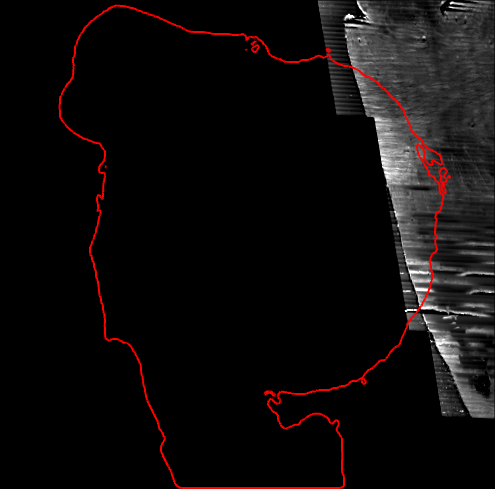
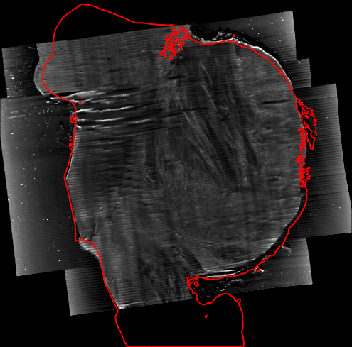
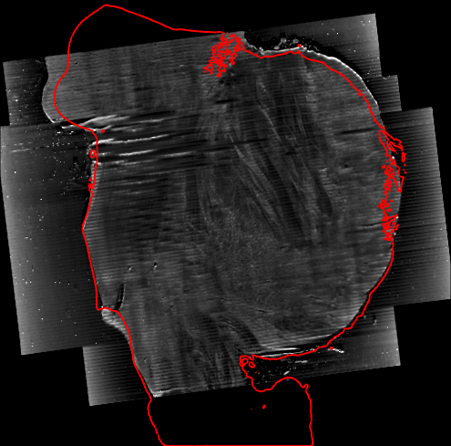
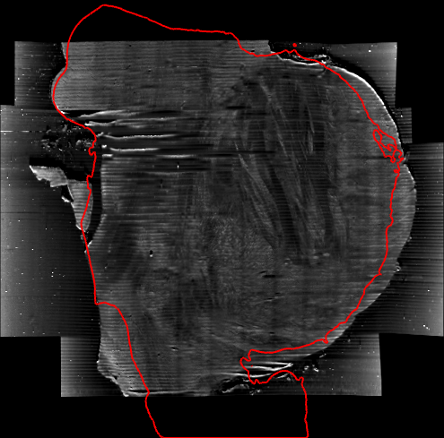
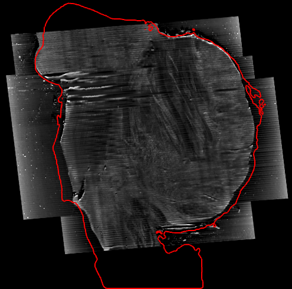
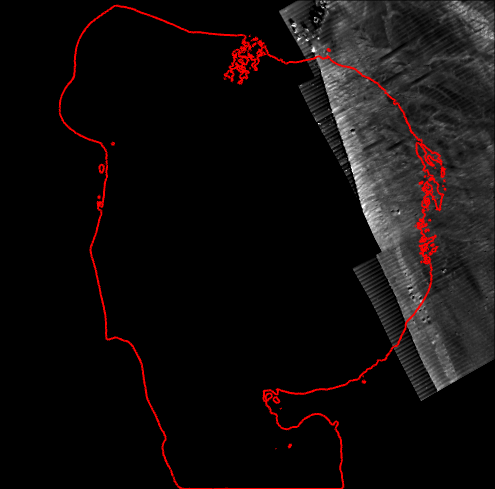
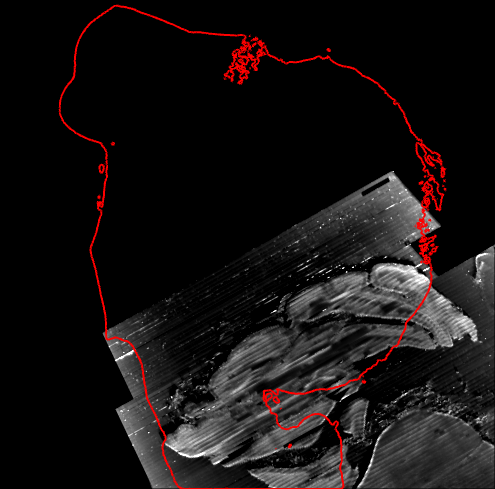
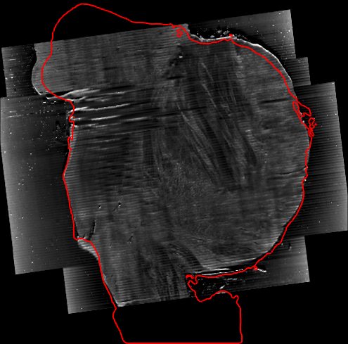
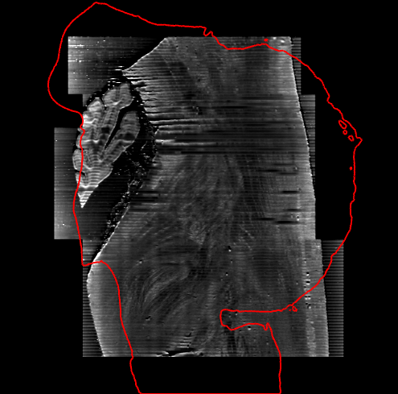
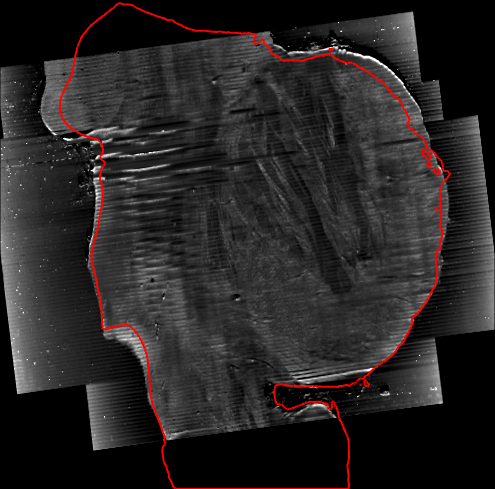

# bench

The scripts that run and measure octreg, and their stored results. They are not part of the package. The I58 brainstem pair has
no reference registration, so it is shown in pictures. The test in [i46/](i46/README.md) scores octreg and standard tools on
block I46 of Costantini et al. (2023) against the authors' registration.

## Data layout

The scripts find their files through `bench/paths.py`. By default the runs go to `bench_runs/`, the baseline runs to
`baselines/` and the data are read from `data/` of the repository, all three in `.gitignore`. Four environment variables move
them.

| variable | meaning | default |
|---|---|---|
| `OCTREG_PROJECT_ROOT` | the runs go to `<project root>/bench_runs`, the baseline comparison to `<project root>/baselines` | the repository root |
| `OCTREG_DATA_ROOT` | the data root | `<repository>/data` |
| `OCTREG_I58_DIR` | the folder of the two I58 files | `<data root>/I58` |
| `OCTREG_DANDI000026_DIR` | the download of DANDI:000026 sub-I46 and the authors' registration files for `i46/` | `<data root>/dandi-000026` |

The I58 files are `I58_Brainstem_mus_Slice_full_20um_corr.nii.gz` (the OCT) and `I58_brainstem_MRI_cropped_to_OCT.nii.gz` (the
MRI crop). They are not part of the repository.

## I58

```bash
I58=${OCTREG_I58_DIR:-${OCTREG_DATA_ROOT:-data}/I58}
OCT=$I58/I58_Brainstem_mus_Slice_full_20um_corr.nii.gz
MRI=$I58/I58_brainstem_MRI_cropped_to_OCT.nii.gz
RUNS=${OCTREG_PROJECT_ROOT:-.}/bench_runs/I58
python -m octreg register $OCT $MRI -o $RUNS/octreg
python bench/ablate.py $OCT $MRI -o $RUNS/ablation
python bench/ablate.py $OCT $MRI -o $RUNS/ablation/turned --only base,no_search --turn 0,0,90
python bench/ablate.py $OCT $MRI -o $RUNS/ablation/fine --only base,no_outline --params '{"search_mm": 0.4, "search_sigma_mm": 0.8}'
python bench/repeat.py $OCT $MRI --run $RUNS/octreg -o $RUNS/repeat
```

`ablate.py` runs the method with one change per variant (its `--help` lists them), each through `octreg.register.register`. With
`--turn 0,0,90` it starts from the OCT turned by 90° about its sectioning axis, the z axis of the I58 OCT world. The runs
under `fine` search on a 0.4 mm grid with σ 0.8 mm in place of 0.6 and 1.2 mm, with and without the outline.
`baselines/summarise.py` stores the pose and the search candidates of every ablation run in `results/I58/ablation.json`
and lists the candidates of the search in the I58 run, in the two outline variants and in the `fine` runs in
`results/I58/search.md`. `repeat.py` runs octreg once more and compares the affine with the stored run byte for byte
(`results/repeat.json`).

| | | | |
|---|---|---|---|
| **no outline term** | **poses proposed by (F + O) / 2 only** | **no orientation search** | **no refinement** |
|  |  |  |  |
| **only the first search pose refined** | **no scale and shear prior** | **signed gradients** | **signed gradients, OCT negated** |
|  |  |  |  |
| **the trace-free tensor** | **search gradients over the whole specimen mask** | **turned 90°, the start** | **turned 90°, no orientation search** |
|  |  |  |  |
| **turned 90°, octreg** |  |  |  |
|  |  |  |  |

The sagittal plane of the I58 figure in the [README](../README.md) through each variant, with the MRI foreground boundary in
red.

`figures.py` makes the freeview panels of `docs/figures`: the result, the affine baselines of [baselines/](baselines/README.md)
and the ablation. It runs after the baseline comparison, whose inputs give the display window of every OCT panel
(`--window-from`) and whose runs make the baseline panels. It needs FreeSurfer 8.2 (freeview, mri_mc, mris_smooth) with its
licence, in WSL on Windows.

```bash
python bench/figures.py --octreg-run $RUNS/octreg --ablation $RUNS/ablation
```

## Files

| file | content |
|---|---|
| `paths.py` | the run and data roots, the two I58 files and the form of a path in WSL |
| `ablate.py` | the ablation: one change to the method per variant, on any pair |
| `repeat.py` | octreg once more on a pair, its affine against a stored run of the same code, into `results/repeat.json` |
| `figures.py` | the I58 panels in `docs/figures/` |
| `baselines/` | standard registration tools on the I58 pair, and the tool settings of the I46 test ([README](baselines/README.md), [BASELINES.md](baselines/BASELINES.md)) |
| `i46/` | the test on block I46 of Costantini et al. (2023) ([README](i46/README.md)) |
| `results/I58/` | `result.json` of the I58 run and `ablation/no_outline.json` of that variant, with the input paths cut to file names, the pose and the search candidates of every ablation run in `ablation.json`, the candidates of the search in the I58 run and in the outline variants in `search.md`, and the baseline tables in `baselines/` |
| `results/I46/` | the scores of the I46 test and their tables (`tables.md`) |

The Python scripts print their options with `--help`.
