# Baselines on the I58 brainstem pair

Standard registration tools run on the I58 pair. The fixed image is the MRI crop as given (0.08 mm). The moving image is the 20
µm OCT box-averaged to 0.08 mm isotropic, the voxel size of the MRI. Eight tools run. Seven of them run from their standard
starts (the header alignment, the image centres or centres of mass, and the tool's own search where it has one) and, as separate
runs, with a field-of-view (FOV) mask of the OCT. SynthMorph, which predicts the affine and has no mask option, runs once.
Settings are in [README.md](README.md), the commands of every run in [i58/runs.py](i58/runs.py), versions and installation in
[INSTALL.md](INSTALL.md).

The figures and tables below show each tool at the setting its documentation gives for this kind of registration, with one
exception: FLIRT's two headers are scaled x10, because its schedule resamples the images to fixed voxel sizes in mm. The other
starts and settings are in the stored table [affine.md](../results/I58/baselines/affine.md). I58 has no reference, so the tools
are shown, not scored. The first table gives the scale per OCT axis (the length of a unit step along each OCT array axis after
the transform, 1 = voxel size kept) and the determinant of each affine, and for each run the setting, start, wall time and
hardware.

Each panel is one freeview screenshot of the whole MRI crop at one screen pixel per 0.08 mm voxel, showing the MRI or the 20 µm
OCT resampled through the tool's transform by octreg's resampler. The planes are the sagittal, coronal and axial planes through
the voxel centre nearest the centroid of the MRI tissue, at (1.75, 0.38, 22.26) mm RAS. The red line is the boundary of the MRI
foreground octreg uses ([§1](../../docs/METHOD.md#1-masks)) resampled from its 0.15 mm base grid to the crop. On the sagittal
and coronal planes it also encloses MRI tissue above and below the block. On the axial plane it also encloses MRI tissue along
the right side of the image, where the OCT at octreg's affine shows a dark band with a few bright fragments. The captions call
this the right axial band. The OCT is shown at the default grey window freeview gives the moving image (0.00122 to 0.00553), and
the MRI at 0.212 to 1.662, both linear ([docs/figures/figures.json](../../docs/figures/figures.json)). Sagittal planes have
anterior on the right, coronal and axial planes show the subject's right on the left, and superior is up on sagittal and coronal
planes, anterior up on axial planes. Left, right, top and bottom in the text and the captions refer to the image. On the
sagittal and coronal planes the OCT sections show as fine stripes parallel to the top and bottom edges of the block, horizontal
at the start. `bench/figures.py` makes the panels.

| method | run | setting | start | scale per OCT axis | det | wall time | hardware |
|---|---|---|---|---|---|---|---|
| image box centres aligned (the start) | `reference_centres` | not a registration: the OCT translated so that the centres of the two image boxes coincide, header orientation kept | image box centres aligned | 1.00 / 1.00 / 1.00 | 1.00 |  |  |
| octreg | `octreg` | default parameters | own orientation search (8,000 rotations) inside the MRI crop | 0.96 / 0.95 / 0.97 | 0.88 | 10 min | GPU |
| NiftyReg 2.1.2 reg_aladin | `niftyreg_center` | defaults: symmetric block matching, rigid then affine | image centres (default) | 0.97 / 0.96 / 0.98 | 0.91 | 5 min | CPU, 8 threads |
| greedy 1.4.0 | `greedy_centers` | NMI, -dof 6 then -dof 12, -n 100x50x10, no mask | image centres (-ia-image-centers) | 1.19 / 0.93 / 0.90 | 0.91 | 63 s | CPU, 8 threads |
| elastix 5.3.1 | `elastix_center` | model-zoo Parameters_Rigid then Parameters_Affine (AdvancedMattesMutualInformation), no mask | geometric centres (GeometricalCenter) | 0.92 / 0.84 / 0.97 | 0.74 | 26 s | CPU, 12 threads |
| FreeSurfer 8.2.0 mri_robust_register | `mri_robust_register_default_com` | --cost NMI, rigid then --affine --ixform, tool defaults | centres of mass (default) | 0.99 / 1.00 / 1.07 | 1.06 | 14 min | CPU, 20 threads |
| ANTs 2.6.5 | `ants_com` | antsRegistrationSyN.sh -t a: rigid then affine, Mattes MI, the script's large-image schedule, no mask | centres of mass (script default) | 0.86 / 0.62 / 0.92 | 0.49 | 45 s | CPU, 12 threads |
| FreeSurfer 8.2.0 mri_coreg | `mri_coreg_default` | NMI, --dof 6 then --dof 12 --init-reg, tool defaults | volume centres + the default brute-force search | 0.92 / 0.81 / 1.00 | 0.74 | 22 min | CPU, 20 threads |
| FSL FLIRT 6.0.7.23 | `flirt_search_x10` | normmi, -dof 6 then -dof 12 -nosearch, both headers scaled x10 because FLIRT's schedule resamples the images to fixed voxel sizes in mm (an adaptation FSL does not document) | FLIRT default rotation search (±90°, coarse 60°, fine 18°) | 0.76 / 0.76 / 0.67 | 0.39 | 53 min | CPU (FLIRT runs single-threaded) |
| FreeSurfer 8.2.0 mri_synthmorph | `synthmorph_affine` | register -m affine as documented. A model of 1 mm whole-brain images, run on a 0.08 mm block | none (the network predicts the affine) | 0.82 / 0.62 / 1.20 | 0.49 | 38 s | CPU, 20 threads |

| | sagittal | coronal | axial |
|---|---|---|---|
| **MRI** | 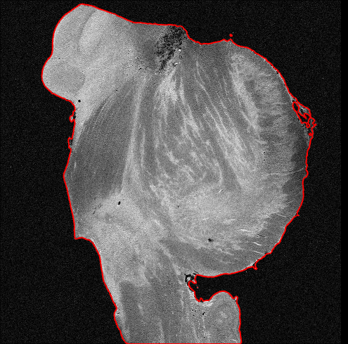 | 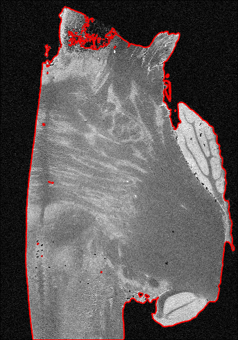 | 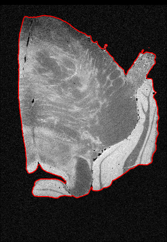 |
| **image box centres aligned (the start)** | 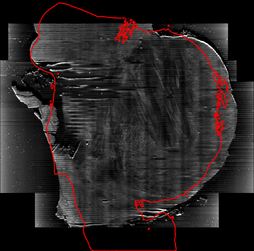 | 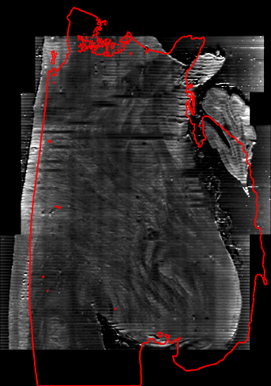 | 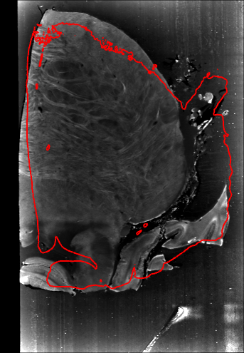 |
| **octreg** | 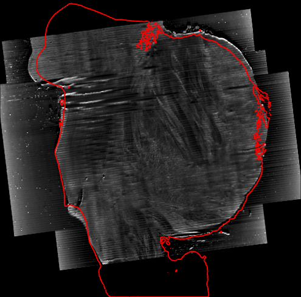 | 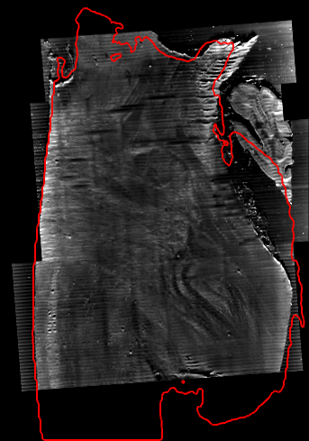 | 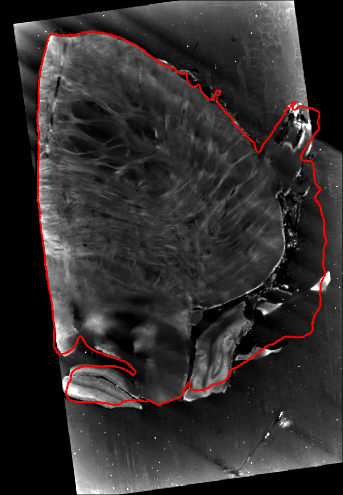 |
| **NiftyReg reg_aladin** | 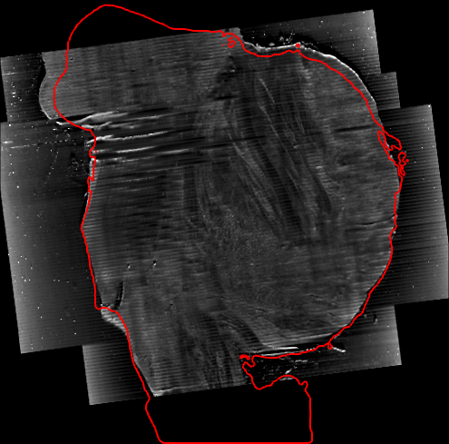 | 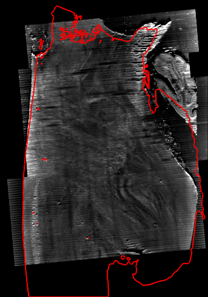 | 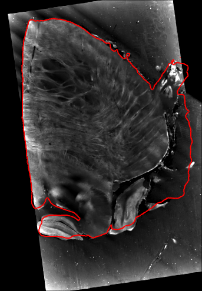 |
| **greedy** | 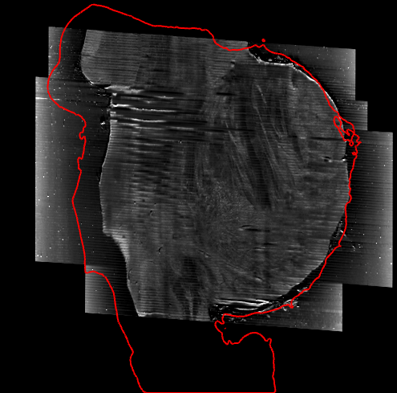 | 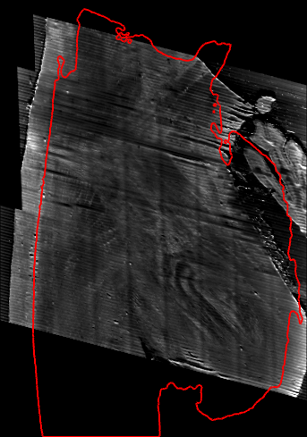 | 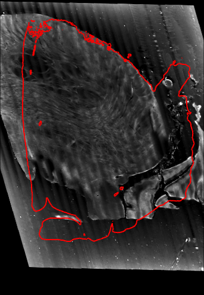 |
| **elastix** | 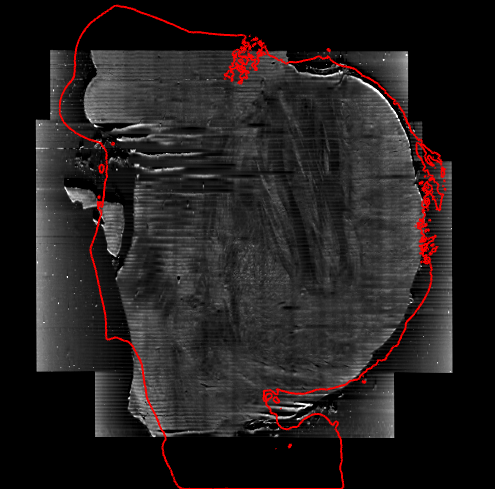 | 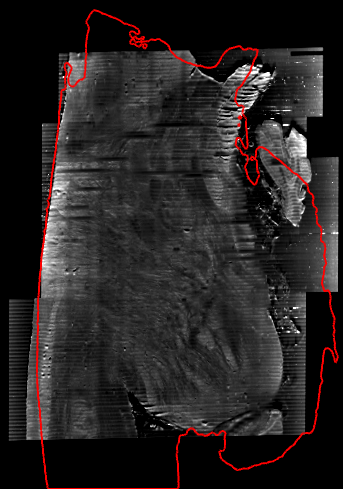 | 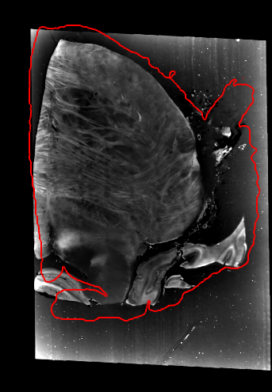 |
| **mri_robust_register** | 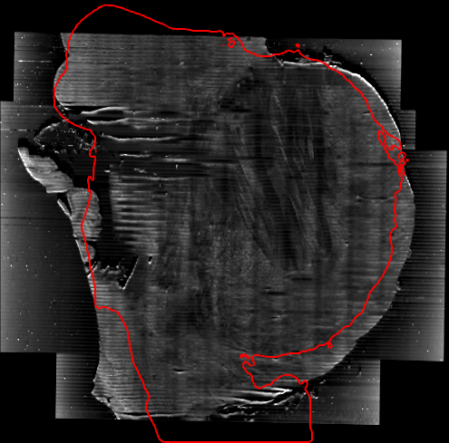 | 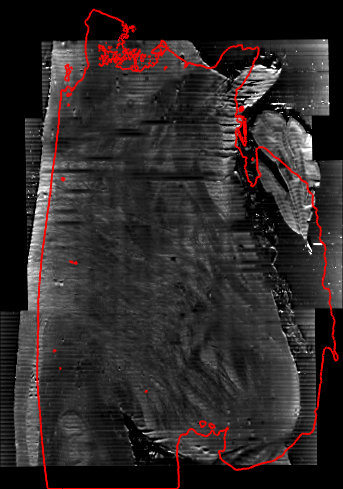 | 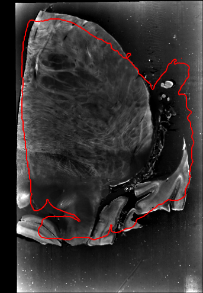 |
| **ANTs** | 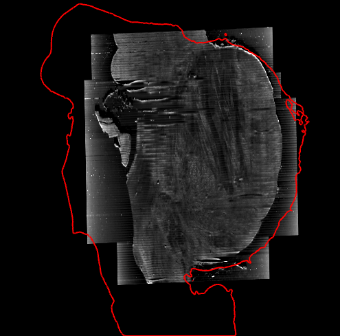 | 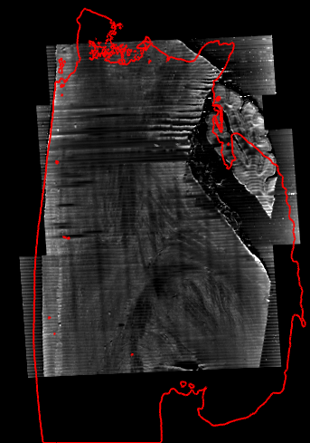 | 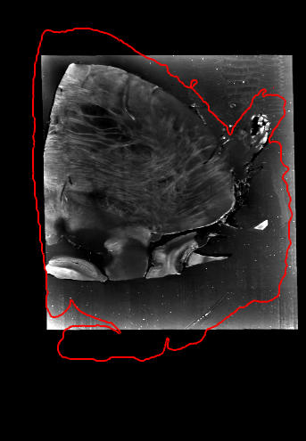 |
| **mri_coreg** | 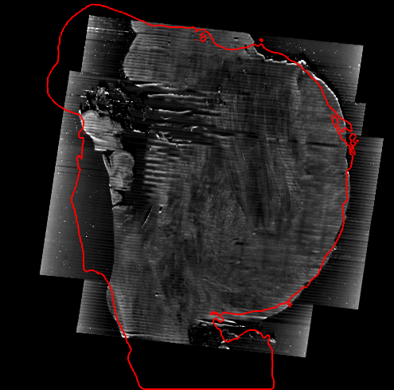 | 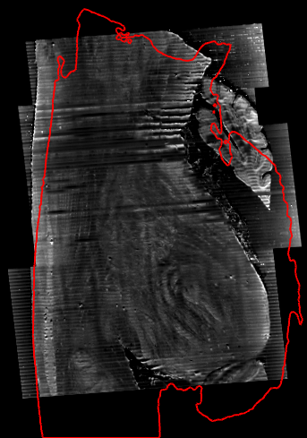 | 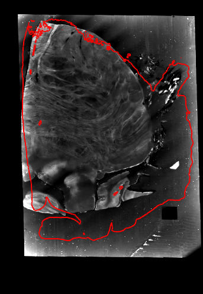 |
| **FLIRT** | 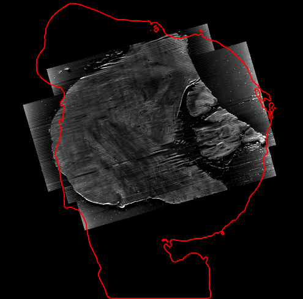 | 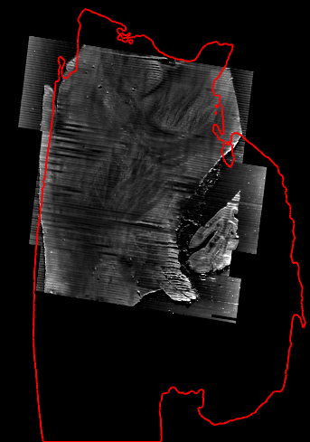 | 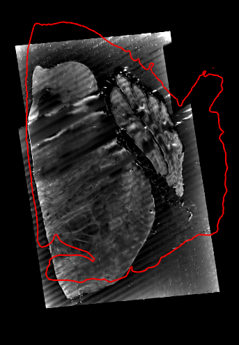 |
| **SynthMorph** | 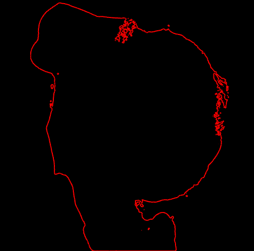 | 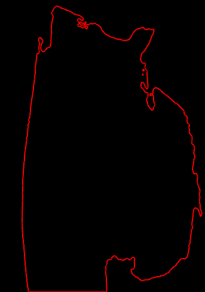 | 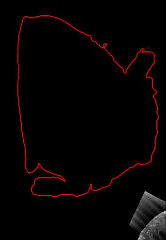 |

| method | what the panels show |
|---|---|
| image box centres aligned (the start) | The block keeps the header orientation, with its edges parallel to the image axes. Tissue lies outside the line along the right side and at the left of the sagittal plane, along the left side and at the upper right of the coronal plane, and along the left side, at the top and at the lower left of the axial plane. |
| octreg | The block is turned relative to the image axes and the sections are straight. The specimen surface runs along the line except at these places. On the sagittal plane the bright rim at the top, the rounded tissue edge at the upper left and a bright band just below the step in the line at the lower left lie outside the line, and on the right, below the rim, small loops of the line reach past the specimen edge. On the coronal plane the striped upper right corner of the specimen and a separate piece of tissue below it lie partly outside the line, below that piece the specimen ends short of the line, and at the top the line dips into the specimen. On the axial plane the specimen ends short of the line at the right axial band. |
| NiftyReg reg_aladin | As for octreg: the block is turned, the sections are straight, and the specimen surface runs along the line except at the same places. |
| greedy | The block is sheared: its edges are slanted, the sections run obliquely on the coronal plane and show as nearly vertical stripes on the axial plane. Parts of the area inside the line hold no tissue on all three planes, most at the lower left of the coronal plane, and on the axial plane tissue lies outside the line along the left side. |
| elastix | The block's edges stay nearly parallel to the image axes. The specimen is smaller than the area inside the line and lies mostly inside the line with gaps, and pieces of tissue cross the line at the upper right of the coronal plane, at the left of the sagittal plane and at the lower left of the axial plane. |
| mri_robust_register | The block keeps the header orientation and stays close to the start. As at the start, tissue lies outside the line on all three planes. |
| ANTs | The block is shrunk, with its edges nearly parallel to the image axes. On every plane the specimen fills only part of the area inside the line. |
| mri_coreg | The block is slightly tilted on the sagittal and coronal planes. The specimen ends short of the posterior end of the line on the axial plane, and the upper left of the area inside the line on the sagittal plane holds no tissue. |
| FLIRT | The block is shrunk and turned. The lower part of the area inside the line on the sagittal and coronal planes holds no tissue, and on the axial plane the specimen is narrower than the area inside the line and reaches past its posterior end. |
| SynthMorph | No OCT reaches the sagittal and coronal planes. One corner of the block appears at the lower right of the axial plane, outside the line. |
