# Baselines on the I58 brainstem pair

Standard registration tools run on the I58 pair. The fixed image is the MRI crop as given (0.08 mm). The moving image is the
20 µm OCT box-averaged to 0.08 mm isotropic, the voxel size of the MRI. The affine stage runs eight tools, each from its
standard starts (the header alignment, the image centres or centres of mass, and the tool's own search where it has one) and, as
separate runs, with a field-of-view (FOV) mask of the OCT. The deformable stage runs five tools, each started from octreg's
affine. Versions, settings and scripts are in [README.md](README.md) and [INSTALL.md](INSTALL.md).

The figures and tables below show each tool at the setting its documentation gives for this kind of registration, with two
exceptions: FLIRT's two headers are scaled x10, because its schedule works in mm, and SyN runs in single precision. The other
starts and settings of the affine stage are in the stored table [affine.md](../results/I58/baselines/affine.md), and the
deformable table is also stored as [deform.md](../results/I58/baselines/deform.md). I58 has no reference, so the tools are
shown, not scored. The tables give the scale per OCT axis and the determinant of an affine, the minimum of the Jacobian
determinant, the share of folded voxels and the SD of log J of a field, and the setting, start, wall time and hardware of each
run.

Each panel is one freeview screenshot of the whole MRI crop at one screen pixel per 0.08 mm voxel, showing the MRI or the 20 µm
OCT resampled through the tool's transform by octreg's resampler. The planes are the sagittal, coronal and axial planes through
the voxel centre nearest the centroid of the MRI tissue, at (1.75, 0.38, 22.18) mm RAS. The red line is the boundary of the MRI
foreground that the rule of octreg's [§1](../../docs/METHOD.md#1-masks) gives on the 0.08 mm grid of the crop. On the sagittal
and coronal planes it also encloses MRI tissue above and below the OCT specimen. On the axial plane the MRI tissue reaches the
line along the right side, where the OCT at octreg's affine shows a dark band with a few bright fragments, called the right
axial band below. The OCT is shown at the default grey window freeview gives the moving image (0.00122 to 0.00553), and the MRI
at 0.212 to 1.662, both linear ([docs/figures/figures.json](../../docs/figures/figures.json)). Sagittal planes have anterior on
the right, coronal and axial planes show the subject's right on the left, and superior is up on sagittal and coronal planes,
anterior up on axial planes. The OCT sections show as fine stripes, horizontal on the sagittal and coronal planes.
`bench/figures.py` makes the panels.

## Affine

| method | run | setting | start | scale per OCT axis | det | wall time | hardware |
|---|---|---|---|---|---|---|---|
| image centres aligned (the start) | `reference_centres` | not a registration: the OCT translated so that the centres of the two image boxes coincide, header orientation kept | image centres aligned | 1.00 / 1.00 / 1.00 | 1.00 |  |  |
| octreg | `octreg` | §1 to §4 with default parameters | own orientation search (8000 orientations) inside the MRI crop | 0.97 / 0.96 / 0.97 | 0.90 | 8 min | GPU |
| NiftyReg 2.1.2 reg_aladin | `niftyreg_center` | defaults: symmetric block matching, rigid then affine | image centres (default) | 0.97 / 0.96 / 0.98 | 0.91 | 5 min | CPU, 8 threads |
| greedy 1.4.0 | `greedy_centers` | NMI, -dof 6 then -dof 12, -n 100x50x10, no mask | image centres (-ia-image-centers) | 1.19 / 0.93 / 0.90 | 0.91 | 63 s | CPU, 8 threads |
| elastix 5.3.1 | `elastix_center` | model-zoo Parameters_Rigid then Parameters_Affine (AdvancedMattesMutualInformation), no mask | geometric centres (GeometricalCenter) | 0.92 / 0.84 / 0.97 | 0.74 | 26 s | CPU, 12 threads |
| FreeSurfer 8.2.0 mri_robust_register | `mri_robust_register_default_com` | --cost NMI, rigid then --affine --ixform, tool defaults | centres of mass (default) | 0.99 / 1.00 / 1.07 | 1.06 | 14 min | CPU, 20 threads |
| ANTs 2.6.5 | `ants_com` | antsRegistrationSyN.sh -t a: rigid then affine, Mattes MI, the script's large-image schedule, no mask | centres of mass (script default) | 0.86 / 0.62 / 0.92 | 0.49 | 45 s | CPU, 12 threads |
| FreeSurfer 8.2.0 mri_coreg | `mri_coreg_default` | NMI, --dof 6 then --dof 12 --init-reg, tool defaults | volume centres + the default brute-force search | 0.92 / 0.81 / 1.00 | 0.74 | 22 min | CPU, 20 threads |
| FSL FLIRT 6.0.7.23 | `flirt_search_x10` | normmi, -dof 6 then -dof 12 -nosearch, both headers scaled x10 because FLIRT's schedule works in mm (an adaptation FSL does not document) | FLIRT default rotation search (±90°, coarse 60°, fine 18°) | 0.76 / 0.76 / 0.67 | 0.39 | 53 min | CPU (FLIRT runs single-threaded) |
| FreeSurfer 8.2.0 mri_synthmorph | `synthmorph_affine` | register -m affine as documented. A 1 mm whole-brain model, outside its domain on a 0.08 mm block | none (the network predicts the affine) | 0.82 / 0.62 / 1.20 | 0.49 | 38 s | CPU, 20 threads |

| | sagittal | coronal | axial |
|---|---|---|---|
| **MRI** |  |  |  |
| **image centres aligned (start)** |  |  |  |
| **octreg** |  |  |  |
| **NiftyReg reg_aladin** |  |  |  |
| **greedy** |  |  |  |
| **elastix** |  |  |  |
| **mri_robust_register** |  |  |  |
| **ANTs** |  |  |  |
| **mri_coreg** |  |  |  |
| **FLIRT** |  |  |  |
| **SynthMorph** |  |  |  |

| method | what the panels show |
|---|---|
| image centres aligned (start) | The block keeps the header orientation, with its edges parallel to the image axes. The specimen crosses the line on all three planes. |
| octreg | The block is turned relative to the image axes and the sections are straight. The specimen surface runs along the line except the bright rim at the top and the rounded tissue edge at the upper left of the sagittal plane, which lie outside it, a separate piece of tissue at the upper right of the coronal plane, which lies partly outside it, and the right axial band. |
| NiftyReg reg_aladin | As for octreg: the block is turned, the sections are straight, and the specimen surface runs along the line except at the same places. |
| greedy | The block is sheared: its edges are slanted, and the sections run obliquely on the coronal and axial planes. Parts of the outline are empty on all three planes, most at the lower left of the coronal plane, and on the axial plane tissue lies outside the line along the left side. |
| elastix | The block keeps the header orientation. The specimen is smaller than the outline and lies mostly inside the line with gaps, and pieces of tissue cross the line at the upper right of the coronal plane, at the left of the sagittal plane and at the lower left of the axial plane. |
| mri_robust_register | The block keeps the header orientation and stays close to the start. As at the start, the specimen crosses the line on all three planes. |
| ANTs | The block is shrunk, with its edges nearly parallel to the image axes. On every plane the specimen fills only part of the outline. |
| mri_coreg | The block is compressed and slightly tilted. The posterior part of the axial outline is empty. |
| FLIRT | The block is shrunk and turned, and the specimen outline does not follow the line on any plane. |
| SynthMorph | No OCT reaches the sagittal and coronal planes. One corner of the block appears at the lower right of the axial plane, outside the line. |

## Deformable

As in the comparison of Klein et al. (NeuroImage 46:786, 2009), every tool starts from one shared affine, here octreg's: the OCT
is resampled through it onto the 0.08 mm MRI grid, and the tool starts from the identity on that grid. The Jacobian determinant
J of the field is computed by finite differences on the field's own grid, over the MRI foreground of octreg's §1 sampled onto
that grid. Folded voxels are those with J <= 0, and the SD of log J, with J clipped below at 1e-6, is the smoothness measure of
Learn2Reg (Hering et al., IEEE Trans. Med. Imaging 42:697, 2023).

| method | run | setting | start | field grid | Jacobian min | folded (J <= 0) | SD log J | wall time | hardware |
|---|---|---|---|---|---|---|---|---|---|
| no deformation | `none` | octreg's affine, no field | octreg's affine |  |  |  |  |  |  |
| octreg | `octreg` | §5: strain-limited field on a 5 mm lattice, default parameters | octreg's affine | 0.15 mm | 0.86 | 0.00 % | 0.06 | 11 s | GPU |
| ANTs 2.6.5 | `deform_ants_syn_cc` | antsRegistrationSyN.sh -t so: SyN, CC radius 2, script defaults in single precision (-p f), no mask | octreg's affine (both images on the MRI grid, identity start) | 0.08 mm | -0.16 | < 0.01 % | 0.46 | 41 min | CPU, 8 threads |
| elastix 5.3.1 | `deform_elastix_default` | model-zoo Parameters_BSpline: Mattes MI, 16 mm final grid, no mask | octreg's affine (both images on the MRI grid, identity start) | 0.08 mm | 1.03 | 0.00 % | 0.04 | 23 s | CPU, 8 threads |
| NiftyReg 2.1.2 reg_f3d | `deform_niftyreg_default` | defaults: NMI 64 bins, control grid 5 voxels (0.4 mm), bending energy 0.001, linear elasticity 0.01, no mask | octreg's affine (both images on the MRI grid, identity start) | 0.08 mm | -125.33 | 46.88 % | 6.35 | 3 min | CPU, 8 threads |
| ConvexAdam 0.2.0 | `deform_convexadam_default` | MIND-SSC, the package's shipped defaults, no mask | octreg's affine (both images on the MRI grid, identity start) | 0.08 mm | -0.92 | 0.46 % | 1.09 | 7 s | GPU |
| greedy 1.4.0 | `deform_greedy_wncc` | the quick-start deformable command: WNCC 2x2x2, -s 1.732vox 0.707vox, -sv, -n 100x50x10, no mask | octreg's affine (both images on the MRI grid, identity start) | 0.08 mm | 0.11 | 0.00 % | 0.17 | 3 min | CPU, 8 threads |

| | sagittal | coronal | axial |
|---|---|---|---|
| **MRI** |  |  |  |
| **no deformation (octreg's affine)** |  | 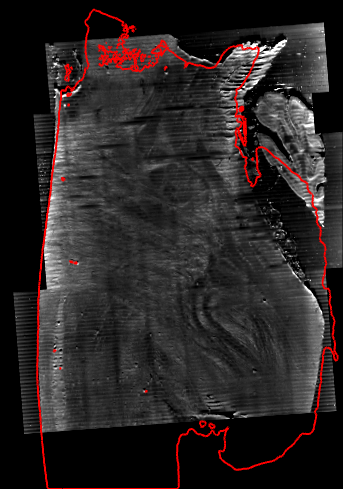 |  |
| **octreg, §5** |  |  |  |
| **ANTs SyN** |  | 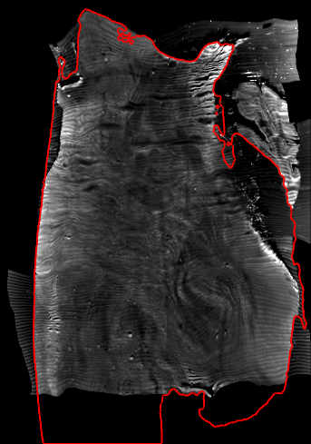 | 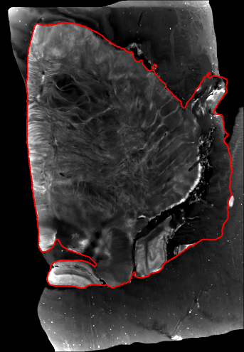 |
| **elastix B-spline** |  | 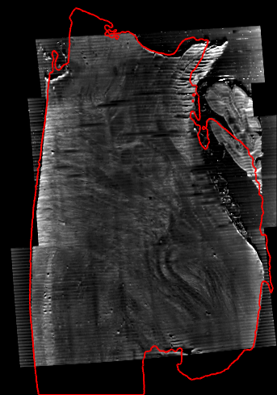 | 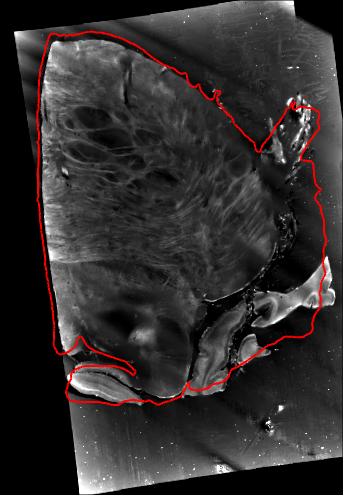 |
| **NiftyReg reg_f3d** |  | 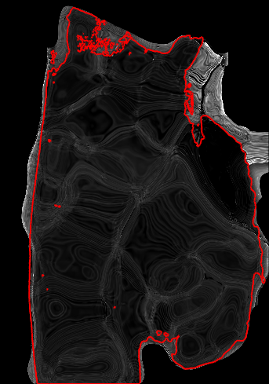 | 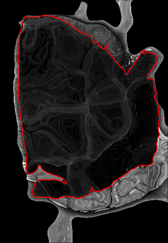 |
| **ConvexAdam** |  | 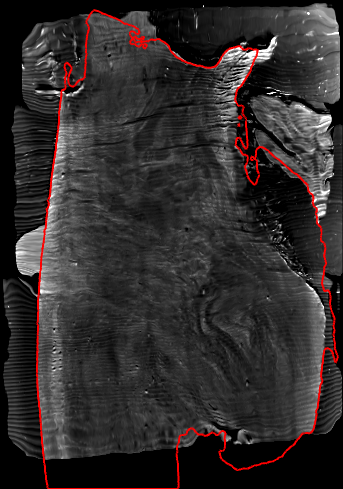 | 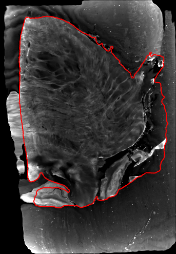 |
| **greedy** |  | 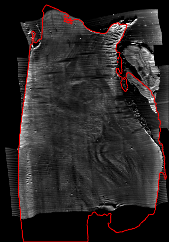 | 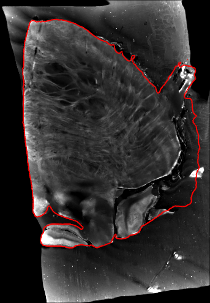 |

| method | what the panels show |
|---|---|
| no deformation (octreg's affine) | The shared start. The sections are straight. On the sagittal plane the bright rim at the top and the rounded tissue edge at the upper left lie outside the line. On the coronal plane the flat superior cut face lies below the top of the MRI tissue, and a separate piece of tissue at the upper right lies partly outside the line. On the axial plane the specimen ends short of the line at the right axial band. |
| octreg, §5 | The sections stay straight. On the sagittal plane the bright rim at the top and the lower part of the surface at the left lie on the line, and the rounded tissue edge at the upper left lies closer to it but still partly outside. On the coronal plane the superior cut face stays flat, and the separate piece at the upper right still lies partly outside the line. On the axial plane the specimen still ends short of the line at the right axial band. |
| ANTs SyN | The flat superior cut face is pulled up into the MRI tissue above it, with stretched texture there. The sections are wavy and the block edges distorted. The specimen surface lies on the line except at the right axial band and at the separate piece at the upper right of the coronal plane, which lies partly outside it. |
| elastix B-spline | The block is moved inferiorly on the sagittal and coronal planes, and the sections stay straight. On both planes the specimen stays inside the line at the left and right with gaps. On the sagittal plane the bright rim at the top lies on the line and the inferior edge of the specimen lies below it, and on the coronal plane the separate piece at the upper right lies partly outside the line. On the axial plane the specimen lies inside the line with gaps on all sides, except the separate piece at the lower left, whose upper part lies outside the line. |
| NiftyReg reg_f3d | The OCT cannot be recognised: inside the outline its texture is replaced by smooth swirl and cell-like patterns, and bright smeared material lies outside the line on every plane. |
| ConvexAdam | The block outline is strongly warped and the agarose is smeared into large smooth patches. The superior cut face is lifted to the top of the outline on the coronal plane. The specimen surface lies on the line except at the right axial band and at two separate pieces, at the upper right of the coronal plane and at the lower left of the axial plane, which lie partly outside it. The sections show local waves. |
| greedy | The sections stay mostly straight, with mild waviness near the block edges. On the coronal plane the superior cut face is pulled up into the MRI tissue above it. The specimen surface, including the bright rim, lies on the line except at the rounded tissue edge at the upper left of the sagittal plane and at the separate piece at the upper right of the coronal plane, which lie partly outside it, and at the right axial band. |
