# Test on DANDI:000026 sub-I46

These scripts run octreg and eight standard registration tools on the OCT block and the MRI of Costantini et al. (2023), "A
cellular resolution atlas of Broca's area" (Science Advances 9:eadg3844, [doi
10.1126/sciadv.adg3844](https://doi.org/10.1126/sciadv.adg3844)), the work octreg extends. The data are public in
[DANDI:000026](https://dandiarchive.org/dandiset/000026/draft) ("Human brain cell census for BA 44/45", CC BY 4.0), and the
authors' OCT→MRI affine, from their code repository, serves as the reference. The results are in
[bench/results/I46/tables.md](../results/I46/tables.md).

## Why this case, and its limits

Costantini et al. scanned one fixed human hemisphere with 7 T MRI at 0.15 mm, cut out a block holding Broca's area, imaged it
with serial-sectioning OCT and registered the MRI to the OCT with an affine transform, the task octreg performs. They published
the data and their registration code and results
([github.com/neuroscales/biccn-broca-I46](https://github.com/neuroscales/biccn-broca-I46)), whose sample is I46. This gives an
expert OCT→MRI affine to measure against, on adult human cortex.

The test has two limits. It is one block of one specimen, so it measures how octreg copes with the placement of the MRI crop and
with the MRI contrast, not how it generalises to other specimens. And parts of octreg, the outline rule of §2, the valley rule
of §1, the candidate suppression of §3 and the score of §5, were designed with runs on these crops, so its numbers here are not
a held-out result. The inputs, the reference, the metrics and the settings of the standard tools were fixed before any run, and
every later analysis was declared before its own runs.

## Data

| what | DANDI path | content |
|---|---|---|
| OCT | `sub-I46/ses-OCT/micr/sub-I46_ses-OCT_sample-BrocaAreaS01_OCT.ome.tiff` | 627 × 1271 × 1230 (plane, y, x), uint8, 12 µm in the plane: a block of about 14.8 × 15.3 mm, 9.5 mm deep |
| OCT vessels | `derivatives/sub-I46/ses-OCT/vessel/ves_seg.tif` | the dataset's vessel segmentation of OCT planes 0 to 560 |
| MRI | `derivatives/EPIC/sub-I46/ses-MRI/anat/sub-I46_ses-MRI_flip-{1,2,3}_VFA.nii.gz` | 7 T FLASH, TR 34 ms, flip angles 10°, 20° and 30°, 0.15 mm, 1280 × 1040 × 576 |
| T1 map | `derivatives/EPIC/sub-I46/ses-MRI/anat/sub-I46_T1map.nii.gz` | the T1 map of the three FLASH images (its sidecar), used only to compare contrasts |
| labels | `derivatives/Labels/sub-I46/ses-MRI/anat/sub-I46_ses-MRI_space-EPIC_label-{vessels,infrasupra}_dseg.nii.gz` | manual MRI labels: vessels (255), white matter (1), infragranular (2) and supragranular (3) cortex |

The authors' registration files come from their repository at commit `b36e398cc42db4ca89ecc121818255bd96fc67ad`:
`results/mri2oct/affine.lta`, `results/mri/recon2raw.lta` and the OCT→LSFM fields `results/oct2lsfm/svf.08.nii.gz` to
`svf.23.nii.gz`. `fetch.sh` downloads everything into `sub-I46/oct`, `sub-I46/mri`, `sub-I46/labels` and
`sub-I46/costantini_repo/results` of `OCTREG_DANDI000026_DIR`.

The 20° FLASH, the T1 map and the labels carry a header that is a 120° rotation (a cyclic permutation of the axes) of the same
voxel grid as the 10° and 30° FLASH. Their arrays are voxel aligned with the 10° FLASH, and every file here is read with the
header of the 10° FLASH (flip-1).

## Reference

The reference R is the authors' affine `A` (their OCT world to their MRI recon world, in the convention of their nitorch code),
composed with `recon2raw` (MRI recon world to the world of the flip-1 header) and with the authors' OCT header, so that it maps
the OCT world of the test to the MRI world. The authors' OCT header is not published. `common.py` rebuilds it from the OCT→LSFM
fields, one per 500 µm slab of 33 OCT planes: their lattices give the depth axis, the in-plane axes and the position of the
block. Along the depth axis the lattice centres step 0.396 mm (33 planes of 12 µm) except 0.488 mm between `svf.12` and
`svf.13`, so the rebuilt position may lie about 0.06 mm from where equal steps would put it (reference_check.json, lattice). The
discrete choices of that construction are fixed by the data (`reference_check.py`,
[reference_check.json](../results/I46/reference_check.json)). The orientation (the sign of the depth axis, and the order and
signs of the in-plane axes) is the one under which the OCT intensity correlates best with the MRI: 0.39 with the 20° FLASH
against at most 0.19 for any other orientation (0.32 against 0.19 at 10°, 0.40 against 0.21 at 30°). The slab, slab 08 = OCT
planes 0 to 32, is the one under which the OCT vessels fall on the MRI vessel labels: 15.8 % of them lie within 0.15 mm of a
label, against 5.4 % and 5.9 % with slab 08 one slab off either way and at most 5.9 % for any other choice. The intensity
correlation does not tell the slabs apart (0.38 with slab 08 = planes 33 to 65). In the test's OCT frame R has a positive
determinant (0.976, [context.json](../results/I46/context.json)), so the OCT array has the handedness of the MRI.

R is an expert registration, not ground truth. An affine fitted to the OCT vessels and the MRI vessel labels alone
(`labelfit.py`, no image intensity), stored as L, lies 0.155 mm (mean) from R, p95 0.31 mm and 0.57° apart, and the same fit as
a rotation with a scale per axis (S9, nine parameters) lies 0.169 mm from R. The difference grows with depth, from about 0.1 mm
in the upper third of the block to 0.17 to 0.18 mm in the middle third and 0.28 to 0.30 mm in the deepest, and the fits put the
OCT planes 15.0 µm apart in the MRI against 14.5 µm in R. A global search of the same fit that never uses R (20,000 rotations of
both handednesses) ends on that solution, with a clearly lower energy than every other candidate it refines (1.25 against at
best 1.47, 14 mm away), and fits to random halves of the labels differ by about 0.09 mm (rms). Every distance from R is also
given from L, and distances below about 0.3 mm are not interpreted. The vessel check of R (below) is 0.101 mm (median), and 0.21
and 0.25 mm with R shifted by 0.5 and 1 mm. The authors fitted R as one affine for the whole block, moving a crop of their MRI
onto the OCT with a local intensity correlation inside an OCT mask, a Dice of grey- and white-matter segmentations and a
distance between vessel segmentations (`scripts/registration/mri2oct_affine.sh` of their repository). The paper reports no
accuracy for this step on its own, only for the chain from the MRI through the OCT to the light-sheet sections. So R may favour
intensity- or class-based methods, and the vessel check, which is close to the authors' vessel term, favours R. R is affine, so
octreg's smooth deformation (§6) is not scored against it.

## Inputs and protocol

The inputs, the reference, the metrics and the settings of the standard tools were fixed on 2026-10-15, before any run on these
inputs, with two amendments the same day, also before any run. The parts of octreg named under the limits above were designed
with runs on these crops. The analyses after the main runs were declared before their own runs. Each is marked below.

- **OCT.** The OME-TIFF in its array frame, (x, y, z) = TIFF (x, y, plane), with spacing 0.012, 0.012 and 0.01515 mm. The depth
  spacing is the acquisition, 500 µm sections of 33 OCT planes each, not a fit. The dataset's own metadata give 12 µm on every
  axis, and the authors' frame places the planes 12 µm apart and leaves the depth scale to their affine. R and L put the planes
  14.5 and 15.0 µm apart, 1.21 and 1.25 times 12 µm, a depth stretch that the scale and shear prior of §4 (λ = 2) works against
  and that lies beyond its clamp of ±0.15 (at most 1.19), so the test depends on this spacing.
- **OCT specimen mask.** The block is not embedded, and the OCT is not zero around the tissue: 32 % of the 24 µm blocks more
  than 0.3 mm outside the specimen mask are non-zero (context.json). octreg's documented usage then applies: give it a specimen
  mask. The mask was made from the OCT alone (24 µm box average above 40, then morphology) and ships here as
  `octmask_24um.nii.gz` (only its array is used, as 24 µm blocks of the OCT array). It leaves out the first six OCT planes
  (91 µm), which hold tissue, for every method alike. Every method gets the OCT multiplied by this mask, so all inputs are the
  same, and octreg also gets `--oct-mask` with the same masked OCT, its documented form for an OCT that is zero outside the
  tissue.
- **MRI.** The three FLASH images, each with the flip-1 header.
- **Primary MRI image: the 10° FLASH** (an amendment made before any run). octreg's §2 needs the tissue to
  show a brighter and a darker class, so the primary image is the one with the strongest grey/white contrast, measured with the
  authors' layer labels: white matter against infra- plus supragranular cortex, each eroded by one voxel, in the box of MRI
  voxels where R places the OCT, with a margin. The contrast, the difference of the two class means over their pooled standard
  deviation, is 3.49 at 10°, 2.87 at 20°, 1.98 at 30° and 0.49 in the T1 map (context.json).  The
  20° and 30° FLASH are reported on every C3 crop as well.
- **Crops.** octreg expects the MRI cropped around the block. Each crop is an axis-aligned box on the MRI voxel grid around the
  0.5 and 99.5 percentiles of the OCT tissue placed by R, with a margin m on every face and a seeded random shift of up to s mm
  per axis (numpy `default_rng(4600 + k)`), so the block is not centred:
  - **C3:** m = 3 mm, s = 2 mm, the main condition, on all three FLASH images.
  - **C6:** m = 6 mm, s = 5 mm, on the 10° FLASH.
  - **C12:** m = 12 mm, s = 10 mm, on the 10° FLASH.
  - Ten crops per condition, k = 0 to 9. The shift of crop k has the same direction in C3, C6 and C12.

  The crop is placed with R, which favours any method that starts from the image centres. The distance from the centre of each
  crop to the centre of the tissue is in [crops.json](../results/I46/crops.json).
- **octreg.** Version 2.1.0 (Params hash 9148790ad6c39454) at its default parameters, `octreg register OCT CROP --oct-mask OCT
  -o RUN` on every crop. As a sensitivity test, the C3 crops of the 10° FLASH also run without `--oct-mask`, with octreg's own
  specimen mask on the same masked OCT. Every entry of octreg.json and near.json records the version and the hash.
- **Standard tools.** One setting each, fixed from each tool's documentation before any run, with no tuning and no mask (FLIRT
  with both headers scaled x10, as its schedule works in mm): NiftyReg reg_aladin with its defaults (image-centre start), greedy
  (NMI, rigid then affine, `-ia-image-centers`), elastix (the model-zoo rigid and affine files, Mattes mutual information,
  geometric-centre start), ANTs `antsRegistrationSyN.sh -t a` (Mattes MI, its own centre-of-mass start), FreeSurfer
  mri_robust_register (`--cost NMI`, rigid then `--affine`, its default start) and mri_coreg (`--dof 6` then 12, its brute-force
  start), FSL FLIRT (normmi, dof 6 then 12, its default search, headers scaled x10 for its pyramid in mm) and SynthMorph (`-m
  affine`, which works in its own 1 mm space). The moving image is the masked OCT that octreg gets, box-averaged to 0.15 mm, the
  fixed image the crop. Every tool runs on the C3 crops k = 0 to 9 of the 10° FLASH and on the C3 k = 0 crops of the 20° and 30°
  FLASH. The commands are in [bench/baselines/standard_tools.py](../baselines/standard_tools.py). Each converted transform on
  the k = 0 crops is checked against the tool's own resampling of the OCT, and a run that ends without a readable transform is
  counted as a tool error.
- **Declared after the main runs, before their own runs** (`analyses.py`, `baselines.py --search`, `--mask` and `--near`):
  - The start test: octreg and A14 (its §4 and §5 without the orientation search) from the OCT turned by 90° and 180° about each
    array axis and by 20 rotations drawn uniformly on SO(3) (scipy `Rotation.random`, seed 4646), on flip1_C3_k0, the crop with
    the median distance.
  - The ablation of `bench/ablate.py` on the C3 crops of the 10° FLASH, and its A4 also on the C3 crops of the 20° and 30° FLASH
    and on the C12 crops.
  - The design choices: octreg with one choice replaced at a time. §5 scored by the weighted mean of (n_O · n_M)² over the
    normalised gradients, the score of Haber and Modersitzki (2007), the outline used whatever the outside, and candidate
    suppression at 10°, on all 60 runs. Every deep MRI valley taken as the tissue edge, on the 7 runs where octreg passes one
    over. 48 refined poses instead of 24, on the 4 runs whose result came from the 18th to 24th of the 24 search candidates.
  - The three tools that have a global rotation search, with that search on (FLIRT `-searchrx/ry/rz -180 180`, ANTs antsAI
    before the declared script, greedy `-search 1000 any 20`), on the C3 crops of the 10° FLASH.
  - The tools whose options take a mask of the moving image, with the OCT tissue as that mask, on the same crops.
  - A start near R: every tool and A14 from R turned by 10° about a random axis through the centre of the OCT tissue and shifted
    by 1 mm (numpy `default_rng(4700 + k)`), on the same crops. The tools get the start as the header of the moving image, with
    the option that starts from the header alignment.
  - The distance from L, the rotation axis, the shift of the tissue centroid and the scale per OCT axis in every table.
- The settings of the standard tools were not changed after any result.

## Metrics

Every estimate T is compared with R. Both map the OCT world to the MRI world.

- **Distance from R:** |T x − R x| over the OCT tissue points, reported as mean, median, p95 and maximum, with the rotation
  angle and axis of T R⁻¹. The points are the specimen mask on a grid of every eighth OCT voxel (96 × 96 × 121 µm), 843,465
  points (context.json). The grid was set by an amendment made before any run. The mean distance from L is given beside it.
- **Tiers:** a mean distance up to 0.30 mm (the precision of the reference), up to 1 mm, and up to 2.5 mm with a rotation up to
  10°.
- **§4:** octreg's affine before §5, from the same run, scored the same way.
- **Vessel check:** the MRI vessel labels placed in the OCT by T, those inside the tissue (at least 0.15 mm from its edge, in
  the annotated planes 0 to 560), and their distance to the nearest OCT vessel, mean and median. A run with fewer than 50 such
  labels has no value, and the tables give the median over the runs with one and their number. The check saturates near 0.25 mm
  and favours R, so it is a check, not a ranking.
- **Counts:** one block, so each condition gives counts over its ten crops with Clopper-Pearson 95 % intervals. The interval
  treats the crops as independent, which they are not, so it describes the placement of the crops on this block, not a rate on
  other specimens, and there are no p-values across crops. The design choices pool the conditions, or take only the runs where a
  choice applies, so their counts are given without an interval. Medians are over all runs of a row, a run without a transform
  counted as beyond every other.
- **Pictures:** `figures.py` shows in freeview the C3 crop of the 10° FLASH with the median distance under octreg, on whole
  planes through the tissue centre: the MRI, and the OCT through R, through octreg and through each tool. It also shows the
  median crop of every condition and every C3 crop of the 10° FLASH. The red line is the white-matter boundary of the authors'
  MRI labels, which comes from no compared method. Black means no OCT.

## Results

[tables.md](../results/I46/tables.md) gives every number. In brief:

- **octreg** came within 1 mm of R in all 60 runs and within 0.30 mm in none, 0.31 to 0.67 mm from R and 0.32 to 0.69 mm from L,
  each turned by 3.5° to 5.2° from R about an axis that differs between the contrasts. §5 lowers the median distance below that
  of the §4 affine in five of the six conditions and raises it on the 20° FLASH (0.35 to 0.50 mm, in all ten runs). It also
  brings the median distance from L down on the 10° FLASH (0.65 to 0.39 mm), while the vessel check rises after §5 in all 40
  runs with `--oct-mask` on the 10° and 20° FLASH (median from 0.148 to 0.170 mm on the 10° FLASH with a 3 mm margin) and falls
  on the 30° FLASH and in 9 of the 10 runs without `--oct-mask`. Without `--oct-mask` the texture mask leaves out about half of
  the tissue (50 % of the measured OCT lies outside it), and the §4 affine lies beyond 1 mm from R in 9 of the 10 runs (median
  2.52 mm). §6 found no confident interior match on any crop and kept the affine in every run.
- **Starts:** on flip1_C3_k0, from the 26 turned and random starts, octreg ends 0.38 to 0.42 mm from R every time. Without the
  orientation search (A14) it comes within 1 mm from 4 of them.
- **The standard tools** came within 1 mm in none of their 96 runs at the declared settings. The start is 7.0 mm (median) and
  122° from R, and most runs end turned by about as much (median 120°). With their own global search the three tools end 14 to
  24 mm away in all 30 runs. With the OCT tissue as their moving mask greedy, ANTs and FLIRT come within 1 mm in none of their
  30 runs, elastix ends without a transform on every crop, and the other three tools end where they do without the mask.
- **Start near R:** from a start 1.14 to 1.20 mm and 9.7° to 10.4° from R, octreg without its orientation search comes within
  1 mm on all ten crops (0.37 to 0.42 mm), ANTs on six (median over the ten crops 0.84 mm), mri_robust_register on one and the
  other tools on none.
- **Ablation:** without §5 the distance rises from 0.39 to 0.55 mm (median), standardised intensities in place of the two-class
  maps change no final distance by more than 0.07 mm on 40 crops, though their §4 pose lies farther from R on 38 of them, and
  without the scale and shear penalty the result stays within 1 mm. Without the orientation search no crop comes within 1 mm.
- **Design choices:** with §5 scored as Haber and Modersitzki score it, 30 of the 60 runs come within 1 mm, and none of the 20°
  and 30° FLASH or of the runs without `--oct-mask`. With every deep MRI valley taken, 1 of 7. With the outline used whatever
  the outside, 57 of 60. With candidate suppression at 10° and with 48 refined poses every run stays within 1 mm.

## Pictures

Every panel is a freeview screenshot of a whole plane of the crop at two screen pixels per MRI voxel of 0.15 mm, the OCT on the
MRI grid through each transform, black where there is no OCT, with the white-matter boundary of the authors' manual MRI labels
as a red line (`figures.py`). The planes pass through the centre of the OCT tissue placed by R. The grey levels are linear: the
MRI at freeview's default window of its crop, and every OCT panel at the default window of the masked OCT every method received.
The windows, the plane centres and the plane sizes of every panel set are in
[docs/figures/i46/figures.json](../../docs/figures/i46/figures.json). On the crop with the median distance, octreg places the
OCT 0.38 mm from R on average, about five screen pixels.

The crop with the median distance under octreg (the lower of the two middle runs: 10° FLASH, 3 mm margin, k = 0), through octreg
and through every standard tool at its declared setting and with its own search. elastix ended without a transform on this crop.

| panel | axial | coronal | sagittal |
|---|---|---|---|
| MRI | 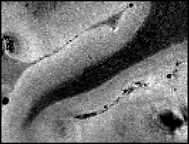 | 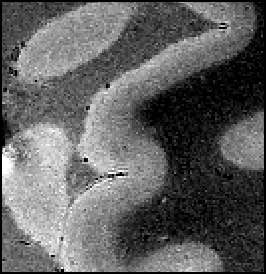 | 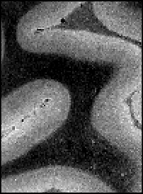 |
| MRI with the line | 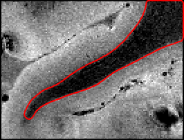 | 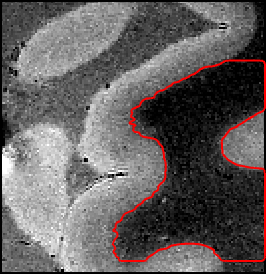 | 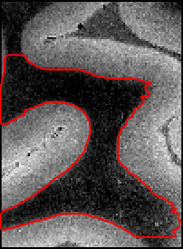 |
| OCT, reference | 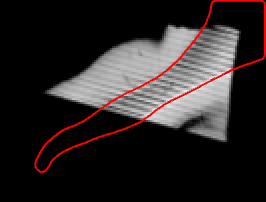 | 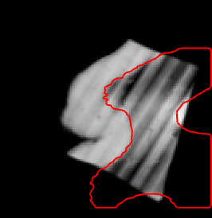 | 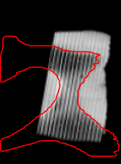 |
| OCT, octreg |  | 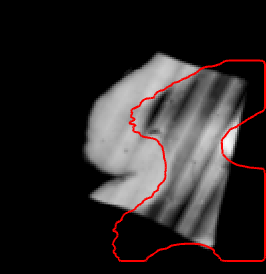 | 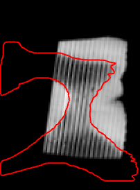 |
| OCT, NiftyReg reg_aladin | 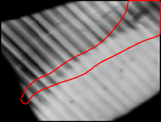 | 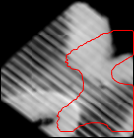 | 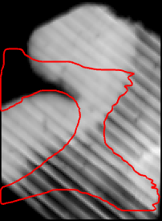 |
| OCT, greedy |  | 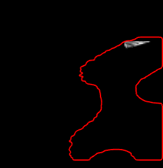 | 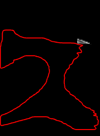 |
| OCT, ANTs | 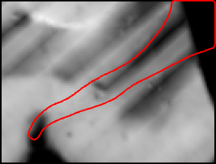 | 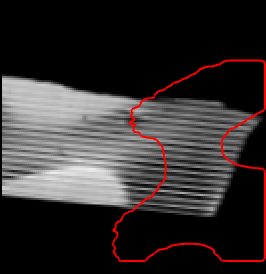 | 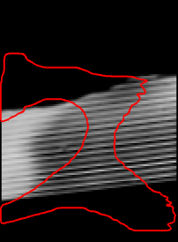 |
| OCT, mri_robust_register | 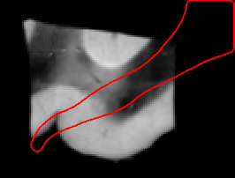 | 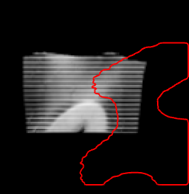 | 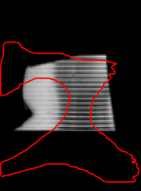 |
| OCT, mri_coreg | 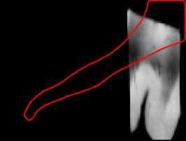 | 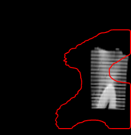 | 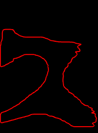 |
| OCT, FLIRT |  |  |  |
| OCT, SynthMorph | 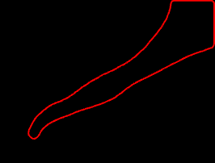 |  |  |
| OCT, FLIRT with its search over ±180° |  |  |  |
| OCT, ANTs from the antsAI start |  |  |  |
| OCT, greedy with its search |  | 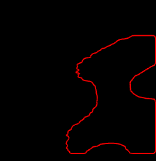 |  |

The crop with the median distance under octreg in every condition, axial plane:

| condition | MRI with the line | OCT, reference | OCT, octreg |
|---|---|---|---|
| 10° FLASH, 3 mm margin, k0 |  |  |  |
| 20° FLASH, 3 mm margin, k7 | 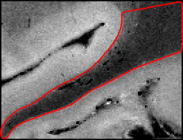 | 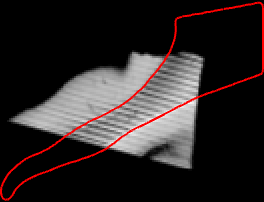 | 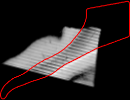 |
| 30° FLASH, 3 mm margin, k2 | 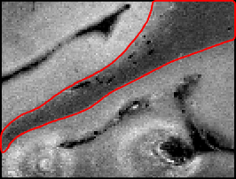 |  | 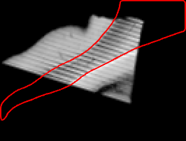 |
| 10° FLASH, 6 mm margin, k3 | 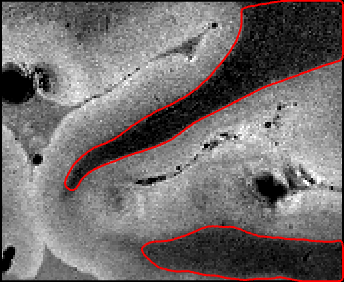 | 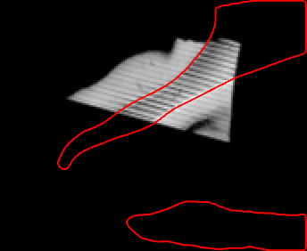 | 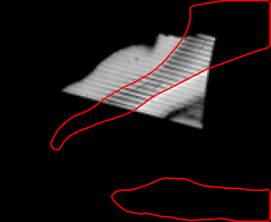 |
| 10° FLASH, 12 mm margin, k1 | 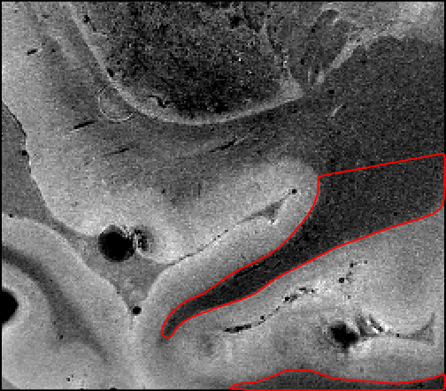 | 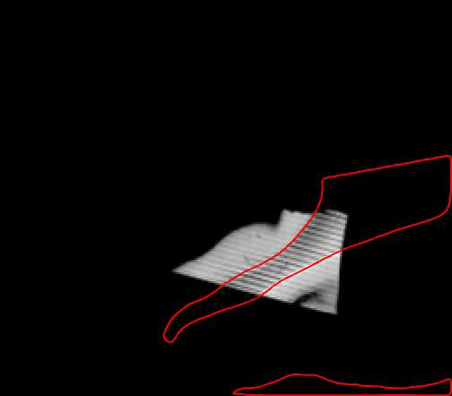 | 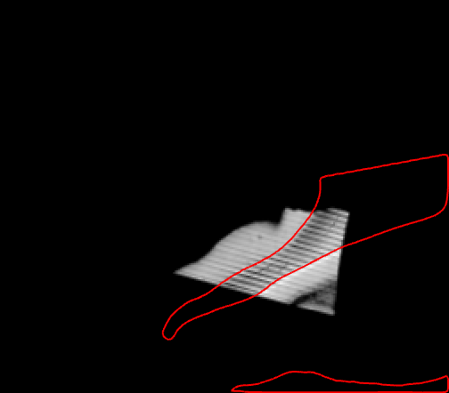 |
| 10° FLASH, 3 mm margin, without --oct-mask, k6 | 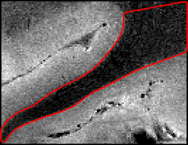 |  | 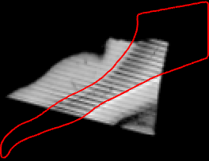 |

The same crop in three planes of the OCT itself (`enface/`):

| OCT plane | OCT | OCT with the line through R | OCT with the line through octreg | MRI through R | MRI through octreg |
|---|---|---|---|---|---|
| 102 |  |  |  |  |  |
| 300 |  |  |  |  |  |
| 498 |  |  |  |  |  |

The same crop in three planes of the OCT itself, the way Costantini et al. show their OCT: OCT planes 102, 300 and 498, each
three planes below the top of its section, 14.7 × 15.2 mm at 48 µm (a 4 × 4 average of the 12 µm OCT). From left: the OCT, the
OCT with the white-matter label of the authors' MRI labels resampled through R and through octreg as a red outline, and the MRI
crop resampled through R and through octreg. The grey levels are linear, at freeview's default window of each OCT plane and of
the crop.

Every crop of the 10° FLASH with a 3 mm margin, axial plane:

| k | MRI with the line | OCT, reference | OCT, octreg |
|---|---|---|---|
| 0 |  |  | 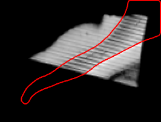 |
| 1 | 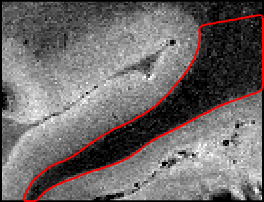 | 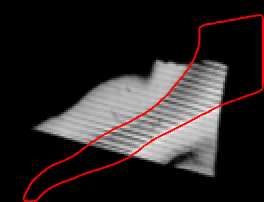 | 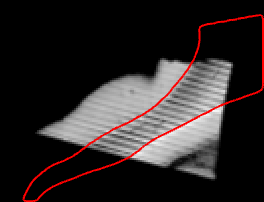 |
| 2 | 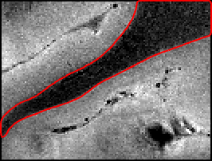 | 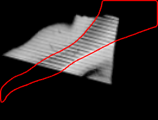 | 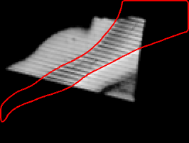 |
| 3 | 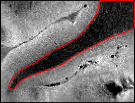 | 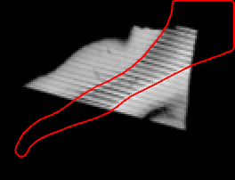 | 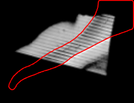 |
| 4 |  |  |  |
| 5 |  |  |  |
| 6 |  |  |  |
| 7 |  |  |  |
| 8 |  |  |  |
| 9 |  |  |  |

## Running

```
export OCTREG_DANDI000026_DIR=/path/to/dandi-000026          # bench/paths.py gives the other roots
bash bench/i46/fetch.sh                                       # about 11 GB, needs the DANDI client (pip install dandi) and curl
python bench/i46/prepare.py                                   # inputs and crops -> crops.json, context.json
python bench/i46/reference_check.py                           # the checks of the reference and L -> reference_check.json
python bench/i46/run.py                                       # 60 octreg runs, one at a time, scored -> octreg.json
python bench/i46/baselines.py prepare                         # and with --search, --mask or --near for the other analyses
bash "${OCTREG_PROJECT_ROOT:-.}/bench_runs/I46/baselines/queue.sh"   # baselines_search, _mask, _near/queue.sh for those
python bench/i46/baselines.py collect                         # -> baselines.json (--search, --mask, --near: baselines_*.json)
python bench/i46/analyses.py ablate                           # the ablation and the start test
python bench/i46/analyses.py choices                          # the design choices
python bench/i46/analyses.py collect                          # -> ablation.json, starts.json, choices.json
python bench/i46/analyses.py near                             # octreg without its search from the start near R -> near.json
python bench/i46/summarize.py                                 # -> tables.md
python bench/i46/figures.py                                   # -> docs/figures/i46
```

The stored times of the `--mask` and `--near` runs come from up to six tool runs at a time on 24 cores, and those of the
declared runs from one at a time, so times from different queues do not compare. `python bench/i46/run.py collect --runs DIR -o
FILE` scores an existing folder of octreg runs without running anything. The standard tools and FreeSurfer run as described in
[bench/baselines/INSTALL.md](../baselines/INSTALL.md). On Windows the commands run in Git Bash, and the scripts start the Linux
tools in WSL. Elsewhere they run in the same shell. The run directories hold image data and stay under `<project
root>/bench_runs/I46`, which is not in the repository.

## Stored results

| file in `bench/results/I46` | content |
|---|---|
| `octreg.json` | one entry per octreg run: version and Params hash, distances from R and L, §4 distances, vessel check, scores of the pose, search rank, flags, time |
| `baselines.json`, `baselines_search.json` | one entry per standard-tool run at the declared setting and with the tool's own search: distances, vessel check, convention check on the k = 0 crops, time, or the tool error |
| `baselines_mask.json`, `baselines_near.json` | the same for the tools with the OCT tissue as moving mask, and for the tools started from the header alignment with the start near R in the moving header, with the distance of that start |
| `near.json` | octreg without its orientation search from the start near R: distances from R and L, §4 distances, vessel check, the distance of the start, time |
| `starts.json`, `ablation.json`, `choices.json` | the start test, the ablation and the design choices of `analyses.py` |
| `reference_check.json` | the checks of the reference: the lattice steps, its frame, the label-only fits L (stored under the key A12, the 12-parameter fit, not the ablation variant A12) and S9 with their split halves and the global search, and the vessel check at R and shifted |
| `crops.json` | the box, shift and centre offset of every crop |
| `context.json` | the reference's determinant, singular values and vessel check, the number of tissue points, the grey/white contrast of each MRI image, and the share of non-zero OCT outside the specimen |
| `tables.md` | the tables of `summarize.py` |
