# Test on DANDI:000026 sub-I46

These scripts run octreg and eight standard registration tools on the OCT block and the MRI of Costantini et al. (2023), "A
cellular resolution atlas of Broca's area" (Science Advances 9:eadg3844, [doi
10.1126/sciadv.adg3844](https://doi.org/10.1126/sciadv.adg3844)), the work octreg extends. The data are public in
[DANDI:000026](https://dandiarchive.org/dandiset/000026/draft) ("Human brain cell census for BA 44/45", CC BY 4.0), and the
authors' own OCT→MRI affine, from their code repository, is the reference R. octreg was developed on the I58 block and checked
on these data during its development, so this is not a held-out test. The results are in
[bench/results/I46/tables.md](../results/I46/tables.md).

## Why this case, and its limits

Costantini et al. scanned one fixed human hemisphere with 7 T MRI at 0.15 mm, cut out a block holding Broca's area, imaged it
with serial-sectioning OCT and registered the MRI to the OCT with an affine transform, the task octreg performs. Their data and
registration code for sample I46 ([github.com/neuroscales/biccn-broca-I46](https://github.com/neuroscales/biccn-broca-I46)) give
an expert OCT→MRI affine on adult human cortex to measure against. It is one block of one specimen, so the test measures how
octreg copes with the placement of the MRI crop and with the MRI contrast, not how it generalises to other specimens.

## Data

| what | DANDI path | content |
|---|---|---|
| OCT | `sub-I46/ses-OCT/micr/sub-I46_ses-OCT_sample-BrocaAreaS01_OCT.ome.tiff` | 627 × 1271 × 1230 (plane, y, x), uint8, 12 µm in the plane: a block of about 14.8 × 15.3 mm, 9.5 mm deep |
| OCT vessels | `derivatives/sub-I46/ses-OCT/vessel/ves_seg.tif` | the dataset's vessel segmentation of OCT planes 0 to 560 |
| MRI | `derivatives/EPIC/sub-I46/ses-MRI/anat/sub-I46_ses-MRI_flip-{1,2,3}_VFA.nii.gz` | 7 T FLASH, flip angles 10°, 20° and 30°, 0.15 mm |
| T1 map | `derivatives/EPIC/sub-I46/ses-MRI/anat/sub-I46_T1map.nii.gz` | the T1 map of the three FLASH images (flip angles 10°, 20° and 30° in its JSON sidecar), used only to compare contrasts |
| labels | `derivatives/Labels/sub-I46/ses-MRI/anat/sub-I46_ses-MRI_space-EPIC_label-{vessels,infrasupra}_dseg.nii.gz` | manual MRI labels: vessels (255), white matter (1), infragranular (2) and supragranular (3) cortex |

The authors' registration files come from their repository at commit `b36e398cc42db4ca89ecc121818255bd96fc67ad`:
`results/mri2oct/affine.lta`, `results/mri/recon2raw.lta` and the OCT→LSFM fields `results/oct2lsfm/svf.08.nii.gz` to
`svf.23.nii.gz`. `fetch.sh` downloads everything into `sub-I46/oct`, `sub-I46/mri`, `sub-I46/labels` and
`sub-I46/costantini_repo/results` of `OCTREG_DANDI000026_DIR`.

The 20° FLASH, the T1 map and the labels carry a header that is a 120° rotation (a cyclic permutation of the axes) of the same
voxel grid as the 10° and 30° FLASH. Their arrays are voxel aligned with the 10° FLASH, and every file here is read with the
header of the 10° FLASH (flip-1).

## Reference

R is the authors' affine `A` (their OCT world to their MRI recon world, in the convention of their nitorch code), composed with
`recon2raw` (MRI recon world to the world of the flip-1 header) and with the authors' OCT header, so that it maps the OCT world
of the test to the MRI world. The authors fitted it as one affine for the whole block, with a local intensity correlation inside
an OCT mask, a Dice of grey- and white-matter segmentations and a distance between vessel segmentations
(`scripts/registration/mri2oct_affine.sh` of their repository). Their OCT header is not published. `common.py` rebuilds it from
the OCT→LSFM fields, one per 500 µm slab of 33 OCT planes, whose lattices give the depth axis, the in-plane axes and the
position of the block. The data fix the two choices this leaves open (`reference_check.py`,
[reference_check.json](../results/I46/reference_check.json)). The orientation (the sign of the depth axis, and the order and
signs of the in-plane axes) is the one under which the OCT intensity correlates best with the MRI, 0.39 with the 20° FLASH
against at most 0.19 for any other orientation. The placement of the slabs (slab 08 on OCT planes 0 to 32) is the one under
which the most OCT vessels lie within 0.15 mm of an MRI vessel label, 15.8 % against at most 5.9 % for any other choice.

R is an expert registration, not ground truth. An affine fitted to the OCT vessels and the MRI vessel labels alone
(`labelfit.py`), called L here, lies 0.155 mm (mean) from R, p95 0.31 mm, so distances below about 0.3 mm are not interpreted.

## Inputs and protocol

- **OCT.** The OME-TIFF as released, in its array frame, (x, y, z) = TIFF (x, y, plane), with spacing 0.012, 0.012 and
  0.01515 mm. The depth spacing is the 500 µm slab divided by its 33 planes. The dataset's metadata give 12 µm on every axis,
  and R scales the axes of this frame to 12.46, 11.82 and 14.48 µm ([reference_check.json](../results/I46/reference_check.json),
  `labels`). The block was embedded in agarose, which the 8-bit OCT shows mostly as zero. Of the 2 × 2 × 2 voxel blocks more
  than 0.3 mm outside the specimen mask below, 32 % are not zero (context.json). Every method gets this OCT.
- **Specimen mask.** `octmask_24um.nii.gz`, one voxel per 2 × 2 × 2 OCT voxels, with its header in the OCT world above. It is
  made from the OCT alone by `python bench/i46/prepare.py --mask`: a threshold at 40 of the 2 × 2 × 2 means smoothed by a
  3 × 3 × 3 box filter, then morphology, hole filling and the largest component. It leaves out the first six and the last nine
  OCT planes (91 and 136 µm). It gives the tissue points of the metrics, and octreg (`--oct-mask`) and the tools
  (`baselines.py --mask`) get it as a mask in further runs below.
- **MRI.** The three FLASH images, each with the flip-1 header. The primary image is the 10° FLASH, the one with the strongest
  grey/white contrast measured with the authors' layer labels (context.json).
- **Crops.** octreg expects the MRI cropped around the block. Each crop is an axis-aligned box on the MRI voxel grid around the
  0.5 and 99.5 percentiles of the OCT tissue placed by R, with a margin m on every face and a seeded random shift of up to s mm
  per axis (numpy `default_rng(4600 + k)`), so the block is not centred:
  - **C3:** m = 3 mm, s = 2 mm, the main condition, on all three FLASH images.
  - **C6:** m = 6 mm, s = 5 mm, on the 10° FLASH.
  - **C12:** m = 12 mm, s = 10 mm, on the 10° FLASH.
  - Ten crops per condition, k = 0 to 9. The shift of crop k has the same direction in C3, C6 and C12.
- **octreg.** Version 3.2.0 at its default parameters, `octreg register OCT CROP -o RUN` on every crop, with its own masks (50
  runs). The C3 crops of the 10° FLASH also run with `--oct-mask` and the specimen mask (10 runs).
- **Standard tools.** One setting each, taken from the tool's documentation, with no tuning and no mask: NiftyReg reg_aladin
  with its defaults (image-centre start), greedy (NMI, rigid then affine, `-ia-image-centers`), elastix (the model-zoo rigid and
  affine files, Mattes mutual information, geometric-centre start), ANTs `antsRegistrationSyN.sh -t a` (Mattes MI, its own
  centre-of-mass start), FreeSurfer mri_robust_register (`--cost NMI`, rigid then `--affine`, its default start) and mri_coreg
  (`--dof 6` then 12, its brute-force start), FSL FLIRT (normmi, dof 6 then 12, its default search, both headers scaled x10,
  because its schedule resamples the images to fixed voxel sizes in mm) and SynthMorph (`-m affine`, which works in its own 1 mm
  space). The moving image is the OCT box-averaged to 0.15 mm, the fixed image the crop. Every tool runs on the C3 crops k = 0
  to 9 of the 10° FLASH and on the C3 k = 0 crops of the 20° and 30° FLASH. The commands are in
  [bench/baselines/standard_tools.py](../baselines/standard_tools.py). A run that ends without a readable transform counts as a
  tool error.
- **Start test and ablation** (`analyses.py`). octreg, with its own masks, starts from the OCT turned by 90° and 180° about each
  array axis and by 10 rotations drawn uniformly on SO(3) (scipy `Rotation.random`, seed 4646), on the C3 crop k = 0 of the 10°
  FLASH (flip1_C3_k0). The variants of `bench/ablate.py` run with octreg's own masks on the C3 crops of the 10° FLASH, except
  the variants of the outline, which are shown on I58. The MRI of these crops is all tissue, so the outline is not used and its
  variants equal the method.
- **Further tool runs** on the C3 crops of the 10° FLASH (`baselines.py --search`, `--mask` and `--near`): the three tools that
  have a global rotation search, with that search on (FLIRT `-searchrx/ry/rz -180 180`, ANTs antsAI before the same script,
  greedy `-search 1000 any 20`), the tools whose options take a mask of the moving image, with the specimen mask as that mask,
  and every tool from a start near R. That start is R turned by 10° about a random axis through the centre of the OCT tissue and
  shifted by 1 mm (numpy `default_rng(4700 + k)`). A NIfTI qform cannot hold the shear of R, so the tools get the pose with a
  rotation and a scale per axis closest to that start over the tissue points as the header of the moving image, with the option
  that starts from the header alignment.

## Metrics

Every estimate T is compared with R. Both map the OCT world to the MRI world.

- **Distance from R:** |T x − R x| over the OCT tissue points, reported as mean, median, p95 and maximum, with the rotation
  angle and axis of T R⁻¹. The points are the specimen mask on a grid of every eighth OCT voxel (96 × 96 × 121 µm), 843,465
  points (context.json). The mean distance from L is given beside it.
- **Tiers:** a mean distance up to 0.30 mm (the precision of the reference) and up to 1 mm.
- **Counts:** each condition gives counts over its ten crops, shifted boxes around the same block. Medians are over all runs of
  a row, a run without a transform counted as beyond every other.
- **Vessels:** the MRI vessel labels that T places in the OCT tissue, at least 0.15 mm from its edge and within the segmented
  planes 0 to 560, and their distance to the nearest OCT vessel of the dataset's segmentation, median over the labels. The
  vessels are independent of what octreg fits, while R was fitted partly to them.

## Results

[tables.md](../results/I46/tables.md) gives every number. In brief:

- **octreg** with its own masks comes within 1 mm of R in all 50 runs and within 0.30 mm in none, 0.32 to 0.37 mm from R and
  0.35 to 0.44 mm from L, each turned by 2.9° to 4.0° from R about an axis that differs between the contrasts. With the test's
  specimen mask as `--oct-mask` it comes within 1 mm in all 10 runs, 0.37 mm from R.
- **Starts:** on flip1_C3_k0, from the 16 turned and random starts, octreg ends 0.35 to 0.37 mm from R every time.
- **The standard tools** come within 1 mm in none of their 96 runs at their documented settings. The pose before any
  registration, the header orientation with the image box centres aligned, is 7.0 mm (median) and 122° from R, and
  most runs end turned by about as much (median 120°). With their own global search the three tools end 14 to 26 mm away in all
  30 runs. With the test's specimen mask as their moving mask none of the seven tools that take one comes within 1 mm: elastix
  ends without a transform on every crop, and reg_aladin ends where it does without the mask, since NiftyReg 2.1.2 does not use
  that mask.
- **Start near R:** from a start 1.14 to 1.20 mm and 9.7° to 10.4° from R, ANTs comes within 1 mm on seven crops (median over
  the ten crops 0.84 mm) and the other tools on none.
- **Ablation** on the 10° FLASH with a 3 mm margin: without the orientation search no crop comes within 1 mm, with signed
  normalised gradients, with or without the OCT intensities negated, none does, without the refinement 3 of the 10 crops end
  beyond 1 mm, and with the search gradients taken over octreg's whole specimen mask 2 do. Without the scale and shear prior
  every crop comes within 1 mm, 0.47 mm (median) from R.

## Pictures

`figures.py` shows the crop at the lower median of the ten distances under octreg (10° FLASH, 3 mm margin, k = 8) in the OCT's
own planes, the way Costantini et al. show their OCT: planes 102, 300 and 498 of the released OCT (12 µm in the plane), each
three planes below the top of its slab, 14.76 × 15.25 mm at one screen pixel per two OCT voxels. The red line is the
white-matter boundary of the authors' manual MRI labels, made a surface by mri_mc and mris_smooth -n 3 -nw. lta_convert writes
each transform as an LTA file, and freeview moves the surface and resamples the MRI through it (nearest neighbour, its
default). Outside the OCT tissue the line continues through the MRI, and where the white matter reaches the edge of the crop
it runs along that edge. The grey levels are linear, at freeview's default window of the OCT and of the crop
([figures.json](../../docs/figures/i46/figures.json)).

From left: the OCT, the OCT with the line placed through R and through octreg, and the MRI crop placed through R and through
octreg. On every plane the line through octreg follows the line through R, a little lower where it crosses the left half of the
tissue on planes 102 and 300 and the middle of the tissue on plane 498. Across the upper left corner of the tissue on planes 102
and 300 it cuts off a smaller part. The white matter is dark in the MRI panels.

| OCT plane | OCT | OCT with the line through R | OCT with the line through octreg | MRI through R | MRI through octreg |
|---|---|---|---|---|---|
| 102 | 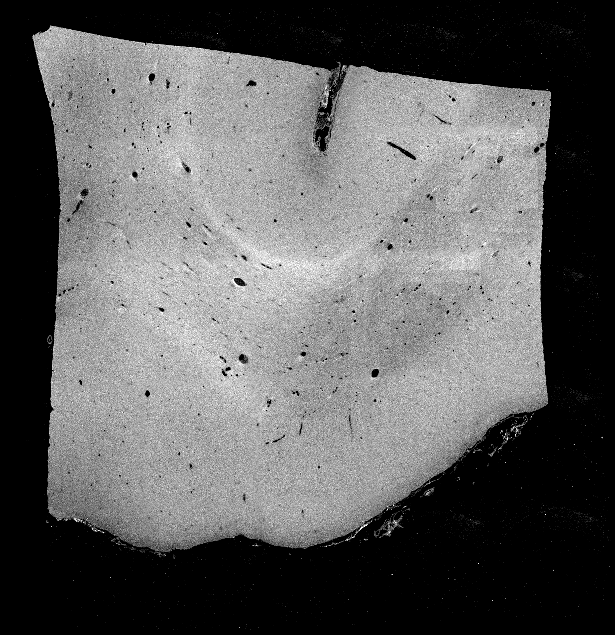 | 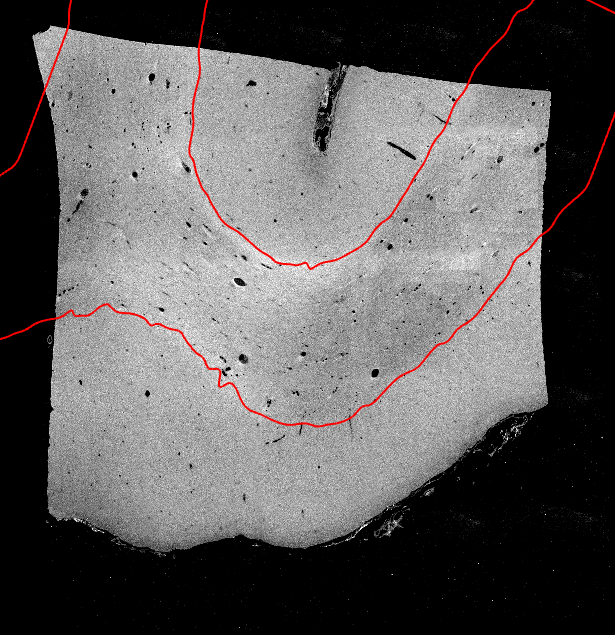 | 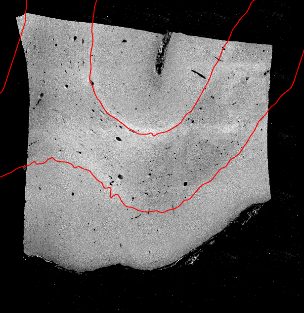 | 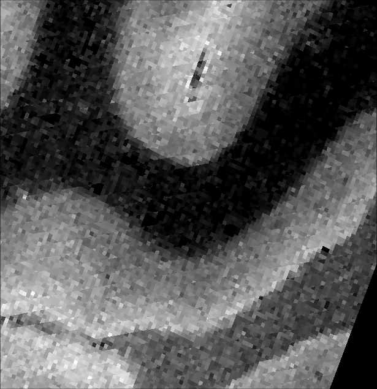 | 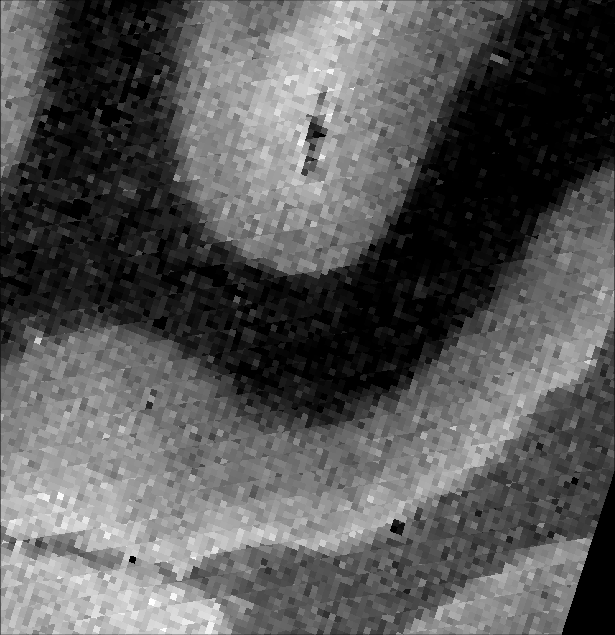 |
| 300 |  | 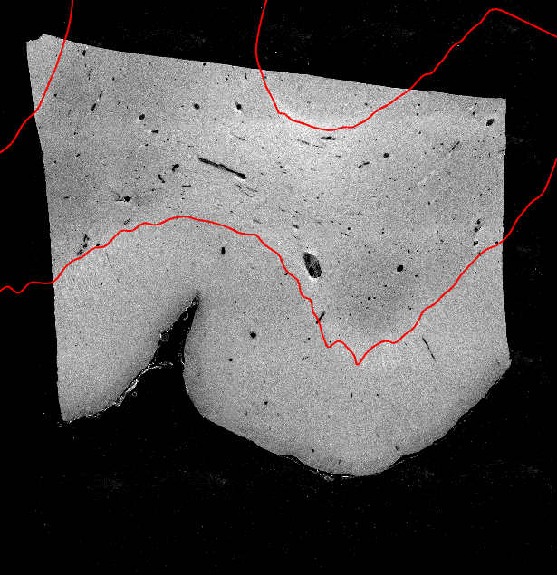 | 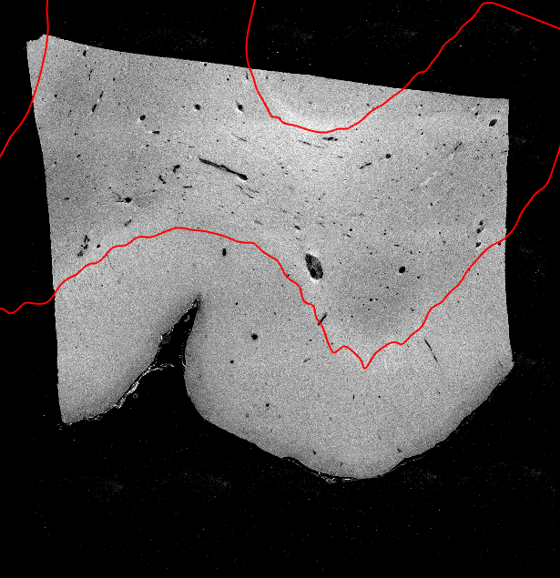 | 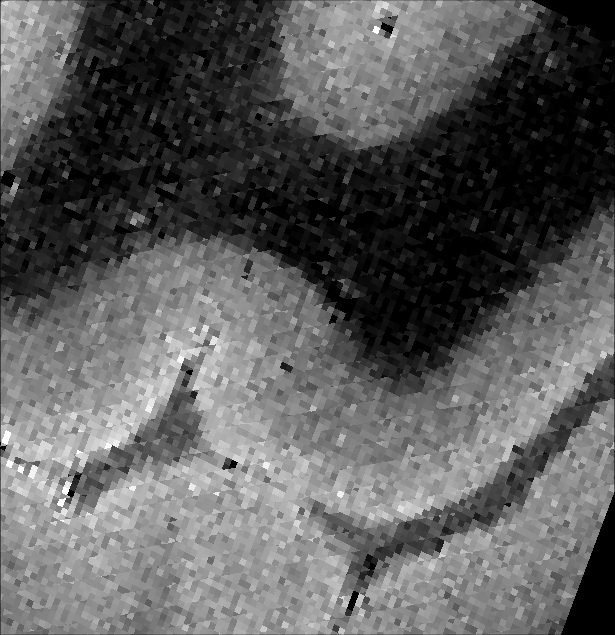 | 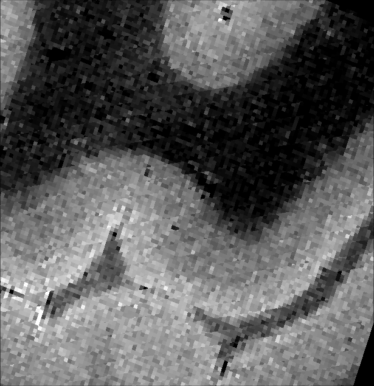 |
| 498 | 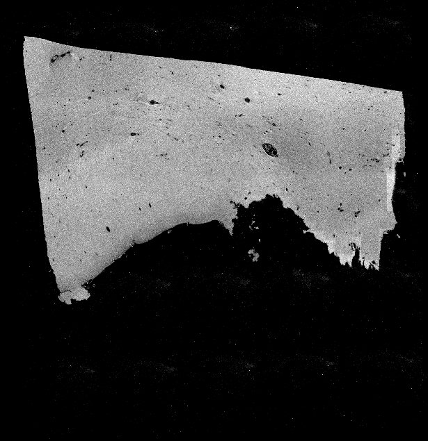 | 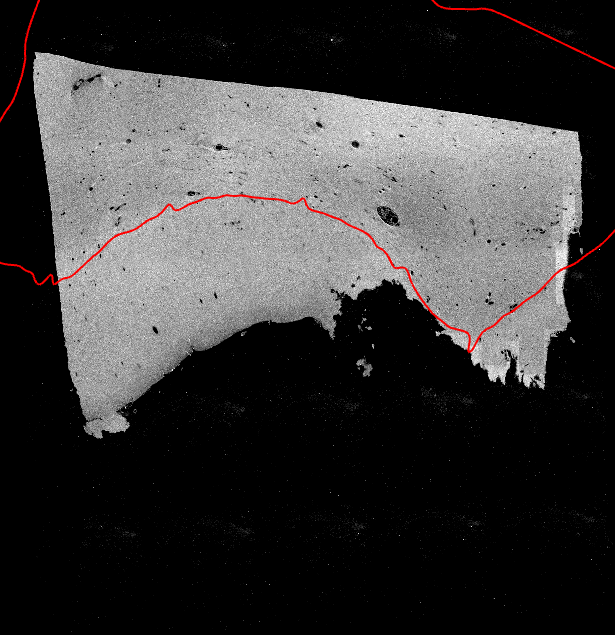 | 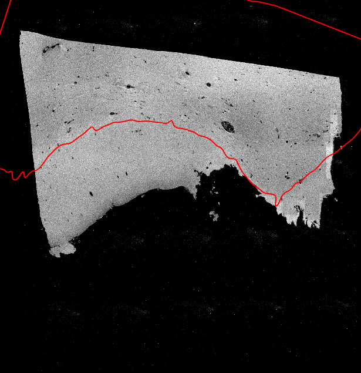 | 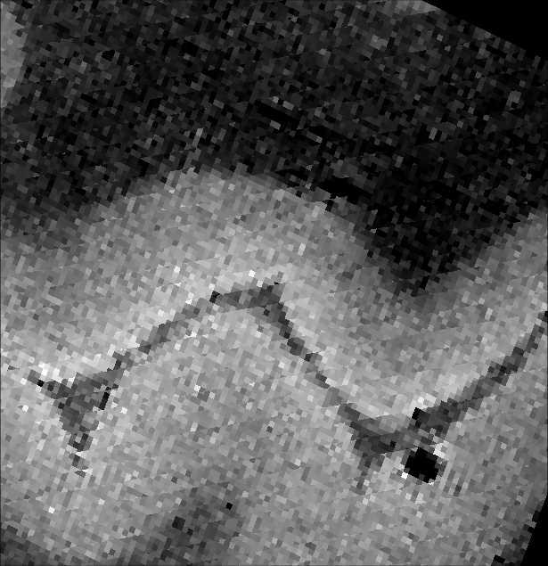 | 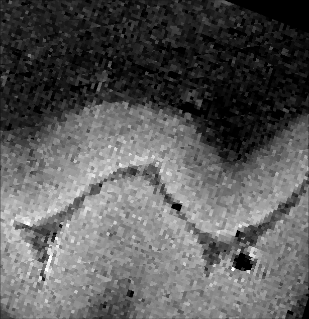 |

OCT plane 300 with the line placed through R, through octreg, through each standard tool at its documented setting and through
FLIRT, ANTs and greedy with their own search. The lines through reg_aladin and elastix run diagonally down across the tissue to
its lower edge, the first from its top near the upper right corner, the second from its right side. Outside the tissue the line
through reg_aladin turns back and crosses the bottom of the tissue in a short arc. The line through mri_robust_register crosses
the left part of the tissue in one straight horizontal and one straight vertical stretch. The line through ANTs runs outside the
tissue along its lower right edge, and the line through mri_coreg cuts the upper right corner of the tissue and runs outside
along its right side and lower right edge. For greedy, FLIRT, SynthMorph and the three searches the boundary does not cross this
plane inside the OCT field of view, so their panels show no line.

| R | octreg | NiftyReg reg_aladin | greedy | ANTs |
|---|---|---|---|---|
|  |  | 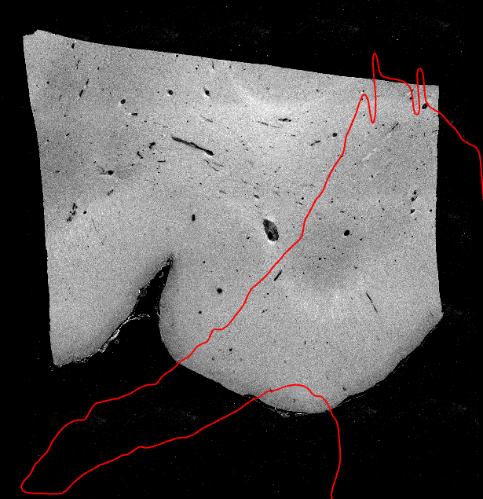 |  | 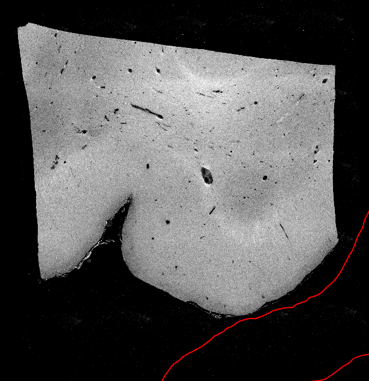 |
| **mri_robust_register** | **mri_coreg** | **FLIRT** | **SynthMorph** | **elastix** |
| 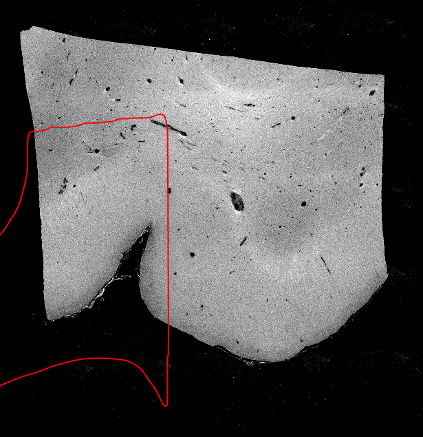 | 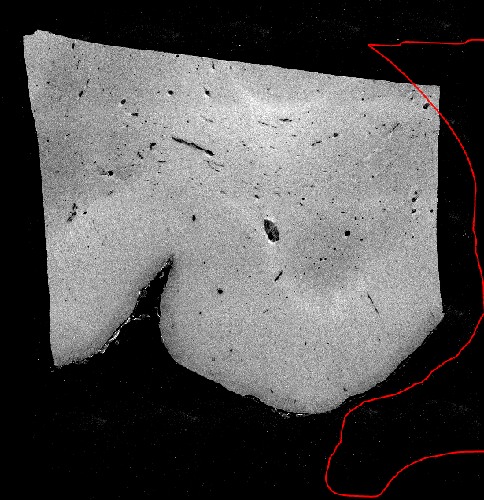 |  |  | 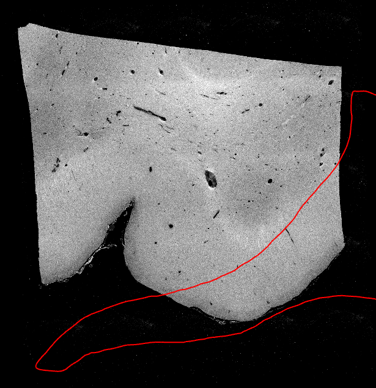 |
| **FLIRT, its search over ±180°** | **ANTs, antsAI start** | **greedy, its search** |  |  |
| 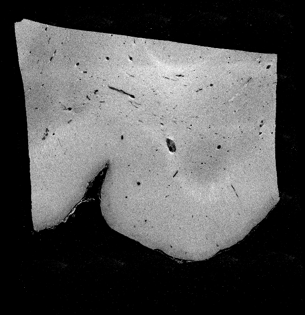 |  |  |  |  |

## Running

```
export OCTREG_DANDI000026_DIR=/path/to/dandi-000026          # bench/paths.py gives the other roots
bash bench/i46/fetch.sh                                       # needs the DANDI client (pip install dandi) and curl
python bench/i46/prepare.py                                   # inputs and crops -> crops.json, context.json
python bench/i46/prepare.py --mask                            # the specimen mask octmask_24um.nii.gz, as committed
python bench/i46/reference_check.py                           # the checks of the reference and L -> reference_check.json
python bench/i46/run.py                                       # 60 octreg runs, one at a time, scored -> octreg.json
python bench/i46/baselines.py prepare                         # and with --search, --mask or --near for the other analyses
bash "${OCTREG_PROJECT_ROOT:-.}/bench_runs/I46/baselines/queue.sh"   # baselines_search, _mask, _near/queue.sh for those
python bench/i46/baselines.py collect                         # -> baselines.json (--search, --mask, --near: baselines_*.json)
python bench/i46/analyses.py ablate                           # the ablation
python bench/i46/analyses.py starts                           # the start test
python bench/i46/analyses.py collect                          # -> ablation.json, starts.json
python bench/i46/summarise.py                                 # -> tables.md
python bench/i46/figures.py                                   # -> docs/figures/i46
```

`python bench/i46/run.py collect --runs DIR -o FILE` scores a folder that holds the 60 runs, made by the checked-out octreg
code, without running anything. The standard tools and FreeSurfer run as described in
[bench/baselines/INSTALL.md](../baselines/INSTALL.md). On Windows the commands run in Git Bash, and the scripts start the Linux
tools in WSL. Elsewhere they run in the same shell. The run directories hold image data and stay under `<project
root>/bench_runs/I46`, which is not in the repository.

## Stored results

| file in `bench/results/I46` | content |
|---|---|
| `octreg.json` | one entry per octreg run, as `run.py` describes it: version and code, distances from R and L, the vessel check, the search rank and scores, the outside fractions and time |
| `baselines.json`, `baselines_search.json` | one entry per standard-tool run at the documented setting and with the tool's own search: distances and time, or the tool error |
| `baselines_mask.json`, `baselines_near.json` | the same for the tools with the specimen mask as moving mask, and for the tools started near R, with the distance of that start |
| `starts.json`, `ablation.json` | the start test and the ablation of `analyses.py` |
| `reference_check.json` | the checks of `reference_check.py`, with the label-only fit L under the key A12 (the 12-parameter affine of `labelfit.py`) |
| `crops.json` | the box, shift and centre offset of every crop |
| `context.json` | the number of tissue points, the grey/white contrast of each MRI image, and properties of the reference and the OCT |
| `tables.md` | the tables of `summarise.py` |
