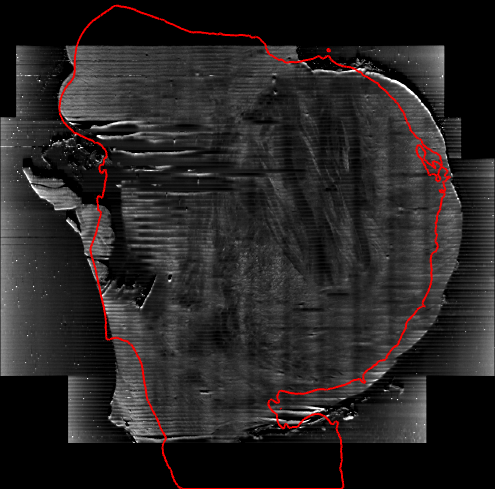
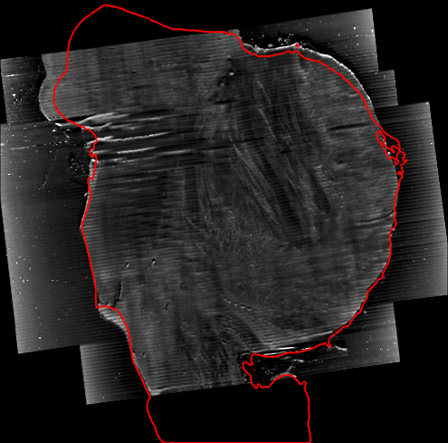
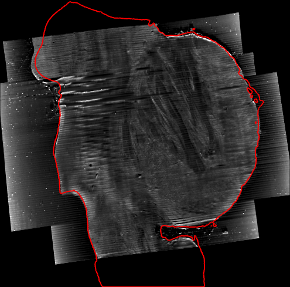

# octreg: method and evaluation

octreg registers an OCT volume of an embedded tissue block to an ex-vivo MRI cropped around it. §1 to §5 find an affine
transform, and §6 adds a small smooth deformation on top of it.

## Inputs and assumptions

The OCT is a scattering or intensity map of a block embedded in scatterer-doped agarose. It has section stripes along one array
axis, tile seams in the section plane and exact zeros where data are missing, and its contrast may be inverted relative to the
MRI. The MRI is an ex-vivo scan roughly cropped around the block. The crop should hold the whole block. It is the only position
prior, and it may hold tissue that is not in the block, for example beyond a face where the block was cut out of a larger
specimen. Both voxel sizes are taken as correct, so the true scales are close to 1. Inside the tissue the MRI must show the
OCT's two classes (§2), or the crop must be tight enough for the outline to fix the pose. In ex-vivo FLASH the grey/white
contrast depends on the flip angle and can vanish or invert between two angles, so the contrast given must show it. The MRI
medium must be darker than half the brightest tissue and the intensities free of an offset, otherwise its foreground is given
with `--mri-mask`.

The OCT and the MRI show the same specimen, so they differ by a proper rotation and never by a mirror image. The file frames fix
the handedness, and §3 searches proper rotations only. A TIFF or NPY stack, or a NIfTI file without sform and qform, is taken in
its array frame, which must then have the handedness of the specimen. The score of §2 cannot tell mirror images apart on a
nearly symmetric block (on I58 the best mirrored pose after §4 has the lower L, 0.7073 against 0.7287).

Transforms map millimetres in the world frame of the OCT file to that of the MRI file. The world frame is the NIfTI header frame
or, for TIFF and NPY, diag(spacing) on the axes (x, y, z) = numpy axes (2, 1, 0). The OCT is streamed plane by plane into a
0.04 mm fine grid, where the specimen mask is computed. Both volumes have a 0.15 mm base grid, for the OCT a box average of the
fine grid (masks kept above 0.5). All later steps use the base grid, except the search of §3, which runs on its 4³ box average,
a 0.6 mm grid.

## §1 Specimen mask

Doped agarose scatters about as strongly as tissue, but its structure is directional. A section stripe varies only along the
sectioning axis and a tile seam only across the seam, while tissue varies along every direction. The fine OCT is smoothed
(normalised Gaussian, σ 0.08 mm), the running coefficient of variation c_a is computed along each array axis over 0.36 mm, and
the texture field C = min_a c_a is averaged over 0.16 mm blocks. log C is smoothed (σ 1.2 mm), split by Otsu's threshold, closed
(0.48 mm) and reduced to its largest component. Uniform tissue such as a white-matter bundle leaves holes, and a hole that
reaches a cut face is not enclosed in 3-D, so holes are filled in every array plane. On I58 the specimen mask measures
19.24 cm³, against 29.52 cm³ for an intensity threshold (both on the base grid, intersected with the measured OCT). Smoothed at
σ 1.2 mm, the mask extends somewhat into the agarose around the specimen. The rule needs the agarose embedding (see Scope).

The MRI foreground threshold is the first histogram valley, walking down from the brightest peak, that lies below 0.5 of its
smaller neighbouring peak and whose darker peak lies below half the brightest peak (`medium_fraction`). The histogram has 256
bins over the positive values below their 99.5th percentile and is smoothed over 5 bins, and its peaks are found on the square
root of the counts, each with a prominence of at least 5 % of the largest and at least 5 bins from the next. The second
condition assumes that the medium lies below half the tissue intensity and that two tissue classes of one specimen differ by
less. The value 0.5 is the default fractional threshold of BET, which puts the brain edge halfway between a robust background
level and the local tissue intensity (Smith, Hum. Brain Mapp. 17:143, 2002). A deep valley between grey and white matter in a
crop without medium is then passed over (flag `mri_tissue_valley_passed`) and never taken as the edge of the tissue. On I46 the
darker peaks of the valleys passed over lie at 0.71 to 0.72 of the brightest peak, and one at 0.56
(bench/results/I46/octreg.json). Without such a valley the threshold is the lower of the 1st percentile and half the lower cut
of a three-class Otsu threshold, which keeps nearly the whole field of view, and the run is flagged `mri_foreground_no_valley`.
The mask is closed with a ball of 2 voxels, its holes are filled in 3-D and components below `min_component` of the foreground
volume are dropped. Either mask can be supplied as a file and then replaces the rule. A supplied OCT mask is still restricted to
the measured voxels.

## §2 Two-class maps and outline

OCT scattering and MRI intensity follow no fixed mapping, but in both the tissue falls into a brighter and a darker class. Each
volume I with foreground M is flattened: it is divided by its local foreground mean G(I M) / G(M) (Gaussian σ 10 mm) to give x.
x is blurred by one voxel as G(xM) / G(M), so that background and masked-out gaps do not bleed into tissue. With t the Otsu
threshold and s the standard deviation of the foreground values of x clipped at their 99.5th percentile, the two-class map is
p = sigmoid((x − t) / (0.25 s)).

The OCT enters as channels u = (p_O, 1 − p_O) with its specimen mask w as weight, the MRI as v = (p_M M, (1 − p_M) M). The class
structure alone is a weak signal, so the score also compares the outlines, w against M, over the measured OCT voxels q. The
outline is one-sided. OCT tissue has to lie on MRI tissue, but agarose over MRI tissue is no mismatch, since the crop can hold
tissue that is not in the block. The weight leaves that case out: q' = q (1 − (1 − w) E), with E = M inside the crop and 1
outside it.

    S_class = ½ [NCC_w(u_1, v_1) + NCC_w(u_2, v_2)],   S_outline = NCC_q'(w, M),   S = (2 |S_class| + S_outline) / 3.

The outline compares what lies outside the tissue in both images, so it is used only when both have a measured outside: OCT
voxels outside the specimen mask and MRI voxels outside the foreground, each eroded by one base voxel to remove the resampling
shell of a mask, must make up at least 1 % of the measured OCT and of the MRI grid. An OCT given as tissue only (zero outside
it, and its own `--oct-mask`) or an MRI crop that is all tissue has no outside, and the correlation would rest on a handful of
voxels. S_outline is then 0 in §3 and §4 and the run is flagged `outline_not_used`. The rule asks whether an outside exists, not
whether it is real: an OCT of tissue only, run without its mask, has an outside wherever the texture mask leaves tissue out, and
the outline then depends on the MRI alone. On I58 and I46 the decision is the same for any threshold from 0.04 % to 31.6 %.

S is the mean of the three correlations and has no weight to set. Without the outline S = 2 |S_class| / 3, so the prior of §4
weighs 1.5 times more against the data. Weighted covariance is linear and ignores constants, so NCC_w(1 − u, v) = −NCC_w(u, v).
Swapping the OCT classes negates S_class exactly and leaves S_outline unchanged. One correlation therefore scores both
contrasts, and the sign of S_class is the polarity (−1: inverted). The identity needs the OCT channels to sum to 1 wherever
w > 0, which is why the mask is a weight and never multiplies them. Standardised intensities (z, −z) in place of the two-class
maps end at the same affine on I58. On I46 their §4 pose lies farther from the authors' registration in all four conditions
where they were run, and after §5 their distance from it differs from the method's by at most 0.07 mm on any crop and 0.001 mm
in median (Ablations, and bench/i46).

## §3 Orientation search

The crop bounds the position, so no global search is needed. For each of 8,000 rotations sampled uniformly on SO(3), the OCT
template is rotated about its box centre and S is computed with FFTs over every translation that puts that centre inside the
crop, in a weighted form of the masked correlation of Padfield (IEEE Trans. Image Process. 21:2706, 2012). Since q' = q − b E
with b = q (1 − w), every sum of the outline NCC is a correlation of a template with E, M, M² or M³. Outside the crop, OCT
tissue counts as lying over background and agarose is left out. Each rotation keeps its best translation. Greedy non-maximum
suppression then drops a pose when a better pose already kept lies within 3 mm and 20°, and the best 24 that remain go to §4.
The 20° is set by hand. It is of the order of the critical distance of multi-level single linkage (Rinnooy Kan and Timmer, Math.
Program. 39:57, 1987), which starts a local search from a random sample point unless a better sample point lies within
r = π^(−1/2) [Γ(1 + n/2) m σ ln N / N]^(1/n). For N = 8,000 rotations of SO(3), with the rotation angle as distance (n = 3,
m = 8π²), r is 20° at σ = 2 and 25° at σ = 4, the value of their experiments. On I46, 10° keeps all 60 runs within 1 mm, at the
same median distance from the authors' registration, 0.40 mm (bench/i46).

## §4 Affine refinement

All 24 poses are refined on the base grid with their polarity fixed, since the search score does not settle their order:

    x_MRI = R(r) Sh(h) diag(exp(ℓ)) (x_OCT − c) + t,   L = 1 − S + λ (Σ ℓ_i² + Σ h_i²),   λ = 2,

with rotation vector r, shears h, log-scales ℓ and c the OCT box centre (Adam, 200 iterations, cosine schedule). The lowest L
wins. The penalty is the prior, and it is needed because S alone rewards distorting the block. Each ℓ_i and h_i is also clamped
to ±0.15. The clamp is a guard and not a parameter. With the penalty it is not reached on I58, and a run that reaches it is
flagged `clamp_saturated`.

## §5 Fine-structure refinement

The score of §2, dominated by the outline, finds the block, but an outline that carries a margin of agarose, or a cut face,
leaves the last millimetres open. The best pose of §4 is therefore refined on the internal structure of both volumes, such as
fibre bundles, vessels and nuclei, compared through the orientation of their gradients. Each volume I with mask m is smoothed
and differentiated inside the mask by normalised convolution, g = ∇(G_σ(I m) / G_σ(m)), so the mask edge adds no gradient. The
normalised gradient (Haber and Modersitzki, Methods Inf. Med. 46:292, 2007) is n = g / √(|g|² + ε²), with ε the median |g| of
each volume, over the MRI points used for the MRI and over the OCT specimen mask for the OCT. Both masks are eroded by five
steps of the 6-neighbourhood on the base grid (0.8 mm rounded to base voxels), which removes 0.75 mm along the array axes and
0.43 mm along their diagonals, so the outline counts mainly in §2 to §4. Over every second interior MRI voxel along
each axis, with the eroded OCT mask w,

    a(x) = P(n_O(x)),  b(x) = P(n_M(x)),  F(T) = Σ_x w ⟨a − ā, b − b̄⟩ / √(Σ_x w |a − ā|² · Σ_x w |b − b̄|²),   g_O(x) = A⁻ᵀ g_OCT(T⁻¹x),

with w = w(T⁻¹x), ā and b̄ the w-weighted means and A the linear part of T. P(n) = n nᵀ − |n|² I / 3 is the trace-free part of
the outer product n nᵀ, by which Knutsson (Proc. 6th Scand. Conf. Image Anal., 244, 1989) represents orientation, so that n and
−n give the same tensor. Then ⟨P(n), P(n′)⟩ = (n · n′)² − |n|² |n′|² / 3 compares the orientation of edges weighted by |n|²
|n′|². An inverted contrast flips the sign of a gradient and the tensor removes it, so F needs neither an intensity mapping nor
the polarity. F is the w-weighted correlation of the two tensor fields, the score of the §6 block matching taken over the whole
interior. Haber and Modersitzki score (n · n′)² = |n|² |n′|² cos² θ. With ε > 0, |n| grows with the gradient, and the gradient
of the OCT mapped through T grows when the block shrinks, so that score rewards a smaller block. The trace-free part leaves out
the term |n|² |n′|² / 3, centring leaves out the agreement of the mean orientations, and normalising makes F a correlation.
L = 1 − F + λ (Σ ℓ_i² + Σ h_i²) is minimised with Adam as in §4, from the §4 pose and under the same prior (λ = 2), with a fifth
of the learning rates of §4, in one pass of 150 iterations at each of σ = 0.6, 0.4 and 0.3 mm. Each pass keeps its lowest-L
iterate. At these scales section stripes a few tenths of a millimetre apart are smoothed away. §5 refines and does not search,
and it can lower S, whose outline and tissue classes are coarse.

## §6 Smooth deformation

The specimen deforms slightly between the MRI scan and the OCT embedding, and serial sectioning adds small distortions. After
the affine, local misfits of a fraction of a millimetre remain. §6 fits a small smooth displacement field on top of the affine.
The affine is the primary result. Every transform file holds it alone, and the field is written next to them.

The field u is a pull-back on the MRI base grid, in mm along the MRI world axes. The registered OCT at the MRI point x is
OCT(T⁻¹(x + u(x))). The OCT and its specimen mask are resampled onto the MRI base grid through T (mask kept above 0.99), and two
kinds of label-free evidence are measured there, interior matches and surface-edge offsets. Both have one reach, 1.35 mm. The
masks of §1 do not place the surface to a fraction of a millimetre, since the specimen mask is smoothed at σ 1.2 mm and the MRI
foreground is a threshold. §6 therefore reads the surface from the intensity of each volume.

Interior matches. MRI blocks of 4.5 mm, every 1.5 mm, with at least 70 % of the block inside both masks eroded by four steps of
the 6-neighbourhood (0.6 mm, 0.35 to 0.60 mm deep depending on the surface), are
searched in the OCT within ±1.35 mm per axis. The score is the zero-mean normalised cross-correlation of the trace-free part of
n nᵀ (six channels, `octreg.blockmatch`), with n = g / √(|g|² + ε²) as in §5 at σ 0.24 mm, ε the median |g| over the whole mask
of each volume. The Frobenius product of two such
tensors is (n · n′)² up to a term in the two magnitudes, so the block score is the local counterpart of F and also needs neither
an intensity mapping nor the polarity. A match counts when its peak stands 4 standard deviations above the mean of its score
map, off the border of the range, and its length is at most 1.35 mm. Each match gives a displacement at its block centre.

Surface-edge offsets. Up to 50,000 outermost voxels of the MRI foreground are sampled as boundary points, with outward normals ν
from the gradient of the smoothed signed distance to the surface (σ 2.5 voxels). Along each normal the intensity of each volume
is read from −2.1 to +2.1 mm, the reach and 0.75 mm beyond it, in base-grid steps, and differentiated with a Gaussian of
σ 1 sample. The surface edge is the steepest fall of the intensity going outwards. This assumes that in both volumes the tissue
at the surface is brighter than what surrounds it. In the MRI the tissue falls into background. In the OCT the surface carries a
bright rim, so the intensity falls going outwards into the agarose even where the bulk scatters alike, whatever the polarity of
the interior classes. A prominent fall is a local maximum of the fall more than 5 MADs above its median along the profile and
within ±1.35 mm, located to sub-sample precision by a parabola, which can carry it up to half a step beyond the reach. The
offset δ is the OCT edge minus the MRI edge along ν, and it constrains ν · u. The same rule finds both edges along the same
normal, so the place of the sampled voxels relative to the true surface cancels in the difference, and the bias of the rule
cancels where the two edges have a similar profile. A boundary point is used only when at
least 95 % of its OCT profile is measured and each profile has exactly one prominent fall. Faces crossed by section stripes show
several falls and mostly drop out, so the sectioning axis need not be known.

The edge is used and not the bright rim, because the rim is a layer below the surface. Its ridge lies inside the surface by half
the thickness of the layer, which differs from face to face, so taking the ridge for the surface reads an offset where there is
none.

Model. Displacements c on a control lattice of 5 mm spacing over the bounding box of the MRI grid, trilinear in between, are
fitted by regularised least squares. Each interior match gives three rows and each boundary point one row ν · u = δ, weighted by
√(3N / M) for N matches and M points so that both kinds carry the same total weight. A membrane penalty with weight λ acts on
the first differences of c along the lattice axes, and a small ridge penalty keeps lattice nodes without evidence determined.
The system is solved four times with Huber re-weighting at 0.3 mm on both kinds of residual.

Model choice. Only λ is chosen, and the strain limit sets it. The strain, the largest first difference of c divided by the
spacing, must stay below 0.15 for the field to remain plausible for fixed tissue. The strain falls as λ grows, so λ is the
smallest weight between 0.3 and 30 that keeps the limit, found by bisection in log λ to a factor of 1.05. This gives the most
flexible field the limit allows. The field is then accepted only when it predicts evidence it was not fitted to. Both kinds of
evidence are split into four spatial folds (cells of 7 mm, with no buffer, so the test measures interpolation). At the chosen λ
the field is fitted without one fold and tested on it, for each of the four folds. The held-out median error of the interior
matches plus that of the surface-edge offsets, over all folds, must fall below 0.9 times the same score without deformation. The
held-out error alone does not bound the field, since on I58 it still falls a little past the strain limit (the strain limit 0.20
row of `bench/results/I58/deform_ablation.md`). The limit therefore sets λ, and the held-out error only gates the field. A field
is also refused with fewer than 100 interior matches or 300 boundary points, or when no weight up to 30 keeps the limit.
Whenever a field is refused, the run is flagged `deformation_not_supported` and no field is written.

The evidence is measured and the field fitted once. Both kinds of evidence are then measured again on the warped OCT, the
interior matches over every confident match before the length cut and the surface-edge offsets over every boundary point with
one edge. These residuals are the read-outs of the stage.

The field is written as oct2mri_warp.nii.gz, the read-outs go to result.json under `deform`, and [README](../README.md#outputs)
lists the outputs. The field is not inverted, so the MRI to OCT direction is affine only.

## Evaluation

A registration is judged by looking at it, because label-free numbers can prefer a wrong pose. qc_montage.png shows four planes
per OCT axis, each as the OCT, the MRI through the affine on the grey scale of the OCT, a checkerboard of the two over
everything the specimen mask or the MRI foreground reaches, and the OCT with both outlines. In every plane the MRI outline must
follow the edge of the OCT specimen, the specimen must lie on the same anatomy in the MRI, and internal structures must continue
across the checkerboard. Folded pieces, and cut faces that the MRI also shows, must correspond and lie on the same side, and the
contrast must be consistently inverted or not. `octreg qc --T` renders other candidate transforms for comparison.

### I58 brainstem pair

The OCT has 1457×2013×1595 voxels at 20 µm and the MRI crop 343×489×495 voxels at 0.08 mm. The run takes 10 min 46 s on the
original files with 5.2 GiB of RAM and 1.6 GiB of GPU memory allocated by torch (RTX 5090, Windows). Of this, §3 takes 31 s, §4
316 s, §5 5 s and §6 21 s. §1 to §4 give S 0.2781 (S_class −0.1020, S_outline 0.6302) and polarity −1. §5 moves the OCT by
3.84 mm at the corners of its image (2.04 mm over the specimen mask, 9.1°), to scales 0.993 / 0.964 / 0.980. A frame check
confirms that the exported overlay follows the header and the transform. Raw 20 µm OCT values mapped through the header and the
transform correlate with the affine overlay at Spearman 0.991, against at most 0.268 with any OCT axis flipped.

§6 finds 510 interior matches and 18,792 boundary points and takes λ 0.82 at strain 0.150. Its own read-outs follow. The
held-out median errors fall from 0.240 to 0.165 mm for the interior matches and from 0.311 to 0.120 mm for the surface-edge
offsets. Re-measured on the warped OCT, the median residual of the interior matches falls from 0.244 to 0.117 mm and that of the
surface-edge offsets from 0.311 to 0.089 mm, and the offsets within 0.3 mm rise from 49 % to 81 %. Over the MRI foreground the
field has a median of 0.25 mm and a maximum of 1.22 mm. The surface-edge offsets are largest at the superior end of the block.
In 4 mm slabs along the sectioning axis, the median surface-edge offset falls from 0.87 to 0.19 mm in the first slab at that end
and from 0.77 to 0.18 mm in the next. In each of the other slabs it falls from between 0.15 and 0.50 mm to between 0.05 and
0.14 mm. These values per slab are stored in `bench/results/I58/deform_ablation.json`. §6 looks for interior matches and surface
edges only within the 1.35 mm reach, so it does not bring back tissue that lies farther than that from its MRI position.

The [README](../README.md#results-on-the-i58-brainstem-block) shows the result on three planes in freeview. The second and third
rows of the deformable comparison in [BASELINES.md](../bench/baselines/BASELINES.md#deformable) show the OCT through the affine
alone and through the affine and §6 on the three planes.

### Ablations

Each variant is the method with one element removed or replaced, run by `bench/ablate.py` on the same two files with everything
else unchanged. I58 has no reference, so the variants are shown and not scored: every panel is the sagittal plane of the README
figure in freeview, through the variant's own affine, the whole MRI crop at one pixel per MRI voxel (39.6 × 39.1 mm), with the
boundary of the MRI foreground in red and the OCT at the grey window of the moving image (0.00122 to 0.00553,
docs/figures/figures.json). Anterior is on the right and superior at the top. Where the red line runs beyond the OCT at the top
left and at the bottom, the MRI holds tissue beyond the cut faces at the two ends of the block. The table gives properties of
each affine that need no reference. On the data of Costantini et al. (2023), [bench/i46](../bench/i46/README.md#results) scores
every variant of this table except the intensity-threshold mask against their registration, and also standardised intensities in
place of the two-class maps and the two-sided outline.

| variant | step | scale per OCT axis | determinant | polarity |
|---|---|---|---|---|
| octreg, §1 to §5 |  | 0.99 / 0.96 / 0.98 | 0.94 | −1 |
| intensity-threshold mask instead of the texture mask | §1 | 1.01 / 1.00 / 1.00 | 1.01 | −1 |
| no outline term | §2 | 0.99 / 1.00 / 0.98 | 0.97 | −1 |
| the outline alone, no two-class term | §2 | 0.99 / 0.97 / 1.00 | 0.96 | +1 (no class term) |
| no orientation search, from the image centres | §3 | 0.99 / 0.96 / 0.98 | 0.94 | −1 |
| no scale and shear penalty | §4 | 0.86 / 0.86 / 0.90 | 0.66 | −1 |
| no fine-structure refinement | §5 | 0.99 / 0.96 / 0.97 | 0.92 | −1 |

| MRI | octreg, §1 to §5 | image centres aligned (start, no registration) |
|---|---|---|
|  |  |  |
| **intensity-threshold mask** | **no outline term** | **the outline alone** |
|  |  |  |
| **no orientation search** | **no scale and shear penalty** | **no fine-structure refinement** |
|  |  |  |

With the intensity-threshold mask or without the outline term, the section stripes, nearly level in the method's panel, slant,
and without the scale and shear penalty they stand upright in a smaller block. In all three the specimen no longer follows the
red line. The intensity threshold takes in more of the agarose (29.5 cm³ against 19.2 cm³ for the texture mask) and leaves the
measured OCT almost no outside, so the rule of §2 also turns the outline off (S_outline 0). Without the penalty, §4 shrinks the
block until all three log-scales sit at the clamp of −0.15, at a pose turned from the method's that scores higher than the
method's §4 pose (S 0.334 against 0.278). With the clamp widened to 1.0 as well, §4 reaches S 0.530, and after §5 the block ends
at a determinant of 0.14 with one log-scale at the widened clamp (A6 in bench/BENCHMARK.md), so S alone rewards distorting the
block. With the outline alone, §4 prefers a pose of higher outline score than the method's (S_outline 0.668 against 0.630) but
of nearly no class agreement (|S_class| 0.007 against 0.102), turned from it, and §5 then brings the block to a pose whose panel
looks like the method's. Without §5 the posterior surface of the OCT lies beyond the red line at mid-height and the inferior
notch does not meet the line. Without the orientation search, §4 and §5 from the image centres end at the method's affine, since
the header orientation of this pair is only 11° from it. Standardised intensities in place of the two-class maps and the
two-sided outline also end at the method's affine, so their panels are the method's.

The start test checks the method's consistency with itself. The OCT is turned by 90° and 180° about each of its array axes,
through the centre of its image box, and the method runs from each turned start. The table gives the distance of each start and
of each result from the method's result from the file orientation, the mean displacement over the specimen mask with the
rotation angle.

| start | the start | octreg |
|---|---|---|
| image centres, header orientation | 2.5 mm, 11° | 0.00 mm, 0.0° |
| turned 90° about OCT array axis 0 | 15.3 mm, 83° | 0.09 mm, 0.4° |
| turned 180° about OCT array axis 0 | 22.8 mm, 173° | 0.00 mm, 0.0° |
| turned 90° about OCT array axis 1 | 14.3 mm, 86° | 0.00 mm, 0.0° |
| turned 180° about OCT array axis 1 | 20.5 mm, 175° | 0.09 mm, 0.4° |
| turned 90° about OCT array axis 2 (the sectioning axis) | 15.2 mm, 98° | 0.00 mm, 0.0° |
| turned 180° about OCT array axis 2 (the sectioning axis) | 20.2 mm, 173° | 0.09 mm, 0.4° |

| turned 90° about the sectioning axis (start) | no orientation search | octreg |
|---|---|---|
|  |  |  |

From every turned start the method ends within 0.1 mm and 0.4° of its result from the file orientation, at one of two poses
0.09 mm apart, which is the precision of the stopping point of §5. The panels show the variant without the search from the start
turned by 90° about the sectioning axis, where the block stays turned. Scored against the registration of Costantini et al.,
the variant without the search comes within 1 mm from 4 of 26 turned and random starts (bench/i46).

The §6 variants fit the field at the method's affine to one kind of local evidence at a time, with λ chosen by the rule of the
method, the smallest weight between 0.3 and 30 that keeps the strain below 0.15. The table gives each field's own properties.

| variant | λ | strain | field median / max (mm) |
|---|---|---|---|
| no deformation (the method's affine) |  |  | 0 |
| octreg, §6 | 0.82 | 0.150 | 0.25 / 1.22 |
| interior matches only | 0.30 | 0.119 | 0.16 / 1.03 |
| surface-edge offsets only | 10.19 | 0.148 | 0.37 / 1.23 |

| MRI | no deformation (the method's affine) | octreg, §6 |
|---|---|---|
|  |  |  |
| **interior matches only** | **surface-edge offsets only** | |
|  |  | |

With the interior matches only, the bright rim of the OCT at the superior anterior surface lies outside the red line, as without
deformation. With the surface-edge offsets only, it lies on the line, as with §6. Inside the block the panels do not show a
difference between the variants. The read-outs of each variant, which are §6's own measurements and not a score, are in
bench/results/I58/deform_ablation.md.

[bench/BENCHMARK.md](../bench/BENCHMARK.md) lists each variant of §1 to §5 that `bench/ablate.py` runs with its own values, and
the start test, and [bench/results/I58/deform_ablation.md](../bench/results/I58/deform_ablation.md) every variant of §6, which
also cover the rim ridge in place of the edge, boundary points only near interior matches, no Huber re-weighting, coarser
lattices, other strain limits and longer reaches.

## Parameters

The constants of the method are fields of `octreg.params.Params` (override with `--params`). The I58 pair uses the defaults,
whose hash is `9148790ad6c39454`. The first ten rows state what the method assumes about the data, and the rest set how a step
is computed. The scales of §1, the sigmoid width, the rotation set and the erosions are set by hand on the I58 pair.
`medium_fraction` and `outline_min_outside` were set with runs on block I46 of Costantini et al. (2023)
([bench/i46](../bench/i46/README.md)), and `nms_deg` with runs on I46 and on public blocks of DANDI:000874, whose runs are not
part of this repository.

§3 to §6 also hold guards and fixed rules at the top of their modules, outside Params, and the fixed rules of §1 and §2 are
given in their sections. In §3 the local variance of each MRI channel under the template is floored at 0.02 times its variance
over the MRI foreground (for M over the whole grid). In §4 and §5 this is the clamp of ±0.15 on log-scales and shears, and §5
uses a fifth of the learning rates of §4. In §6 these are the floor of 1e-3 per voxel on the OCT feature variance of a block
window, the range 0.3 to 30 of λ and the factor of 1.05 to which it is found, the 10 % held-out gain, the least evidence of 100
interior matches and 300 boundary points, the 0.99 above which the resampled OCT mask is kept, the 0.75 mm a boundary profile
runs beyond the reach, the σ of 1 sample of its derivative, the 95 % of an OCT profile that must be measured, the limit of
50,000 boundary points drawn with seed 0, the σ of 2.5 voxels on the signed distance, the four folds of 7 mm cells, where the
cell with index k goes to fold (k · (1, 3, 5)) mod 4, the ridge weight 1e-2 on the lattice displacements, the four Huber rounds
and the 70 % of a block that must lie inside both masks.

| parameter | default | role |
|---|---|---|
| `texture_bandpass_mm`, `texture_window_mm` | 0.08, 0.36 mm | §1: smoothing before, and window of, the directional coefficient of variation |
| `texture_smooth_mm`, `texture_close_mm` | 1.2, 0.48 mm | §1: smoothing of log C, closing radius |
| `flatten_sigma_mm` | 10 mm | §2: scale of the local foreground mean that flattens the intensities |
| `medium_fraction` | 0.5 | §1: the darker peak of an MRI foreground valley lies below this fraction of the brightest peak (medium, not tissue) |
| `lam` | 2.0 | §4 and §5: weight λ of the scale and shear prior |
| `ngf_sigmas_mm`, `ngf_erode_mm` | 0.6, 0.4, 0.3 mm, and 0.8 mm | §5: gradient scales of the passes, erosion of both masks (steps of the 6-neighbourhood) |
| `df_sigma_mm`, `df_block_mm` | 0.24, 4.5 mm | §6: gradient scale of the interior matches, edge of the matched blocks |
| `df_reach_mm` | 1.35 mm | §6: reach of the evidence, search range of the interior matches and largest distance of a surface edge from the MRI surface |
| `df_erode_mm` | 0.6 mm | §6: erosion of both masks that keeps the blocks inside (steps of the 6-neighbourhood) |
| `df_grid_mm`, `df_max_strain` | 5 mm, 0.15 | §6: spacing of the control lattice, strain limit |
| `search_mm`, `base_mm`, `fine_mm` | 0.6, 0.15, 0.04 mm | search grid, base grid, OCT grid of the specimen mask |
| `valley_ratio`, `min_component` | 0.5, 0.01 | MRI histogram valley / smaller peak, and the smallest MRI foreground component kept, as a fraction of the foreground |
| `texture_grid_mm`, `sigmoid_std` | 0.16 mm, 0.25 | texture blocks, and the sigmoid width in foreground standard deviations |
| `n_rot`, `seed`, `topk` | 8000, 0, 24 | rotations, rotation set seed, poses refined |
| `nms_mm`, `nms_deg` | 3 mm, 20° | poses closer in both count as one |
| `outline_min_outside` | 0.01 | §2: share of measured voxels outside the tissue each image needs for the outline to be used |
| `iters`, `lr_rot`, `lr_t`, `lr_ls`, `lr_sh` | 200, and 0.02 rad, 0.3 mm, 0.01, 0.01 | §4: Adam iterations and learning rates (§5: `ngf_iters` 150 per pass, a fifth of the rates) |
| `df_step_mm`, `df_z_min` | 1.5 mm, 4 | §6: grid step of the block centres, standard deviations above the mean of its score map a match needs |
| `df_edge_mad`, `df_huber_mm` | 5, 0.3 mm | §6: prominence of a fall in MADs above the median of the profile derivative, Huber threshold of both residuals |

## Scope

octreg was developed on one brainstem block, I58, which is unpublished, and the constants set by hand (see Parameters) were
chosen on it, except the three named there. It was run on block I46 of Costantini et al. (2023), the public data of the work it
extends ([bench/i46](../bench/i46/README.md)). In all 60 runs it came within 1 mm of the authors' registration and in none
within 0.30 mm, each turned by 3.5° to 5.2° from it. The outline rule of §2, the valley rule of §1, the candidate suppression of
§3 and the score of §5 were designed with runs on these data, so this is not a held-out test. The specimen mask of §1 needs the
agarose embedding. Without it there are not two classes, and the threshold splits the tissue itself, more so where section
stripes make tissue quiet along one axis. A block without embedding needs its specimen mask given with `--oct-mask`. The OCT
file itself can serve when it is exactly zero outside the tissue, since a mask file is read as its positive voxels. On I46 the
outline is unused in every run, and §6 found no confident interior match and at most three boundary points on any crop and
refused its field in every run, so there the test covers the MRI foreground rule of §1, §2's two-class term, §3, §4 and §5. §5
brings the median distance from the reference down in five of the six conditions and up on the 20° FLASH (median 0.35 to
0.50 mm), while the vessel check rises after §5 in all 40 runs with `--oct-mask` on the 10° and 20° FLASH and falls in 9 of the
10 runs without it. The texture mask is tested on I46 only on an OCT that is zero outside the tissue. There it leaves out about
half of the tissue (50 % of the measured OCT lies outside it), and the §4 affine lies beyond 1 mm from the authors' registration
in 9 of the 10 runs (median 2.52 mm). §5 brings all ten within 1 mm. The outline and §6 are shown on I58 only.
